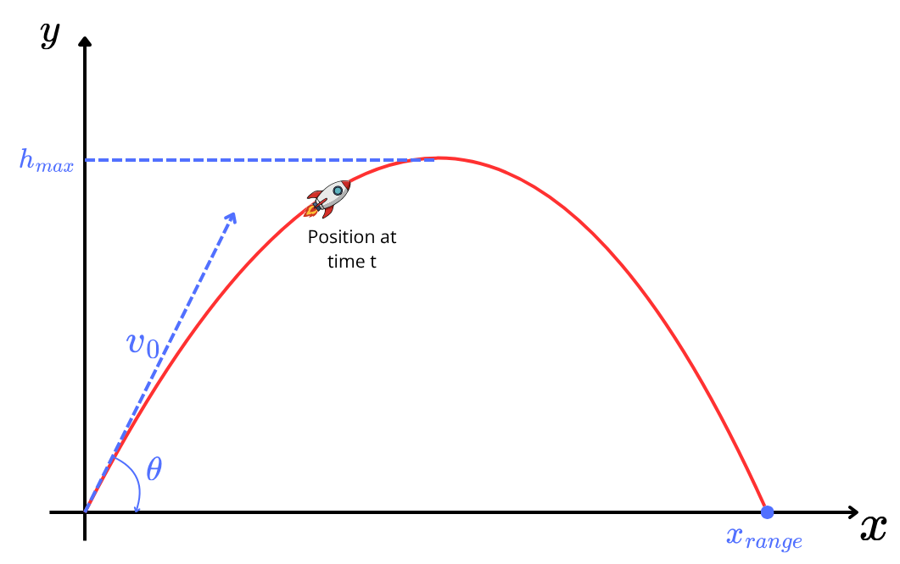
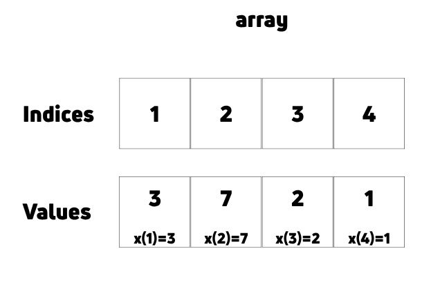

# Arrays {#sec-arrays}

::: {.prep-reminder}
 The PREP for this topic: [Lesson 3&4 PREP: Arrays: indexing and slicing]().
:::

::: {.callout-note appearance="simple"}
## Learning objectives

Throughout this chapter, you will learn to:

- Recognize when an array is the appropriate data structure for a computational problem.
- Create arrays and perform arithmetic operations on them.
- Access and modify elements of an array using indexing, slicing, and Boolean indexing.
:::

An **array** stores a list of values under one variable name. Use an array when you have several values of the same kind that all go through the same computation.

## Example: projectile motion {#sec-projectile}

::: {.motivation}
Without arrays, comparing four launches means four copies of every variable and every formula:

```matlab
t_flight_A = 2*v0_A*sin(theta_A)/g_A;
t_flight_B = 2*v0_B*sin(theta_B)/g_B;
t_flight_C = 2*v0_C*sin(theta_C)/g_C;
t_flight_D = 2*v0_D*sin(theta_D)/g_D;
```

plus 12 more lines to define `v0_A`, `theta_A`, `g_A`, and so on. This is a lot of typing, it's easy to make a typo, it doesn't scale to 50 launches, and a mistake in the formula has to be fixed in four places.
:::

The projectile motion formulas give the time in flight, maximum height, and range of an object launched from the ground:
$$t_{\text{flight}} = \frac{2 v_0 \sin(\theta)}{g}, \qquad h_{\max} = \frac{\left(v_0 \sin(\theta)\right)^2}{2g}, \qquad x_{\text{range}} = v_0 \cos(\theta) \cdot t_{\text{flight}}.$$
They depend on three launch conditions: the initial velocity $v_0$, the launch angle $\theta$, and the force of gravity $g$.

{fig-alt="Diagram of a rocket launched from the origin at angle theta with initial velocity v0. Its path is a red arc that rises to a maximum height h_max and lands at a horizontal distance x_range." width="60%"}

| Launch identifier | Initial velocity (m/s) | Launch angle (degrees) | Force of gravity (m/s²) |
|---|---:|---:|---:|
| Launch A: Earth | 100 | 75 | 9.81 |
| Launch B: Earth | 200 | 85 | 9.81 |
| Launch C: Moon | 15 | 30 | 1.63 |
| Launch D: Moon | 25.9 | 40 | 1.63 |

: Launch conditions for four launches. {#tbl-launches}

With arrays, each launch condition is one variable and each formula is one line:

```matlab
v0 = [100, 200, 15, 25.9];            % initial velocities (m/s)
theta = [75, 85, 30, 40]*pi/180;      % launch angles, converted to radians
g = [9.81, 9.81, 1.63, 1.63];         % force of gravity (m/s^2)

t_flight = 2*v0.*sin(theta)./g;       % flight time for all four launches
```

## Creating arrays {#sec-creating}

There are four common ways to create an array. Which one to use depends on what you know.

| Tool | Use it when you know... | Example | Result |
|---|---|---|---|
| `[ ]` | the exact values | `[100, 200, 15]` | `[100, 200, 15]` |
| `a:step:b` | the **spacing** between values | `0:0.5:2` | `[0, 0.5, 1, 1.5, 2]` |
| `linspace(a, b, N)` | the **number** of values | `linspace(0, 2, 5)` | `[0, 0.5, 1, 1.5, 2]` |
| `zeros(1, n)` | only the size (fill in the values later) | `zeros(1, 4)` | `[0, 0, 0, 0]` |

: Ways to create an array.

::: {.callout-note appearance="simple"}
`linspace` is introduced in Lesson 5 (with discretization, @sec-discretizing) and `zeros` in Lesson 6 (with for loops, @sec-for-loops). They're collected here so all the ways to create an array are in one place.
:::

`length(x)` returns the number of elements in `x`.

### Listing the values: `[ ]`

List the values inside square brackets, separated by commas or spaces:

```matlab
v0 = [100, 200, 15, 25.9];
v0 = [100 200 15 25.9];      % the same array
```

### Choosing the spacing: `a:step:b` {#sec-colon}

The colon operator creates evenly spaced values. `a:b` counts from `a` to `b` by 1, and `a:step:b` counts by `step`:

| Code | Result |
|---|---|
| `1:5` | `[1, 2, 3, 4, 5]` |
| `1:2:9` | `[1, 3, 5, 7, 9]` |
| `5:-1:1` | `[5, 4, 3, 2, 1]` |
| `0:0.5:2` | `[0, 0.5, 1, 1.5, 2]` |

### Choosing the number of points: `linspace` {#sec-linspace}

[`linspace(a, b, N)`](https://www.mathworks.com/help/matlab/ref/linspace.html) creates `N` evenly spaced points from `a` to `b`, including both endpoints. The spacing between points is $\Delta x = \frac{b - a}{N - 1}$.

```matlab
x = linspace(-1, 1, 5)        % 5 evenly spaced points from -1 to 1
dx = x(2) - x(1)              % spacing between points
```

``` {.output}
x =

   -1.0000   -0.5000         0    0.5000    1.0000

dx =

    0.5000
```

Check: $\Delta x = \frac{1 - (-1)}{5 - 1} = 0.5$.

::: {.callout-warning}
## Common mistake: the colon doesn't always reach the end

`a:step:b` stops at the last value that doesn't go past `b`, so it can miss `b` entirely:

```matlab
0:0.3:1              % 0    0.3000    0.6000    0.9000      (no 1!)
linspace(0, 1, 4)    % 0    0.3333    0.6667    1.0000
```

`linspace` always includes both endpoints. Use it when the endpoints matter, as in discretizing a function on an interval.
:::

### Placeholder arrays: `zeros` {#sec-zeros}

`zeros(1, n)` creates a row of `n` zeros (1 row, `n` columns). Use it to **predefine** an array before filling in its values one at a time, usually in a for loop (@sec-for-loops).

```matlab
N = zeros(1, 4)       % 0     0     0     0
N(1) = 12;            % now fill in values
```

## Arithmetic with arrays {#sec-array-math}

::: {.motivation}
Arrays are only useful if we can compute with them as easily as with single numbers. Most operations work element by element, but multiplication, division, and powers need one extra character.
:::

### An array and a number

Arithmetic between an array and a single number is applied to each element. These are called **element-wise operations**. Functions like `sin` and `sqrt` are also applied element-wise.

```matlab
x = [1, 2, -3, pi, 0];
x + 10      %  11.0000   12.0000    7.0000   13.1416   10.0000
2*x         %   2.0000    4.0000   -6.0000    6.2832         0
x/3         %   0.3333    0.6667   -1.0000    1.0472         0
sin(x)      %   0.8415    0.9093   -0.1411    0.0000         0
```

### The dot: `.*`, `./`, `.^`

MATLAB (**MAT**rix **LAB**oratory) treats `*`, `/`, and `^` as matrix operations. To multiply, divide, or raise to a power element by element, put a `.` in front of the operator.

| Operation | Element-wise | Without the dot |
|---|---|---|
| Multiply two arrays | `x .* y` | `x * y` is an error |
| Divide by an array | `4 ./ x` | `4 / x` is an error |
| Raise to a power | `x .^ 2` | `x ^ 2` is an error |
| Add or subtract | `x + y`, `x - y` | (there is no dot version) |

Multiplying or dividing an array *by a number* doesn't need the dot (`2*x`, `x/3`), but the dot version also works. When in doubt, use the dot.

Dividing by 0 gives `Inf`:

```matlab
4./x        %   4.0000    2.0000   -1.3333    1.2732       Inf
```

### Two arrays

Element-wise operations on two arrays pair up the elements in the same position:

```matlab
x = [1, 2, -3];
y = [0, -4, 3];
x + y       %   1  -2   0
x - y       %   1   6  -6
x .* y      %   0  -8  -9
```

::: {.callout-warning}
## Common mistake: forgetting the dot

```matlab
x * y
```

``` {.output}
Error using *
Incorrect dimensions for matrix multiplication. Check that the number of columns
in the first matrix matches the number of rows in the second matrix. To operate on
each element of the matrix individually, use TIMES (.*) for elementwise
multiplication.
```

The last sentence of the error message tells you the fix.
:::

::: {.callout-note appearance="simple"}
For those who know linear algebra: the arrays here are row vectors. `x'`
(transpose) turns a row vector into a column vector, and `[1; 2; 3]`
(semicolons) creates a column vector. `*` does regular matrix multiplication (a
dot product or an outer product, depending on the dimensions).
:::

::::: {.exercise}
### Exercise: Comparing projectile motion for different launch conditions {#sec-ex-projectile}

**Lesson files:** [Lesson_3_arrays.m (starter)](../files/Lesson_3_arrays.m) · [Lesson_3_arrays.m (completed)](../files/Lesson_3_arrays_Completed.m) (Exercise 1)

**Learning outcomes.** This exercise should help you to:

- Recognize when an array is the appropriate data structure for a computational problem.
- Create arrays and perform arithmetic operations on them.

:::: {.callout-note collapse="true" appearance="simple"}
## Full exercise

Compute `t_flight`, `h_max`, and `x_range` for the four launches in @tbl-launches, using the formulas in @sec-projectile. Start from `v0 = [100, 200, 15, 25.9]` and create arrays for the launch angle and the force of gravity.

**Expected output.** Three arrays, `t_flight`, `h_max`, and `x_range`. Each array should have 4 elements corresponding to the 4 different initial launch conditions.

**If you want more of a challenge:**

- Which launch went the farthest? Instead of displaying the results and looking at it, think about how you can do it with code. Check the documentation for the [`max` function](https://www.mathworks.com/help/matlab/ref/max.html).
- Can you accomplish this task using a 2D array (matrix) containing the whole data table?

::: {.callout-tip collapse="true" appearance="simple"}
## Takeaways and common mistakes


**Key takeaways**

- `t_flight = 2*v0.*sin(theta)./g;` computes the flight time for every launch.
- Convert the whole array of angles to radians in one step: `theta = [75, 85, 30, 40]*pi/180;`
- `[m, I] = max(x_range)` returns the largest value `m` and its index `I`, which tells you which launch went the farthest.

**Common mistakes**

- Using `*`, `/`, or `^` between arrays instead of `.*`, `./`, `.^`. This gives an "Incorrect dimensions" error.
- Writing `/2*g` instead of `/(2*g)`. MATLAB divides by 2 and then *multiplies* by `g`.
- Forgetting to convert degrees to radians. `sin` expects radians.
:::
::::
:::::

## Indexing {#sec-indexing}

::: {.motivation}
With arrays, `t_flight` holds all four flight times, so we can no longer write `disp(t_flight_A)`. Indexing is how we get one value back out.
:::

`x(k)` returns the element of `x` in position `k`. Indexing uses parentheses, and the first element is in position 1.

```matlab
x = [3, 7, 2, 1];
x(1)        % 3
x(2)        % 7
```

The index is a position, not a value: `x(1)` means "the first element," not "find the number 1."

{fig-alt="Diagram of the array x = [3, 7, 2, 1]. A row of indices 1, 2, 3, 4 sits above a row of values 3, 7, 2, 1, labeled x(1)=3, x(2)=7, x(3)=2, x(4)=1." width="55%"}

`end` stands for the last index, so you can count back from the end without knowing the length of the array.

| Code | Meaning | Result for `x = [3, 7, 2, 1]` |
|---|---|---|
| `x(1)` | first element | `3` |
| `x(end)` | last element | `1` |
| `x(end-1)` | second to last element | `2` |
| `length(x)` | number of elements | `4` |

### Rules for indexing {#sec-indexing-rules}

Indices must be positive integers from 1 to `length(x)`. Anything else is an error. Going past the end of the array, an **out-of-bounds error**, is very common.

```matlab
x(5)        % Error: Index exceeds the number of array elements. Index must not exceed 4.
x(0)        % Error: Array indices must be positive integers or logical values.
x(1.5)      % Error: Array indices must be positive integers or logical values.
x(end-4)    % Error: this is x(0)
```

There is nothing between `x(1)` and `x(2)`. Data is discrete!

## Slicing {#sec-slicing}

::: {.motivation}
Often we want several elements at once, like the first 10 of 100 flight times. Slicing extracts them in one step.
:::

`x(a:b)` returns the elements in positions `a` through `b`, including both endpoints. The result is a new array. Any range of indices works, including ranges with a step:

```matlab
x = [3, 7, 12, 15, 27];
```

| Code | Result | Meaning |
|---|---|---|
| `x(1:3)` | `[3, 7, 12]` | first three elements |
| `x(2:5)` | `[7, 12, 15, 27]` | positions 2 through 5 |
| `x(end-1:end)` | `[15, 27]` | last two elements |
| `x(1:2:end)` | `[3, 12, 27]` | every other element |
| `x(end:-1:1)` | `[27, 15, 12, 7, 3]` | reversed |

Save a slice to a new variable by assigning it: `y = x(2:5)`.

::: {.callout-note collapse="true"}
## In class: How do I flip an array?

Instead of jumping straight to the answer, we can build it from what we already know about ranges and indexing.

A colon range creates an array:

```matlab
1:5        % 1  2  3  4  5
```

The middle number is the step size:

```matlab
1:2:5      % 1  3  5   (every other number)
```

Ranges also work as indices, so we can use one to pick out elements of an array:

```matlab
y = [10 20 30 40 50];
y(1:2:5)   % 10  30  50
```

What if the step is negative? Then the range counts *down*, and indexing with it walks through the array backward:

```matlab
5:-1:1       % 5  4  3  2  1
y(5:-1:1)    % 50  40  30  20  10
y(end:-1:1)  % same result, and works for an array of any length
```

**Takeaway:** `start:step:stop` builds a list of indices, and a negative step walks backward. (MATLAB also has a built-in function, `flip(y)`, that does the same thing.)
:::

## Changing elements {#sec-changing-elements}

::: {.motivation}
When one launch condition changes, we shouldn't have to retype the whole array.
:::

Indexing and slicing also work on the left side of `=`. Use them to change part of an array:

```matlab
x = [3, 7, 12, 15, 27];
x(2) = 0                              % x is now [3, 0, 12, 15, 27]
x(end-1:end) = x(end-1:end) + 100     % x is now [3, 0, 12, 115, 127]
```

Anything computed from `x` before the change keeps its old value. Rerun those calculations to update them.

::::: {.exercise}
### Exercise: Changing launch conditions {#sec-ex-changing}

**Lesson files:** [Lesson_3_arrays.m (starter)](../files/Lesson_3_arrays.m) · [Lesson_3_arrays.m (completed)](../files/Lesson_3_arrays_Completed.m) (Exercise 2)

**Learning outcomes.** This exercise should help you to:

- Access and modify elements of an array using indexing and slicing.

:::: {.callout-note collapse="true" appearance="simple"}
## Full exercise

Start with the code from @sec-ex-projectile.

- First, display the flight time for every launch except Launch D.

We now want to modify the existing code to take into account changing conditions:

- The second earth launch is going by far the farthest, perhaps because of the larger initial velocity used. Decrease the launch speed of the second earth launch (Launch B) by 60% and recheck the results.
- The projectile did not go as far on the moon. Increase the launch angle for both tests on the moon by 5 degrees.

Before completing these last two tasks, think about how you can do this without rewriting the code defining the arrays you've already defined. Can you think of a way to update (re-define) specific elements of an array using indexing and slicing?

**Expected output.** Re-create the three arrays `t_flight`, `h_max`, and `x_range` with the changed conditions.

::: {.callout-tip collapse="true" appearance="simple"}
## Takeaways and common mistakes


**Key takeaways**

- `disp(t_flight(1:3))` shows launches A through C.
- `v0(2) = v0(2) - v0(2)*0.6;` changes only Launch B.
- `theta(end-1:end) = theta(end-1:end) + 5*pi/180;` changes both moon launches.
- After changing the inputs, rerun the formulas. `t_flight` doesn't update on its own.

**Common mistakes**

- Decreasing by 60% with `v0(2)*0.6`. That *keeps* 60%. A 60% decrease keeps 40%: `v0(2)*0.4`.
- Adding `5` to an angle that is in radians. Convert first: `5*pi/180`.
- Retyping the whole array instead of changing just the elements that change.
:::
::::
:::::

