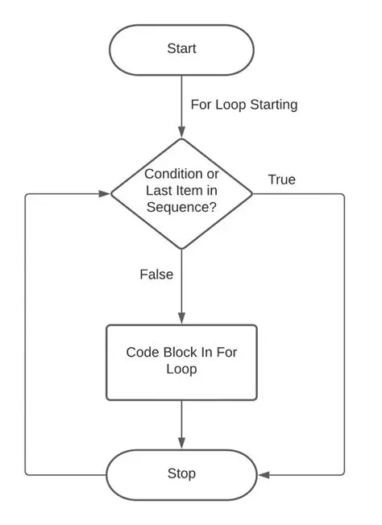
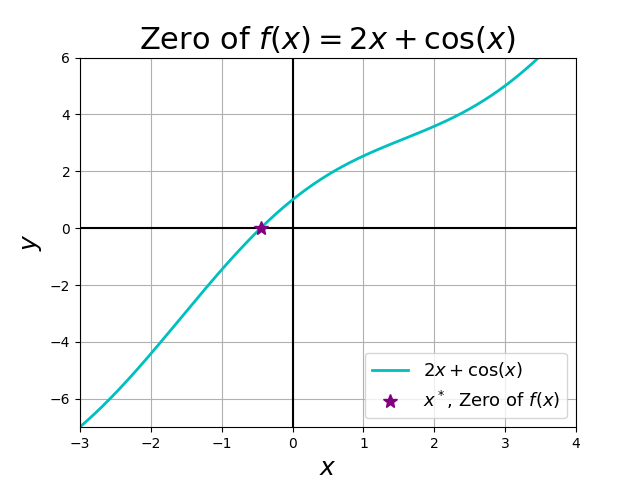
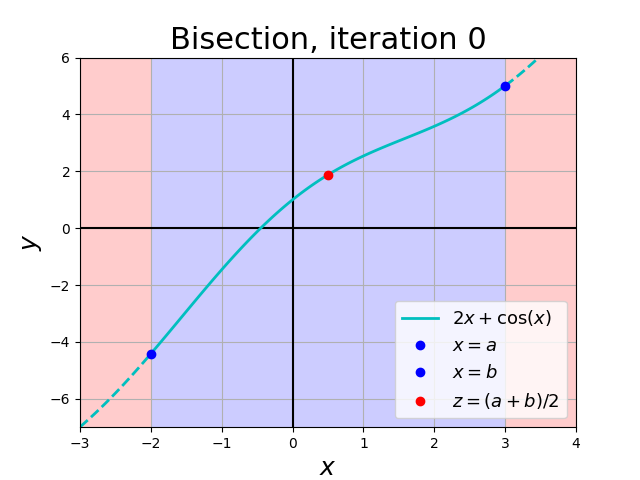
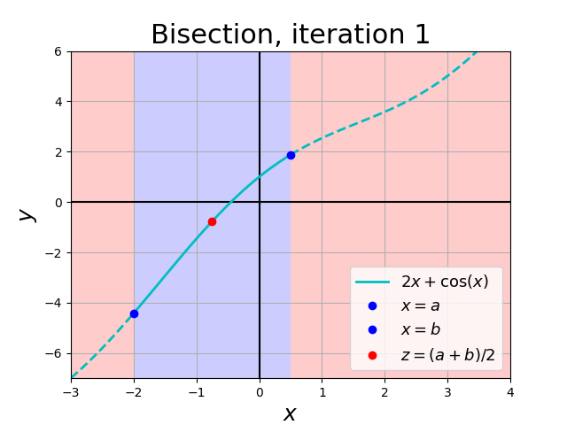
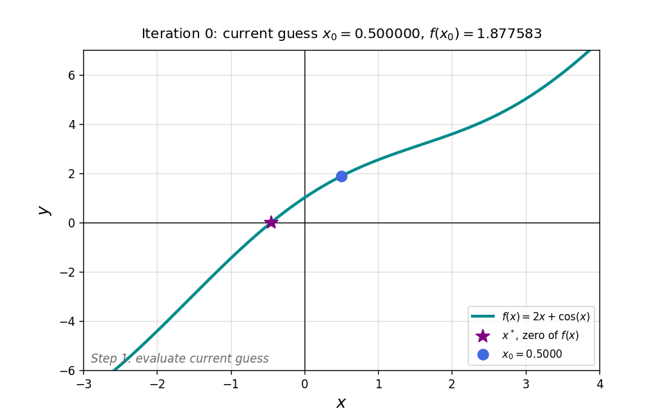
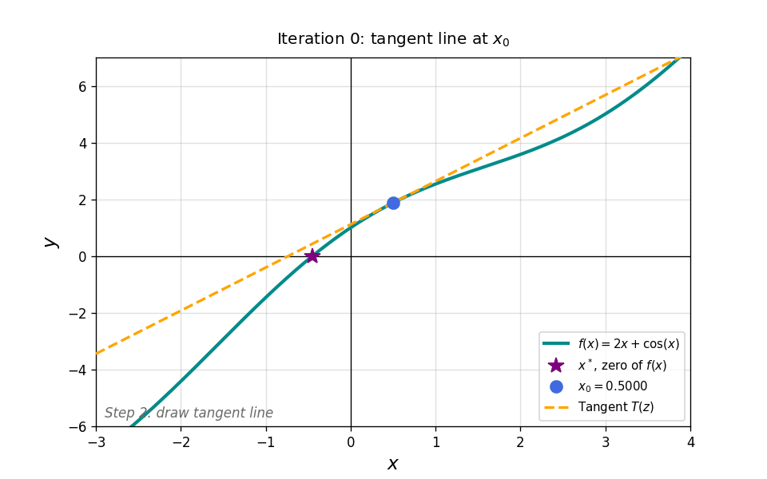
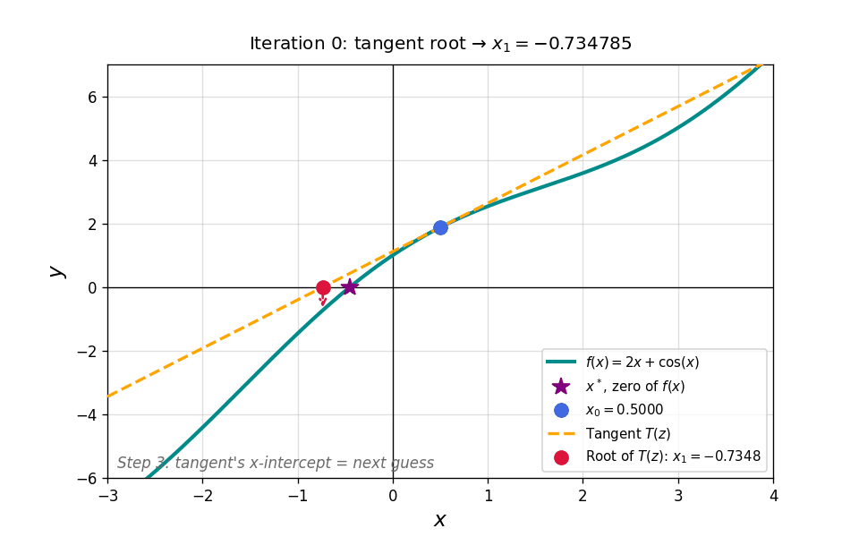

# Control flow {#sec-control-flow}

::: {.prep-reminder}
 The PREPs for this topic: [Lesson 6 PREP: For
loops](), [Lesson 7 PREP: If statements and root-finding
problems](), and [Lesson 8 PREP: Newton's Method]().
:::

::: {.callout-note appearance="simple"}
## Learning objectives

Throughout this chapter, you will learn to:

- Write a for loop.
- Recognize when a for loop is appropriate.
- Trace a for loop by tracking variable values, including with an if statement.
- Create and populate an array using `zeros()` and a for loop.
- Read and interpret pseudocode for a simple algorithm.
- Use Boolean variables and comparison operators to evaluate conditions.
- Implement if/elseif/else statements to control the flow of a program.
- Translate a pseudocode algorithm into working code.
- Solve equations by converting them to root-finding problems and using a root-finding algorithm.
- Implement the bisection method and Newton's method with appropriate tolerance checks.
- Compare the bisection method and Newton's method, including their convergence properties and limitations.
- Implement an iterative algorithm using a loop with a convergence criterion.
:::

## For loops {#sec-for-loops}

::: {.motivation}
In 1859, Thomas Austin released about a dozen rabbits in Australia. Within a couple of decades there were roughly 10 million. A simple model, where each rabbit produces 2 surviving offspring per year and doesn't survive to the next year, gives
$$N_{t+1} = 2 N_t, \qquad N_0 = 12,$$
where $N_t$ is the number of rabbits $t$ years after 1859. Computing 20 years of this by hand, or by copying and pasting `N(21) = 2*N(20);` twenty times, is slow and error-prone. A for loop does the repetition for us.

{fig-alt="A small fluffy white rabbit nibbling a large strawberry." width="30%"}
:::

A **for loop** repeats the same tasks while one variable changes, usually increasing by 1 each time.

```matlab
for VARIABLE = ARRAY
    % tasks to repeat (indented)
end
```

How it runs:

1. `VARIABLE` is set to `ARRAY(1)`, and the tasks inside the loop run.
2. `VARIABLE` is set to `ARRAY(2)`, and the tasks run again.
3. This repeats until `VARIABLE = ARRAY(end)`.

Indent the tasks inside the loop so readers can see what repeats. `1:5` creates the array `[1, 2, 3, 4, 5]` (@sec-colon).

```matlab
for var = 1:5
    disp("The current value of 'var' is:")
    disp(var)
end
```

``` {.output}
The current value of 'var' is:
     1
The current value of 'var' is:
     2
The current value of 'var' is:
     3
The current value of 'var' is:
     4
The current value of 'var' is:
     5
```

{fig-alt="Flow chart: Start, then 'For loop starting', then a decision diamond 'Condition or last item in sequence?'. If False, run the code block in the for loop and return to the decision. If True, go to Stop." width="35%"}

::: {.callout-tip appearance="simple"}
If you find yourself copying and pasting similar lines of code, there's probably a more efficient way to do it, often a for loop. Copying and pasting isn't hard, but it's error-prone: it's easy to forget to change one index.
:::

### Filling an array with a loop

To store every year of the rabbit population, keep the values in an array `N`. Because MATLAB indices start at 1, `N(1)` holds $N_0$: in general, `N(n)` $= N_{n-1}$.

**Predefine** the array before filling it, using `zeros(1, n)` to create a row of `n` zeros (@sec-zeros):

```matlab
r = 2;                          % reproduction rate
years = 20;                     % number of years to compute
N = zeros(1, years+1);          % N(1) is year 0, so we need years+1 entries

N(1) = 12;                      % starting population (no calculation)

for year = 1:years
    N(year+1) = r*N(year);      % population next year
end

disp(N(end))                    % population after 20 years
```

``` {.output}
    12582912
```

The model predicts about $1.26 \times 10^7$ rabbits in 1879, close to the estimated 10 million. Changing `years` or `r` takes one edit.

::: {.callout-note collapse="true"}
## Why predefine with `zeros`?

MATLAB is really friendly and does not require you to do so. If you assign
`N(5)` and `N` only has 4 elements, MATLAB makes the array longer for you. It's
still a good habit:

- **It's faster.** When an array grows inside a loop, MATLAB copies the whole array every time it gets longer. The MATLAB Editor warns about this with an orange underline: "The variable appears to change size on every loop iteration."
- **It avoids leftover values.** If `N` already exists from an earlier run and is longer, the old values past the new end stay in the array.
- **It shows the size up front.** Readers can see how many values the loop will fill.
- **Almost every other coding language in the world requires it.** Predefining is good practice!
:::


::: {.callout-note appearance="simple"}
Choosing the value of $r$ so that the model matches data is called **parameter tuning**.
:::

::: {.callout-tip}
## Try it

Change `years` and `r` in the code above and watch how the result changes.
:::


## If statements {#sec-if-statements}

::: {.motivation}
We often need to do different things depending on the value of some variable.
For example, the rabbit loop in @sec-for-loops computes the population every
year. In what year did the population first pass 10 million? To answer it, the
loop has to check each year's value and do something only when the answer is
yes.
:::

### Comparisons and logicals {#sec-comparisons}

A comparison asks a yes-or-no question. The answer is a **logical** (also called a **Boolean**): `1` for true, `0` for false.

| Code | Asks |
|---|---|
| `a > b` | Is `a` greater than `b`? |
| `a >= b` | Is `a` greater than or equal to `b`? |
| `a < b` | Is `a` less than `b`? |
| `a <= b` | Is `a` less than or equal to `b`? |
| `a == b` | Is `a` equal to `b`? (two equals signs) |
| `a ~= b` | Is `a` not equal to `b`? |

: Comparison operators.


```matlab
3 > 2       % 1 (true)
-4 > 0      % 0 (false)
2 == 2      % 1 (true)
```

You can save a comparison in a variable (a **Boolean variable**) and use it later: `is_positive = x > 0;`

### `if` {#sec-if}

An **if statement** runs a block of code only when a condition is true. Like a for loop, it is a **control structure**: it controls which lines of code run.

```matlab
x = 2;

if x > 0
    disp("Success! x is positive.")
end
```

- The condition after `if` must give a logical: `1` (true) or `0` (false).
- Every line between `if` and `end` belongs to the if statement. Indent them so readers can see that.
- If the condition is false, MATLAB skips everything up to `end`.

Back to the rabbits. Put an if statement inside the loop to check each year's population:

```matlab
r = 2;
years = 30;
N = zeros(1, years+1);
N(1) = 12;

for year = 1:years
    N(year+1) = r*N(year);
    if N(year+1) > 1e7
        disp("The population passed 10 million in " + (1859 + year))
        break           % stop the loop
    end
end
```

``` {.output}
The population passed 10 million in 1879
```

**`break`** stops a for loop immediately, skipping any remaining iterations. Without it, the message would print again for every year after 1879, since the population stays above 10 million.

### `if`, `elseif`, `else` {#sec-elseif}

An `if` on its own answers a yes-or-no question. Some problems have more than two outcomes. The quadratic formula has three possible outcomes, depending on the discriminant (2 real roots, 1 real root, or no real roots). Code that implements it has to do different things in different situations.

The real roots of $ax^2 + bx + c = 0$ are
$$x = \frac{-b \pm \sqrt{b^2 - 4ac}}{2a}.$$
The discriminant $d = b^2 - 4ac$ decides how many real roots there are: two if $d > 0$, one (repeated) if $d = 0$, and none if $d < 0$. In pseudocode (@sec-algorithms):

```text
Algorithm: Find the real roots of ax^2 + bx + c = 0 using the quadratic formula.

Inputs:  Coefficients a, b, and c.
Outputs: An array of the real roots, and a message saying how many there are.

Steps:
1. Calculate the discriminant, d = b^2 - 4ac.
2. Check the discriminant:
    a) IF d > 0:
        Display "There are two real roots"
        Calculate x1 = (-b - √d) / (2a) and x2 = (-b + √d) / (2a)
        Store x1 and x2 in an array.
    b) IF d = 0:
        Display "There is one real root"
        Calculate x = -b / (2a)
        Store x in an array.
    c) IF d < 0:
        Display "There are no real roots"
        Create an empty array.
3. Display the array containing the roots.
```

The pseudocode is organized around checking the discriminant, not around the steps you'd take by hand. To choose between several outcomes, add `elseif` and `else` to the if statement:

```matlab
if condition1
    % runs if condition1 is true
elseif condition2
    % runs if condition1 is false and condition2 is true
else
    % runs if every condition above is false
end
```

- MATLAB checks the conditions from top to bottom and runs **only the first** block whose condition is true. The rest are skipped.
- You can have as many `elseif` blocks as you need, or none.
- `else` is optional. It catches everything the conditions above didn't.
- The whole structure ends with a single `end`.

The quadratic-formula pseudocode becomes:

```matlab
d = b^2 - 4*a*c;

if d > 0
    disp("There are two real roots")
    x1 = (-b - sqrt(d)) / (2*a);
    x2 = (-b + sqrt(d)) / (2*a);
    roots = [x1, x2];       % an array of the roots
elseif d == 0
    disp("There is one real root")
    roots = [-b/(2*a)];
else
    disp("There are no real roots")
    roots = [];             % an empty array
end
```

This code has a subtle problem. Can you find it? The exercise below explores it.

::: {.callout-warning}
## Common mistakes with if statements

- **`=` instead of `==`.** `if x = 0` is an error. One `=` assigns a value; two `==` compare.
- **`else if` instead of `elseif`.** Written as two words, `else if` starts a *new* if statement inside the `else`, which needs its own `end`.
- **Forgetting `end`.** Every `if` needs one.
- **Using `==` on computed decimals.** Round-off error (@sec-round-off) means a computed value is rarely *exactly* equal to what you expect. Use a tolerance check (@sec-tolerance) instead:

  ```matlab
  x = 0.1 + 0.2;
  x == 0.3                  % 0 (false), because of round-off error
  abs(x - 0.3) < 1e-12      % 1 (true)
  ```
:::

::::: {.exercise}
### Exercise: The quadratic formula {#sec-ex-quadratic}

**Lesson files:** [Lesson_7_Quadratic.m (starter)](../files/Lesson_7_Quadratic.m) · [Lesson_7_Quadratic.m (completed)](../files/Lesson_7_Quadratic_Completed.m)

**Learning outcomes.** This exercise should help you to:

- Read and interpret pseudocode for a simple algorithm.
- Use Boolean variables and comparison operators to evaluate conditions.
- Implement if/elseif/else statements to control the flow of a program.
- Translate a pseudocode algorithm into working code.

:::: {.callout-note collapse="true" appearance="simple"}
## Full exercise

The starter file implements the quadratic-formula pseudocode above. Try the following combinations of values. Does the implementation always give what you expect? If not, what can you change in the code to make it work in the case where it fails?

- $a = 2$, $b = 3$, $c = 1$
- $a = 1$, $b = 2$, $c = 1$
- $a = 1$, $b = \sqrt{2}$, $c = 1/2$

**If you finish early:**

- Will this always work? Will it ever tell us the incorrect number of roots? Is it possible to write code that will always work?
- What if $a = 0$? What happens to your code, and what should the root be? Can you make sure your code can handle this correctly?
- Can you put this into a MATLAB function with inputs `a`, `b`, `c`, and `tol`?

::: {.callout-tip collapse="true" appearance="simple"}
## Takeaways and common mistakes

**Key takeaways**

- With $a = 1$, $b = \sqrt{2}$, $c = 1/2$, the discriminant should be exactly 0, but round-off error makes it `4.4409e-16`. The check `d == 0` fails, and the code reports two real roots.
- Replace `d == 0` with a tolerance check, and do that check **first**: `if abs(d) < tol` (one root), then `elseif d >= tol` (two roots), then `else` (no real roots).

**Common mistakes**

- Keeping `d > 0` as the first check. A tiny positive `d` caused by round-off error is caught there before the tolerance check ever runs.
- Testing only "nice" inputs. The first two cases work either way; only the third reveals the problem.
:::
::::
:::::

## Putting it together: root finding {#sec-root-finding}

::: {.motivation}
Algebra gives exact solutions for equations like $ax + b = 0$ and $ax^2 + bx + c = 0$, but even the cubic is really hard, and equations like $2x + \cos(x) = 0$ (@sec-what-is-sci-comp) have no algebraic solution at all. Equations like these appear throughout STEM, such as Kepler's equation for planetary orbits or the yield of a bond in finance, and must be solved numerically with a **root-finding algorithm**.
:::

A **root-finding problem** is to find the values of $x$ for which $f(x) = 0$. Any equation can be written this way by moving everything to one side:
$$f(x) = g(x) \quad \Longrightarrow \quad f(x) - g(x) = 0.$$
For example, solving $\cos(x) = x$ is the same as finding a root of $f(x) = \cos(x) - x$.

{fig-alt="Graph of
f(x) = 2x + cos(x) for x from -3 to 4. The curve increases from about -7 to 6
and crosses zero once, just left of x = 0, at a point marked with a star labeled
x*, zero of f(x)." width="55%"}

We will explore two different root-finding algorithms, both have advantages and disadvantages.

### The bisection method {#sec-bisection}

The bisection method is based on the Intermediate Value Theorem from calculus.

::: {.callout-note appearance="simple"}
**Intermediate Value Theorem (IVT).** Suppose $f$ is continuous on $[a, b]$. If $f(a)$ and $f(b)$ have opposite signs, then there is an $x^* \in (a, b)$ with $f(x^*) = 0$.
:::

**The idea.** Start with an interval $[a, b]$ where $f(a)$ and $f(b)$ have opposite signs, so the IVT guarantees a root inside. Guess the midpoint, $x^* = (a + b)/2$. Exactly one of three things is true:

1. $f(x^*) = 0$: we found the root.
2. $f(x^*)$ has the **same sign as $f(a)$**: the root is in $(x^*, b)$. Move the left endpoint: $a = x^*$.
3. $f(x^*)$ has the **same sign as $f(b)$**: the root is in $(a, x^*)$. Move the right endpoint: $b = x^*$.

Each repetition, called an **iteration**, cuts the search interval in half. Repeat until $x^*$ is close enough to the root.

::: {.callout-note collapse="true"}
## Animation: 8 iterations of the bisection method

![The bisection method on $f(x) = 2x + \cos(x)$, starting from $[-2, 3]$.](../figures/bisection_animation.gif){fig-alt="Animation of the bisection method on f(x) = 2x + cos(x), starting from the interval [-2, 3]. In each iteration, the midpoint of the current interval is marked, the half of the interval that can't contain the root is shaded red, and the search interval, shaded blue, shrinks by half. After 8 iterations the blue interval is a narrow band around the root near x = -0.45."}

Close this box to stop the animation.
:::

Each iteration has three steps. The tabs below show them for the first iteration, on $[-2, 3]$.

::: {.panel-tabset}
#### Step 1: Interval

{fig-alt="Step 1 of the first iteration of
the bisection method for f(x) = 2x + cos(x). The search interval [a, b] = [-2,
3] is shaded blue and the regions outside it are shaded red. Blue dots mark
f(a), which is below zero, and f(b), which is above zero."}

The interval is $[a, b] = [-2, 3]$. $f(-2) < 0$ and $f(3) > 0$, so there is a root between them.


#### Step 2: Midpoint

{fig-alt="Step 2 of the first iteration. The interval [-2, 3] is still shaded blue. A red dot marks the midpoint x* = 0.5, where f is above zero."}

The midpoint is $x^* = (-2 + 3)/2 = 0.5$, and $f(0.5) \approx 1.88 > 0$.

#### Step 3: New interval

{fig-alt="Step 3 of the first iteration. The midpoint 0.5 becomes the new right endpoint b. The new search interval [-2, 0.5] is shaded blue, and the right half, from 0.5 to 3, is now shaded red because it cannot contain the root."}

<!-- TODO: The third step should not have a red dot -->

$f(0.5)$ has the same sign as $f(b)$, so the root is to the left of $x^*$. Move the right endpoint: $b = 0.5$. The new interval is $[-2, 0.5]$, half as long as before.
:::

The next iteration repeats the three steps on $[-2, 0.5]$. The first four iterations:

| Interval $[a, b]$ | Midpoint $x^*$ | $f(x^*)$ | Root is | New interval |
|:---|:---|:---|:---|:---|
| $[-2, 3]$ | $0.5$ | $1.88$ (positive) | left of $x^*$ | $[-2, 0.5]$ |
| $[-2, 0.5]$ | $-0.75$ | $-0.77$ (negative) | right of $x^*$ | $[-0.75, 0.5]$ |
| $[-0.75, 0.5]$ | $-0.125$ | $0.74$ (positive) | left of $x^*$ | $[-0.75, -0.125]$ |
| $[-0.75, -0.125]$ | $-0.4375$ | $0.03$ (positive) | left of $x^*$ | $[-0.75, -0.4375]$ |

: The first four iterations of the bisection method for $f(x) = 2x + \cos(x)$. {#tbl-bisection}

After 42 iterations, $x^* \approx -0.45018$ and $|f(x^*)| < 10^{-12}$.

The bisection method is an **iterative algorithm**: it repeats a process, and each iteration gets a closer approximation than the last.

### Stopping the iterations

An iterative algorithm needs a **stopping condition**: a check for when the answer is good enough. Getting close enough to the answer is called **convergence**.

- **Close enough.** Because of round-off error, $f(x^*)$ will almost never be exactly 0. Instead, stop when $|f(x^*)| < \text{tol}$ for a small tolerance like $10^{-12}$ (@sec-tolerance).
- **Maximum number of iterations.** Set a limit, `max_iter`. If the algorithm reaches it without converging, display a warning.

### Pseudocode

```text
Algorithm: The Bisection Method

Inputs:
    - A function, f(x)
    - The endpoints a and b of the interval [a, b] in which to find a root
    - A tolerance, tol, for deciding if we are "close enough" to a root
    - A maximum number of iterations, max_iter
Outputs:
    - A root of f(x) in [a, b]
    - A message displaying the result

Steps:
ITERATE, doing the following for each iteration:
    1. Calculate xstar, the midpoint of the interval [a, b].
    2. Check: is xstar close enough to a root? IF it is, save the root
       and stop the iterations. If it is not:
        a. IF f(xstar) has the same sign as f(a), change the left
           boundary a to xstar.
        b. IF f(xstar) has the same sign as f(b), change the right
           boundary b to xstar.
    3. Check: have we reached the maximum number of iterations?
       IF so, display a warning: the algorithm did not converge.
```

ITERATE points to a **for loop** (@sec-for-loops), and each IF points to an **if statement** (@sec-if-statements). Two more tools help translate it:

- **Same sign.** Two numbers have the same sign exactly when their product is positive, so "`f(xstar)` has the same sign as `f(a)`" is the condition `f(xstar)*f(a) > 0`.
- **Stop the iterations** with `break` (@sec-if), as in the rabbit example.

::::: {.exercise}
### Exercise: Implementing the bisection method {#sec-ex-bisection}

**Lesson files:** [Lesson_7_Bisection.m (starter)](../files/Lesson_7_Bisection.m) · [Lesson_7_Bisection.m (completed)](../files/Lesson_7_Bisection_Completed.m) · [as a function (extension)](../files/Lesson_7_Bisection_Completed_Function.m)

**Learning outcomes.** This exercise should help you to:

- Write a for loop.
- Implement if/elseif/else statements to control the flow of a program.
- Translate a pseudocode algorithm into working code.
- Solve equations by converting them to root-finding problems and using a root-finding algorithm.
- Implement the bisection method with appropriate tolerance checks.

:::: {.callout-note collapse="true" appearance="simple"}
## Full exercise

Implement the bisection-method pseudocode above for $f(x) = 2x + \cos(x)$ on the interval $[-2, 3]$, with a tolerance of $10^{-12}$ and at most 1000 iterations.

- **Task 0** (done for you): Set up the parameters and calculate $x^* = (a + b)/2$.
- **Task 1:** Set up the check in step 2 of the pseudocode.
- **Task 2:** Change the boundary, matching steps 2a and 2b of the pseudocode.
- **Task 3:** Check whether the iteration count has reached `max_iter`. If it has, display a warning message because the iteration did not converge.
- **Task 4:** Edit the code to break out of the iterations if the root was found.

With these parameters, the code should display:

``` {.output}
The root was found at xstar = -0.45018
```

**If you finish early:**

- How can you make this algorithm more robust? What if $f(a)$ and $f(b)$ have the same sign? Does the current implementation take that into account? What happens?
- Are we doing enough iterations? Maybe not. Look into `while`.
- Put this into a function. There will be a section in MATLAB Grader testing a function `bisection` that you create.

::: {.callout-tip collapse="true" appearance="simple"}
## Takeaways and common mistakes

**Key takeaways**

- `for j = 1:max_iter` does the iterating; an if/elseif/else inside it makes the decisions.
- The stopping check is `abs(f(xstar)) < tol`, followed by `break`.
- The boundary check is `f(xstar)*f(a) > 0` (same sign as $f(a)$, so move `a`); otherwise move `b`.
- `if j == max_iter` inside the loop catches the case where the loop finishes without finding the root.

**Common mistakes**

- Checking `f(xstar) == 0`. Because of round-off error this almost never happens, so the loop runs all `max_iter` times.
- Forgetting `break`. Once the root is found, `a` and `b` stop changing, so every remaining iteration finds the same `xstar` and prints the message again, hundreds of times.
- Moving the wrong endpoint. If `f(xstar)` has the same sign as `f(a)`, the root is between `xstar` and `b`, so `xstar` replaces `a`.
- Calculating `xstar` once, before the loop. It must be recalculated every iteration, from the new `a` and `b`.
:::
::::
:::::


Later, in @sec-root-finding-function, we'll rewrite this algorithm as a function.


### Newton's method {#sec-newton}

::: {.motivation}
The bisection method always converges, but it's slow: it took 42 iterations to find the root of $2x + \cos(x)$ to within $10^{-12}$. Bisection is slow because every guess, $x^* = (a + b)/2$, is an uninformed guess: it does not take into account the value of $f$. Newton's method uses the slope $f'(x)$ to make a better guess, and finds the same root in 5 iterations.
:::

**The idea.** Near a point, a function looks like its tangent line. That's the
linear approximation from Calculus I. So instead of finding where $f(x) = 0$,
which is hard, find where the tangent line is 0, which is easy. That's the next
guess. Hopefully the root of the tangent line is close to the root of $f(x)$.
Repeat.

1. Start with a guess for the root, $x_0$.
2. Draw the tangent line to $f$ at the current guess $x_n$.
3. The tangent line's $x$-intercept is the next guess, $x_{n+1}$.
4. Repeat until $x_{n+1}$ is close enough to the root.

#### Deriving the Newton formula

The tangent line to $f$ at $x = x_n$ passes through the point $(x_n, f(x_n))$ with slope $f'(x_n)$. In point-slope form, it is
$$T(x) = f(x_n) + f'(x_n)(x - x_n).$$
Near $x_n$, $f(x) \approx T(x)$. Set $T(x) = 0$ and solve for $x$:
<!-- TODO: draw a picture here, reminding them of linearization. -->
$$
\begin{aligned}
f(x_n) + f'(x_n)(x - x_n) &= 0 \\
f'(x_n)(x - x_n) &= -f(x_n) \\
x - x_n &= -\frac{f(x_n)}{f'(x_n)} \\
x &= x_n - \frac{f(x_n)}{f'(x_n)}.
\end{aligned}
$$
This $x$ is the next guess. The **Newton formula** is
$$x_{n+1} = x_n - \frac{f(x_n)}{f'(x_n)}.$$


::: {.callout-note}
Just like the Rabbit example in @sec-for-loops, you should read $x_{n+1}$ as
"the next one" after $x_n$. In this case, it's the next guess for the root.
:::

Dividing by $f'(x_n)$ requires $f'(x_n) \neq 0$. If $f'(x_n) = 0$, the tangent line is horizontal and never crosses the $x$-axis, so there is no next guess.

Compared with bisection, Newton's method needs different information:

| | Bisection | Newton's method |
|:---|:---|:---|
| The function | $f(x)$ | $f(x)$ |
| Also needs | An interval $[a, b]$ where $f$ changes sign | The derivative $f'(x)$ (calculated by hand) and a starting guess $x_0$ |

: What each root-finding method needs.

#### One iteration, step by step

::: {.callout-note collapse="true"}
## Animation: Newton's method

{fig-alt="Animation of Newton's method on f(x) = 2x + cos(x), starting from the guess x0 = 0.5. In each iteration, the current guess is marked on the curve, the tangent line at that point is drawn as a dashed orange line, and the tangent line's x-intercept becomes the next guess. The guesses are 0.5, -0.7348, -0.4623, and -0.4502, landing on the root, marked with a star near x = -0.45, after 3 iterations."}

The animation stops after 3 iterations, when the guess is already correct to 4 decimal places. Close this box to stop the animation.
:::

Each iteration has three steps. The tabs below show them for the first iteration, starting from $x_0 = 0.5$.

::: {.panel-tabset}
#### Step 1: Current guess

{fig-alt="Step 1 of the first iteration of Newton's method for f(x) = 2x + cos(x). A blue dot marks the current guess x0 = 0.5 on the curve, where f(x0) is about 1.88. A star marks the root, near x = -0.45."}

The current guess is $x_0 = 0.5$, and $f(0.5) \approx 1.88$. That's not close to 0, so we need a better guess.

#### Step 2: Tangent line

{fig-alt="Step 2 of the first iteration. A dashed orange tangent line touches the curve at the current guess x0 = 0.5. Near that point, the tangent line and the curve are almost the same."}

The slope is $f'(0.5) = 2 - \sin(0.5) \approx 1.52$. The tangent line is $T(x) = 1.88 + 1.52(x - 0.5)$.

#### Step 3: Next guess

{fig-alt="Step 3 of the first iteration. A red dot marks where the dashed tangent line crosses the x-axis, at x1 = -0.7348. This is the next guess, and it is much closer to the root, marked with a star near x = -0.45, than x0 = 0.5 was."}

The tangent line crosses zero at
$$x_1 = 0.5 - \frac{1.88}{1.52} \approx -0.7348.$$
That's the next guess.
:::

The next iteration repeats the three steps from $x_1 = -0.7348$:

| Guess $x_n$ | $f(x_n)$ | $f'(x_n)$ | Next guess $x_{n+1}$ |
|:---|:---|:---|:---|
| $0.5$ | $1.88$ | $1.52$ | $-0.7348$ |
| $-0.7348$ | $-0.728$ | $2.67$ | $-0.4623$ |
| $-0.4623$ | $-0.0296$ | $2.45$ | $-0.45021$ |
| $-0.45021$ | $-0.0000658$ | $2.44$ | $-0.4501836114$ |

: The first four iterations of Newton's method for $f(x) = 2x + \cos(x)$, starting from $x_0 = 0.5$. {#tbl-newton}

The root is $-0.45018361129\ldots$. Once the guess is close, each iteration roughly doubles the number of correct digits: the guesses above are correct to 0, 1, 4, and 9 decimal places.

#### Pseudocode

```text
Algorithm: Newton's method

Inputs:
    - f: a function, f(x)
    - fp: the derivative of the function, f'(x)
    - xstar: an initial guess for the root
    - tol: a tolerance, used to determine if we are "close enough" to a root
    - max_iter: a maximum number of iterations
Outputs:
    - A root of f(x)
    - A message displaying the result

Steps:
ITERATE, doing the following for each iteration:
    a. Check: is the current guess, xstar, close enough to a root? IF it is:
        - Save the root
        - Display the root and the number of iterations it took
        - Stop the iterations
    b. If not, calculate the next guess using the Newton formula,
       x_{n+1} = x_n - f(x_n) / f'(x_n).
    c. Check: have we reached the maximum number of iterations?
       IF so, display a warning: the algorithm did not converge.
```

The structure is the same as bisection (@sec-bisection): a for loop for ITERATE, an if statement for each check, and `break` to stop. Only the way the next guess is calculated changes.

::::: {.exercise}
### Exercise: Implementing Newton's method {#sec-ex-newton}

**Lesson files:** [Lesson_8_Newtons.m (starter)](../files/Lesson_8_Newtons.m) · [Lesson_8_Newtons.m (completed)](../files/Lesson_8_Newtons_Completed.m)

**Learning outcomes.** This exercise should help you to:

- Write a for loop.
- Implement if/elseif/else statements to control the flow of a program.
- Translate a pseudocode algorithm into working code.
- Solve equations by converting them to root-finding problems and using a root-finding algorithm.
- Implement the bisection method and Newton's method with appropriate tolerance checks.

:::: {.callout-note collapse="true" appearance="simple"}
## Full exercise

Implement the Newton's method pseudocode above for $f(x) = 2x + \cos(x)$, with an initial guess $x_0 = 0$, a tolerance of $10^{-12}$, and at most 100 iterations.

- **Task 1:** Create a function for $f(x)$. Call it `f`. The starter sets up a MATLAB function (@sec-writing-functions); an anonymous function (@sec-anonymous-functions) also works.
- **Task 2:** Create a function for $f'(x)$. You'll need to calculate the derivative by hand. Call this function `fp`.
- **Task 3:** Set up the iteration using `max_iter`.
- **Task 4:** Check to see if `xstar` is a root, or close enough.
- **Task 5:** If `xstar` is not a root, use the Newton formula to update `xstar`:
  $$x_{n+1} = x_n - \frac{f(x_n)}{f'(x_n)}.$$

With these parameters, the code should display:

``` {.output}
Root found at x =-0.45018 in 5 iterations
```

**For more of a challenge:**

- How can you make this algorithm more robust? Are we doing enough iterations? Maybe not. Look into `while`.
- What happens if $f'(x^*) = 0$ for some guess `xstar`?
- Put this into a function (@sec-root-finding-function). There will be a section in MATLAB Grader testing a function `newton` that you create.

::: {.callout-tip collapse="true" appearance="simple"}
## Takeaways and common mistakes

**Key takeaways**

- The completed file creates the function and its derivative with anonymous functions, `f = @(x) 2*x + cos(x);` and `fp = @(x) 2 - sin(x);`. A MATLAB function, `function y = f(x)`, works too: the rest of the code calls `f(xstar)` the same way.
- The loop is the same as bisection: `for j = 1:max_iter`, the check `abs(f(xstar)) < tol`, then `break`.
- The whole update is one line: `xstar = xstar - f(xstar)/fp(xstar);`.

**Common mistakes**

- A wrong derivative. The derivative of $\cos(x)$ is $-\sin(x)$. With `fp = @(x) 2 + sin(x)`, the code still finds the root, but takes 46 iterations instead of 5. A wrong derivative doesn't cause an error, so check the number of iterations.
- Writing the update as `xnew = xstar - f(xstar)/fp(xstar);` but never changing `xstar`. Every iteration then computes the same `xnew`.
- Forgetting `break`. As with bisection, the message prints again in every remaining iteration.
:::
::::
:::::

### Bisection or Newton? {#sec-bisection-vs-newton}

| | Bisection | Newton's method |
|:---|:---|:---|
| Speed | Slow: the interval is cut in half each iteration. 42 iterations for $2x + \cos(x)$. | Fast once the guess is close to the root. 5 iterations for $2x + \cos(x)$. |
| Guaranteed to converge? | **Yes**, if $f$ is continuous and $f(a)$, $f(b)$ have opposite signs (IVT). | **No.** |
| Fails when | $f(a)$ and $f(b)$ have the same sign. | $f'(x_n) = 0$ for some guess (division by 0), or the starting guess is too far from the root. |
| Needs | $f$ and $[a, b]$ | $f$, $f'$, and $x_0$ |

: Comparing the bisection method and Newton's method.

Newton's method is faster, but bisection always converges. Neither one is "better": the right choice depends on the problem. MATLAB's built-in root finder, `fzero`, combines bisection with faster methods to get some of both.


In @sec-root-finding-function, we'll rewrite both algorithms as functions.

::: {.checkpoint}
 covers up through here.
:::
