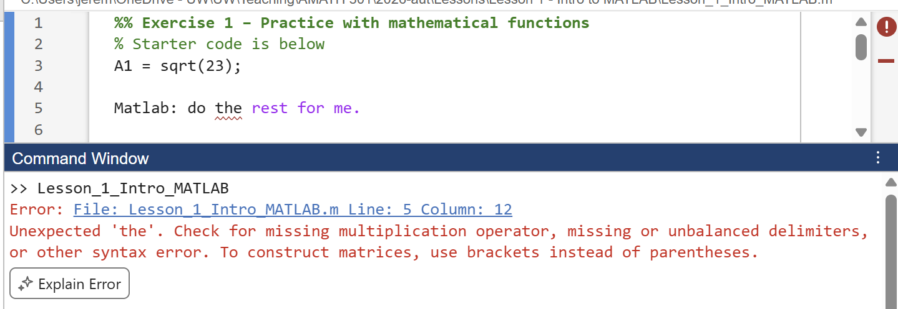
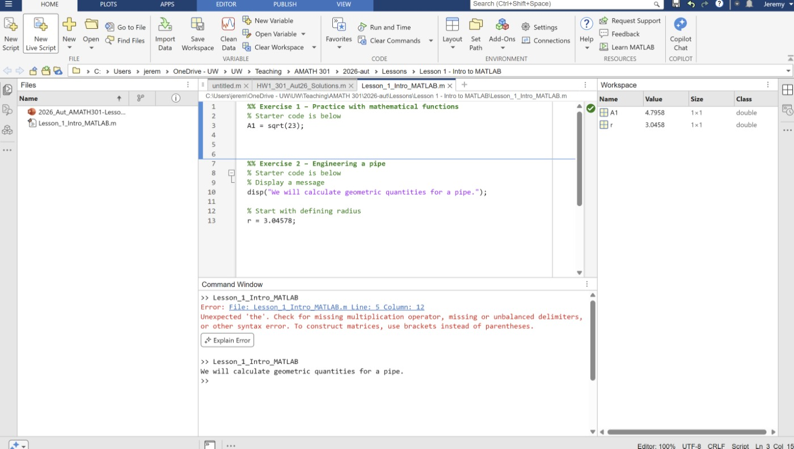
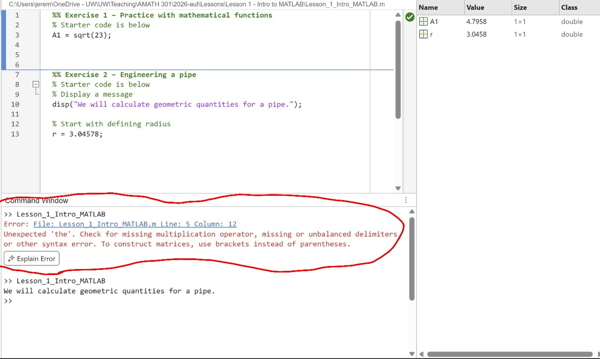
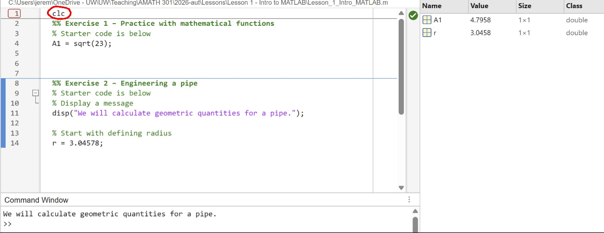

# Errors and round-off error {#sec-errors}

::: {.prep-reminder}
 The PREP for this topic: [Lesson 2 PREP: MATLAB errors, round-off error, and MATLAB debugger]().
:::

::: {.callout-note appearance="simple"}
## Learning objectives

Throughout this chapter, you will learn to:

- Read and interpret error messages to identify what went wrong in a program.
- Use the MATLAB debugger to identify errors in your code.
- Recognize that floating-point arithmetic introduces small errors and apply that understanding to compare numerical values using a tolerance check.
:::

## MATLAB error messages {#sec-error-messages}

::: {.motivation}
Your code won't always work, and that's normal. Errors don't break anything: your script is still there, and you can change it and rerun it. Learning to read error messages is how you fix problems quickly.
:::

An **error** means MATLAB couldn't run one of your instructions. MATLAB doesn't act like AI: it needs explicit instructions in its own language. When it reaches an error, it stops running the script.

{fig-alt="MATLAB Editor and Command Window. Line 5 of the script reads 'Matlab: do the rest for me.' with a red squiggly line under 'the'. The Command Window shows: Error: File: Lesson_1_Intro_MATLAB.m Line: 5 Column: 12. Unexpected 'the'. Check for missing multiplication operator, missing or unbalanced delimiters, or other syntax error. To construct matrices, use brackets instead of parentheses."}

An error message has these parts:

| Part | Example | How useful |
|---|---|---|
| File | `File: Lesson_1_Intro_MATLAB.m` | Which file had the error. |
| Line | `Line: 5` | **The most useful part.** This is where to look. |
| Column | `Column: 12` | Usually less useful. The real problem is often more than one character. |
| Message | `Unexpected 'the'.` | What went wrong. |
| Suggestions | `Check for missing multiplication operator, ...` | Possible causes. Often hard to read at first. |

: The parts of a MATLAB error message.

The Editor also underlines problems with a red squiggly line before you run the code, which can save you time.

::: {.callout-warning}
## Errors and MATLAB Grader

Code that produces an error does not run and cannot be graded by the MATLAB Grader. Before clicking **Submit**, click **Run script** and make sure your code runs. If it produces an error, you will not earn any points.
:::

:::: {.callout-tip collapse="true"}
## Practice: identify the error

A student computes the time in flight, maximum height, and range of a projectile,
$$t_{\text{flight}} = \frac{2 v_0 \sin(\theta)}{g}, \qquad h_{\max} = \frac{\left(v_0 \sin(\theta)\right)^2}{2g}, \qquad x_{\text{range}} = v_0 \cos(\theta) \cdot t_{\text{flight}},$$
with $v_0 = 20$ m/s, $\theta = 0.785$ radians, and $g = 9.81$ m/s². The code produces an error. Which line has the error, what is going wrong, and how do you fix it?

```matlab
v0 = 20;
g = 9.81;
angle_rad = 0.785;

x_range = v0 * cos(angle_rad) * t_flight
t_flight = 2 * v0 * sin(angle_rad) / g
h_max = (v0 * sin(angle_rad))^2 / (2 * g)
```

::: {.callout-caution collapse="true"}
## Answer

The error is on line 5. MATLAB runs code from top to bottom, so when it reaches line 5, `t_flight` hasn't been defined yet; it isn't defined until line 6. MATLAB reports `Unrecognized function or variable 't_flight'`. To fix it, compute `t_flight` before `x_range` by swapping lines 5 and 6.
:::
::::

## The MATLAB desktop: `clc`, `clear`, and `;` {#sec-clc-semicolon}

I recommend the "Three Column" layout: **Home** → **Layout** → **Three Column**.

{fig-alt="The MATLAB toolstrip with the Home tab and the Layout button circled in red."}

{fig-alt="MATLAB in Three Column layout: the Current Folder file list on the left, the script editor at top middle, the Command Window at bottom middle, and the Workspace on the right."}

| Panel | Location | What it shows |
|---|---|---|
| Current Folder | left | files in the current folder |
| Editor | top middle | the active script, where you write code |
| Command Window | bottom middle | output |
| Workspace | right | the variables currently defined |

: The panels of the MATLAB desktop.

### `clc` and `clear`

The Command Window keeps a history of everything since you opened MATLAB, including old errors. `clc` clears the Command Window. It doesn't change your variables.


`clear` removes all variables from the Workspace. Most scripts in this class start with `clear; clc` so each run starts fresh.

::: {.callout-warning}
## Common mistake: using `clear` when submitting to MATLAB grader

Don't use `clear` when submitting to MATLAB grader. This clears all variables I
have created to check your solution and everything will be marked wrong.
:::


::: {.callout-note collapse="true" appearance="simple"}
## Screenshots: before and after `clc`

{fig-alt="MATLAB with the Command Window circled in red. It still shows the error message from an earlier run above the new output."}

{fig-alt="MATLAB after adding clc to the top of the script. The Command Window now only shows the new output: 'We will calculate geometric quantities for a pipe.'"}
:::

### The semicolon

A semicolon at the end of a line hides that line's result. The line still runs.

```matlab
x = 3
y = 4;
disp(y+2)
```

``` {.output}
x =

     3

     6
```

Line 2 still ran: `y` exists and is used on line 3. A semicolon doesn't hide
`disp`, because the point of `disp` is to display something. You can think of
lines of code with `;` as things you would think to yourself or scratch work for
yourself. `disp` is the display, expression, or presentation of your work. 

**Most lines should end with a semicolon.** Leave it off only for a final result or a step you want to see. Displaying output is also slow, which matters once you have lots of code.

## Round-off error {#sec-round-off}

::: {.motivation}
You might see `Variable __ has incorrect value` from the MATLAB Grader even when your code looks right. Often the cause is round-off error.
:::

```matlab
disp(sin(pi))
```

``` {.output}
   1.2246e-16
```

Mathematically $\sin(\pi) = 0$, but MATLAB gives $1.2246 \times 10^{-16}$. This is **round-off error** (also called rounding or floating-point error): computers store numbers with finitely many digits, so they round. $\pi$ has infinitely many digits, so MATLAB's `pi` is already rounded, and `sin` passes that small error along.

::: {.callout-warning appearance="simple"}
`e-16` means $\times 10^{-16}$. This is how MATLAB (and all languages) prints scientific notation. It is **not** the constant $e$.
:::

::: {.callout-note appearance="simple"}
Round-off error is not a MATLAB error; it is one kind of numerical error. We use the word "error" a lot in scientific computing, so read it in context.
:::

### Machine epsilon

By default, MATLAB uses **double-precision** arithmetic: numbers carry about 15–16 significant digits. A change smaller than that is rounded away:

```matlab
disp(1.0 + 1e-16)     % 1
```

<!-- CHANGED: the PREP defines machine epsilon as "the largest ε such that
     1 + ε = 1", which is actually eps/2. This is the definition that
     matches MATLAB's eps. -->

**Machine epsilon** (or machine precision) is the gap between 1 and the next larger number the computer can represent. MATLAB stores it in `eps`:

```matlab
disp(eps)             % 2.2204e-16
```

**Rule of thumb:** treat any result around $10^{-16}$ (sometimes $10^{-15}$ or a little larger) as effectively 0. It is below the resolution of the computer.

::: {.callout-note appearance="simple"}
Other precisions exist. Single precision has more round-off error and quadruple precision has less. Generally, lower precision means faster calculations. We use double precision in this class.
:::

### Checking equality with `==`

`==` asks "are these two things equal?" It returns a **logical** (also called a **Boolean**): `1` for true, `0` for false.

```matlab
1 == 2                % 0
2 == 2                % 1
0.1 + 0.2 == 0.3      % 0
(sqrt(3))^2 == sqrt(3^2)   % 0; they differ by 4.4409e-16
```

Round-off error can appear even in simple decimals like 0.1 + 0.2.

::: {.callout-note collapse="true" appearance="simple"}
## Why is 0.1 + 0.2 not 0.3?

Computers store numbers in binary (base 2), and 0.1 can't be written exactly in binary, just like 1/3 can't be written exactly as a decimal (0.333...). That tiny representation error carries through the calculation. You don't need to remember this reason; it's enough to know that things aren't always exactly what you'd expect.
:::

## Tolerance checks {#sec-tolerance}

::: {.motivation}
The autograder compares your answer to mine. If it used `==`, an answer of `0.1 + 0.2` wouldn't match `0.3`. A tolerance check counts them as the same.
:::

Two numbers $a$ and $b$ are **within tolerance** of each other if
$$|a - b| < \text{tolerance},$$
which is the same as $b - \text{tolerance} < a < b + \text{tolerance}$. In MATLAB:

```matlab
a = sqrt(3^2);
b = sqrt(3)^2;
tolerance = 1e-12;
abs(a - b) < tolerance    % 1 (true): within tolerance
```

There is no single correct tolerance; it depends on the application. In this class you will almost always be told which tolerance to use.

The same idea describes experimental error. A temperature sensor reading 100.3 °C is within a tolerance of 0.5 °C of the boiling point of water (100 °C), but a reading of 100.8 °C is not.

A logical concatenated into a string displays as `true` or `false`:

```matlab
disp("Within tolerance? " + (abs(a - b) < tolerance))
```

``` {.output}
Within tolerance? true
```

::::: {.exercise}
### Exercise: Writing code for and exploring tolerance checks {#sec-ex-tolerance}

**Lesson files:** [Lesson_2_Rounding_Error.m (starter)](../files/Lesson_2_Rounding_Error.m) · [Lesson_2_Rounding_Error.m (completed)](../files/Lesson_2_Rounding_Error_Completed.m)

**Learning outcomes.** This exercise should help you to:

- Explain why floating-point arithmetic introduces small errors and apply that understanding to compare numerical values using a tolerance check.

:::: {.callout-note collapse="true" appearance="simple"}
## Full exercise

**Part 1: Simple tolerance check.** We will use the values `variable_1 = sqrt(3^2)` and `variable_2 = (sqrt(3))^2` as examples in the computation. You will choose a value for `tolerance` based on the two goals below and then write code that determines if the two variables `variable_1` and `variable_2` are within tolerance of one another.

- **Task 1:** Display the value of $|a - b|$ where $a$ and $b$ are the values of `variable_1` and `variable_2`. This will help you choose a reasonable tolerance for the tolerance check.
- **Task 2:** Choose a value of `tolerance` so that the variables are recorded as "close enough" with a tolerance check. Notice that `<` is similar to `==`. It is asking a question: "is this value less than the other value?"
- **Task 3:** Choose a value of `tolerance` so that the variables are recorded as not "close enough" with a tolerance check.

There is no correct answer here for `tolerance`: it depends on the application. You should be using this exercise to experiment with and understand tolerance checks and round-off error.

**Part 2: Connecting to experiment (optional).** The idea of two values being "close enough" or within tolerance is not just a computer thing. It's the same idea as experimental error. Assume you are calibrating three temperature sensors against the accepted boiling point of water at sea level, `T_accepted = 100` (degrees Celsius). A sensor is acceptable if its reading is within `tolerance = 0.5` (degrees Celsius) of the accepted value. The sensors read `sensor_A = 100.3`, `sensor_B = 99.4`, and `sensor_C = 100.8`. Write code to check whether each sensor is within tolerance. You should print your output in a readable format. Your full answer should be:

``` {.output}
Sensor A within tolerance? true
Sensor B within tolerance? false
Sensor C within tolerance? false
```

Hint: try concatenating a logical and see what you get!

::: {.callout-tip collapse="true" appearance="simple"}
## Takeaways and common mistakes


**Key takeaways**

- The two values differ by about `4.4e-16`, so `tolerance = 1e-12` counts them as "close enough" and `tolerance = 1e-17` does not.
- Each sensor check is one line: `disp("Sensor A within tolerance? " + (abs(sensor_A - T_accepted) < tolerance));`

**Common mistakes**

- Forgetting `abs`. Without it, any reading below the accepted value passes: `99.4 - 100 < 0.5` is true, so Sensor B would wrongly be "within tolerance."
- Writing `tolerance = e-12`. Scientific notation needs a number before the `e`: `1e-12`.
:::
::::
:::::


