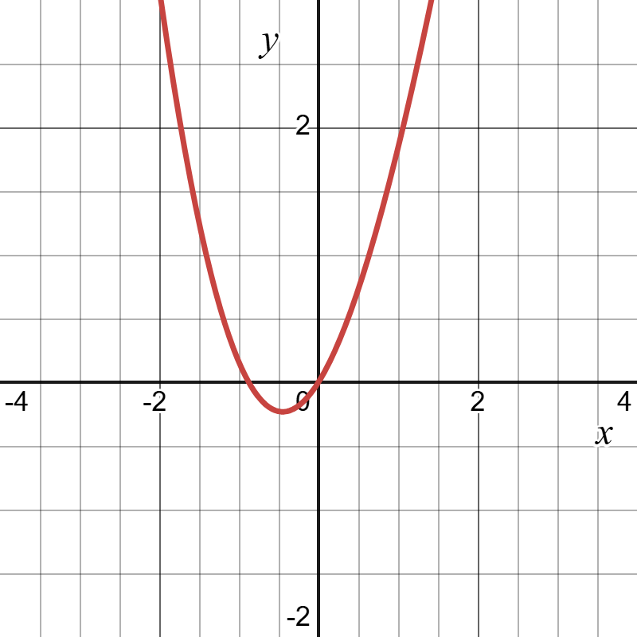
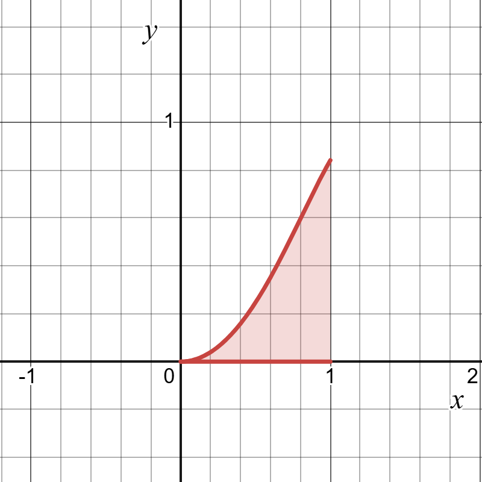
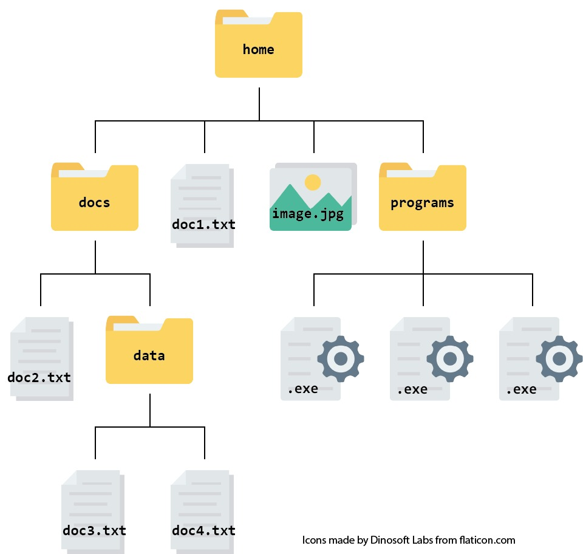
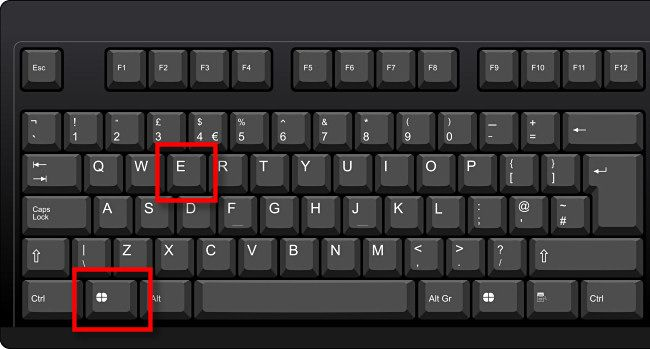
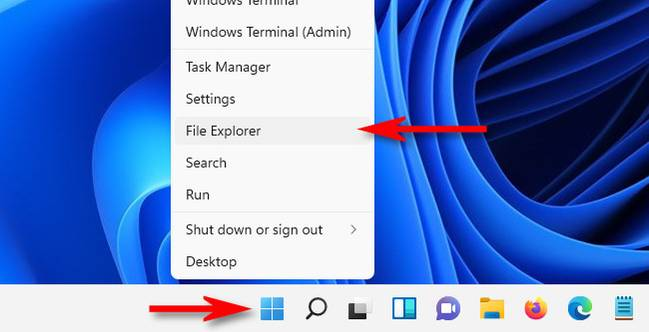
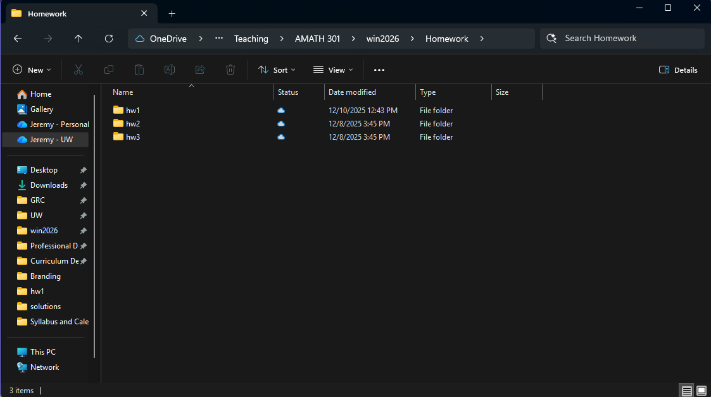

# Getting started {#sec-getting-started}

::: {.prep-reminder}
 The PREP for this topic: [Lesson 1 PREP: Getting started with Ed and MATLAB]().
:::

::: {.callout-note appearance="simple"}
## Learning objectives

Throughout this chapter, you will learn to:

- Describe scientific computing and recognize problems scientific computin solves.
- Create and maintain an organized file system for course materials.

The learning objectives are listed to help you frame your learning. If you ever find yourself asking "what are the important parts in what I am reading?" this should help you answer that question.
:::

## What is scientific computing? {#sec-what-is-sci-comp}

::: {.motivation}
You know more math than most people on Earth, but it's still easy to write down problems you understand and can't solve exactly. Scientific computing is how we get useful answers to them anyway.
:::

**Scientific computing** is using computers to solve math, science, and engineering problems. It uses mathematics, engineering, physics, computer science, and more. We translate a math problem into a form the computer understands, and the computer does the computations.

### Problems you can understand but can't solve exactly

1. **Find the global minimum of $f(x) = x^2 + \sin(x)$.** The minimum is where $f'(x) = 2x + \cos(x) = 0$, but this equation can't be solved exactly. Instead, we estimate the minimum, either with an algorithm that "rolls a marble" down the graph until it stops, or by finding the roots of $f'(x)$ with a root-finding algorithm (@sec-root-finding).

    {fig-alt="Graph of f(x) = x squared plus sine of x for x from about -4 to 4. It is a U-shaped curve with its lowest point a little to the left of x = 0, slightly below the x-axis." width="55%"}

2. **Calculate $\displaystyle\int_0^1 \sin(x^2)\, dx$.** There is no antiderivative of $\sin(x^2)$, but we can approximate the area under the curve.

    {fig-alt="Graph of sine of x squared for x from 0 to 1, with the area between the curve and the x-axis shaded. The curve starts flat at 0 and rises to about 0.84 at x = 1." width="55%"}

3. **Calculate $\displaystyle\int \tan(x)\sqrt{2 + \sqrt{4 + \cos(x)}}\, dx$.** This one *can* be solved exactly, even though it looks the most complicated. The answer is a formula in terms of symbols, which is not what we do in this class.

In scientific computing, we study the algorithms that produce approximations and determine what "close enough" means. Almost every answer we compute has some error, but the approximations are good enough to solve real problems.

### Numerical vs. symbolic computing {#sec-numerical-vs-symbolic}

| | Symbolic computing | Numerical computing (this class) |
|---|---|---|
| Works with | symbols ($x$, $y$, ...), as you would on paper | numbers |
| Answers look like | formulas, e.g. $x = \frac{-b \pm \sqrt{b^2 - 4ac}}{2a}$ | numbers, e.g. $x = 2.718$, and plots |
| Examples | your past math classes, WolframAlpha | MATLAB |

: Symbolic vs. numerical computing.

WolframAlpha and similar tools mostly do symbolic computation. Compare what they give for the three problems above: [problem 1](https://www.wolframalpha.com/input?i=minimize+x%5E2%2Bsin%28x%29), [problem 2](https://www.wolframalpha.com/input?i=integrate+sin%28x%5E2%29+from+0+to+1), [problem 3](https://www.wolframalpha.com/input?i=integrate+tan%28x%29*sqrt%282%2Bsqrt%284%2Bcos%28x%29%29%29).

### Model error

Before computing anything, we turn a real-world problem into math, and that means making assumptions. Physicists joke about "assuming a spherical cow," but every model does something similar: a model of a falling object might ignore air resistance, and a population model might assume the birth rate is constant from year to year. Even a perfect solution to the math still has error, because the model only approximates reality. This is called **model error**. It is not covered in this class.

### Where scientific computing fits in

Scientific computing is one tool in the STEM toolbag, not a replacement for the rest. It fits into a cycle:

1. **Theory builds the model.** This is where the calculus you already know and derivations from science and engineering come in.
2. **Scientific computing solves the model** and visualizes results.
3. **Experts interpret those results** in terms of the original science or engineering question, then change the question and repeat the cycle.

Scientific computing is used across many fields: engineers test bridge designs and simulate airflow over aircraft, scientists model disease spread and predict weather, tech companies build recommendation systems and detect fraud, and space agencies calculate spacecraft trajectories. You'll even learn the algorithm used in the moon landing.

::: {.callout-note collapse="true" appearance="simple"}
## Optional: more examples of scientific computing in action

**Data science and machine learning**

1. Recommendation Systems
    - Netflix recommending shows, Spotify suggesting songs, Amazon products
    - Using algorithms to predict what you'll like based on patterns in massive datasets
2. Image Recognition & Computer Vision
    - Facial recognition; Self-driving cars identifying pedestrians, traffic signs, and obstacles
    - Medical imaging: detecting tumors in X-rays and MRIs automatically
3. Natural Language Processing (NLP)
    - Chatbots and virtual assistants (Siri, Alexa, ChatGPT)
    - Language translation (Google Translate)
4. Fraud Detection
    - Credit card companies analyzing millions of transactions in real-time, identifying unusual patterns that indicate fraud

**Health and biology**

1. Drug Discovery
    - Testing thousands of potential drug compounds virtually before lab testing, saving years of time and millions of dollars
2. Genome Sequencing
    - Analyzing DNA sequences to identify genes and mutations to understand genetic diseases
3. Medical Imaging
    - MRI and CT scans use computational algorithms to reconstruct 3D images
    - Computer vision helps detect tumors and diagnoses
4. Epidemiology
    - Modeling disease spread during pandemics (like COVID-19)
    - Predicting infection rates and evaluating intervention strategies

**Earth and space science**

1. Weather Forecasting
    - Computers solve complex atmospheric equations to predict weather patterns
    - Involves millions of data points and calculations updated every few minutes
2. Climate Modeling
    - Predicting long-term climate change by simulating Earth's atmosphere, oceans, and ice through massive simulations
3. Astrophysics & Space Exploration
    - Simulating galaxy formation and black hole behavior
    - Calculating spacecraft trajectories (like landing rovers on Mars)
    - Processing data from telescopes to discover exoplanets

**Engineering**

1. Structural Engineering
    - Testing designs of bridges, buildings, and aircraft virtually before building physical prototypes
    - Example: Boeing uses simulations to test aircraft wings under different conditions
2. Aerospace Engineering
    - Computational fluid dynamics (CFD) to design airplane wings and rocket shapes
    - Simulating airflow to optimize fuel efficiency and reduce drag
3. Automotive Engineering
    - Crash test simulations instead of destroying physical prototypes
    - Optimizing engine performance and fuel efficiency
4. Electrical & Circuit Design
    - Simulating complex circuits before manufacturing chips
    - Analyzing power grid stability and load distribution
5. Robotics & Control Systems
    - Simulating robot behavior in virtual environments
    - Control algorithms for drones, autonomous vehicles, and manufacturing robots

**Finance & Business**

1. Financial Modeling
    - Predicting stock market trends and risk analysis to create investment strategies
    - High-frequency trading algorithms
2. Predictive Analytics
    - Predicting customer behaviors and sales forecasting
    - Predicting equipment failures in manufacturing before they happen
3. Social Media & Content Analysis
    - Analyzing trends across millions of social media posts
    - Content moderation: detecting harmful content automatically
    - Understanding public opinion during elections or crises

We won't be able to study all of these, but we will learn the basic tools needed to be able to begin to understand these applications, and we will even dive deep into some of them.
:::


## Algorithms and pseudocode {#sec-algorithms}

::: {.callout-note appearance="simple"}
Algorithms and pseudocode are introduced in Lesson 7, alongside if statements (@sec-if-statements).
:::

::: {.motivation}
Before writing code for a problem, it helps to write out the steps in plain language, especially when the code has to do different things in different situations.
:::

An **algorithm** is a sequence of well-defined instructions for performing a specific task, like a recipe. A classic grade-school exercise is writing out exactly how to make a peanut-butter and jelly sandwich, clearly enough that someone could follow it with no other help. In scientific computing, algorithms are usually designed to solve equations, process data, simulate physical systems, or optimize designs.

**Pseudocode** writes out an algorithm in plain language (not actual code), in enough detail that it can be translated into any programming language. Key words in pseudocode point to specific coding tools:

| Pseudocode word | Coding tool |
|---|---|
| IF ..., otherwise ... | an if statement (@sec-if-statements) |
| ITERATE, REPEAT | a for loop (@sec-for-loops) |

: Pseudocode key words and the coding tools they point to.


For example, here is pseudocode for checking a sensor reading against an accepted value (the tolerance check from @sec-tolerance):

```text
Algorithm: Check whether a sensor reading is acceptable.

Inputs:  reading, accepted value, tolerance
Outputs: a message

Steps:
1. Calculate the difference, |reading - accepted value|.
2. IF the difference is less than the tolerance, display "Within tolerance."
   Otherwise, display "Out of tolerance."
```

Longer examples are in @sec-if-statements (the quadratic formula) and @sec-bisection (the bisection method).


## File systems and course organization {#sec-file-systems}

::: {.motivation}
You'll work with a lot of files in this class: MATLAB code, datasets, study guides, and more. A misplaced file wastes time, and submitting the wrong file to the autograder costs points. This comes up all the time in AMATH 301.
:::

A **file system** is a system for storing files. Your computer organizes files like a filing cabinet: main folders like Documents and Desktop are the drawers, and inside them are folders, which hold more folders or files.

{fig-alt="Tree diagram of a file system. A home folder contains a docs folder, a file doc1.txt, an image file, and a programs folder. The docs folder holds doc2.txt and a data folder with doc3.txt and doc4.txt; the programs folder holds three .exe files." width="65%"}

Keep each assignment's files in its own folder. Two files with the same name in one folder (like Downloads) become "temperature_data.csv" and "temperature_data (1).csv", and you can't tell which is which. With a folder per assignment, "hw3/temperature_data.csv" and "hw4/temperature_data.csv" never get mixed up.

### Recommended course folder structure

1. **Open your file browser.**
    - Windows: press Windows Key + E, or right-click Start and click "File Explorer".
    - Mac: click the Finder icon (the smiling blue face) in the dock.
2. **Go to your "Documents" folder** (or another place you'll remember). It's usually on the left side of the file browser.
3. **Create a course folder**, for example "AMATH301". Right-click an empty space (two-finger press on most touchpads) and create a new folder. Don't use spaces in folder or file names: MATLAB won't run files with spaces in the filename.
4. **Create subfolders** inside it, such as "homework", "lectures", and "exams". Every file for this class goes in one of these. If a file doesn't fit, make a new folder for it. Don't leave class files in Downloads.
5. **Keep it up.** For example, inside "homework", create "hw0", "hw1", "hw2", and so on.

::: {.callout-note collapse="true" appearance="simple"}
## Screenshots: opening your file browser

{fig-alt="A keyboard with the Windows key and the E key outlined in red." width="45%"}
{fig-alt="The Windows right-click Start menu with File Explorer pointed out by a red arrow." width="45%"}

{fig-alt="The macOS dock with a red arrow pointing to the blue smiling-face Finder icon." width="45%"}
:::

{fig-alt="Screenshot of Windows File Explorer open to OneDrive, Teaching, AMATH 301, win2026, Homework. The Homework folder contains three folders: hw1, hw2, and hw3."}
