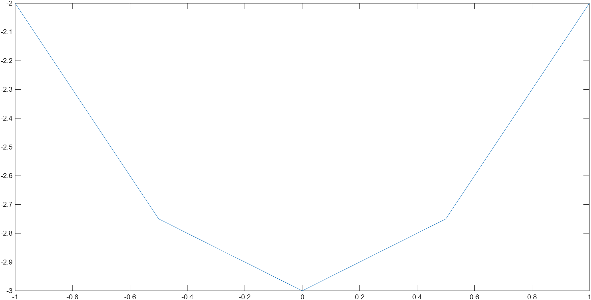
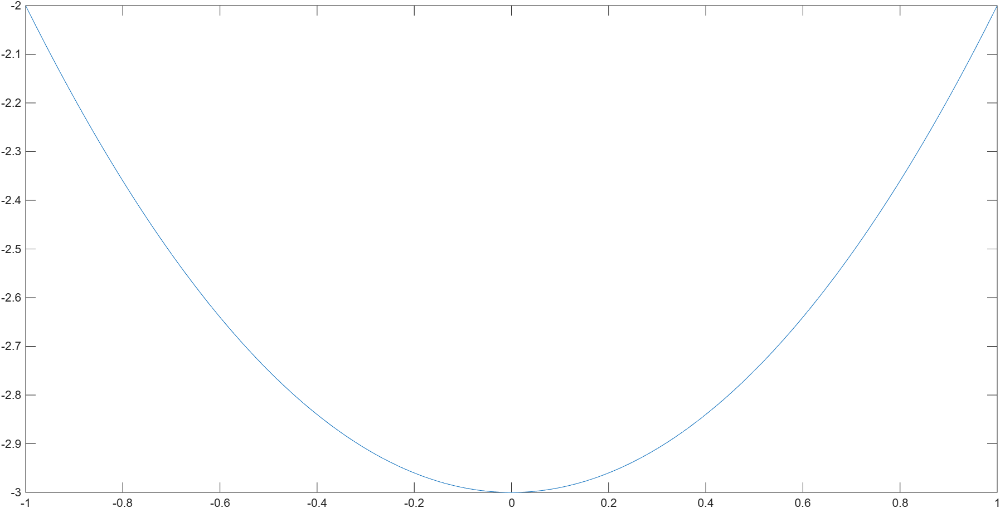
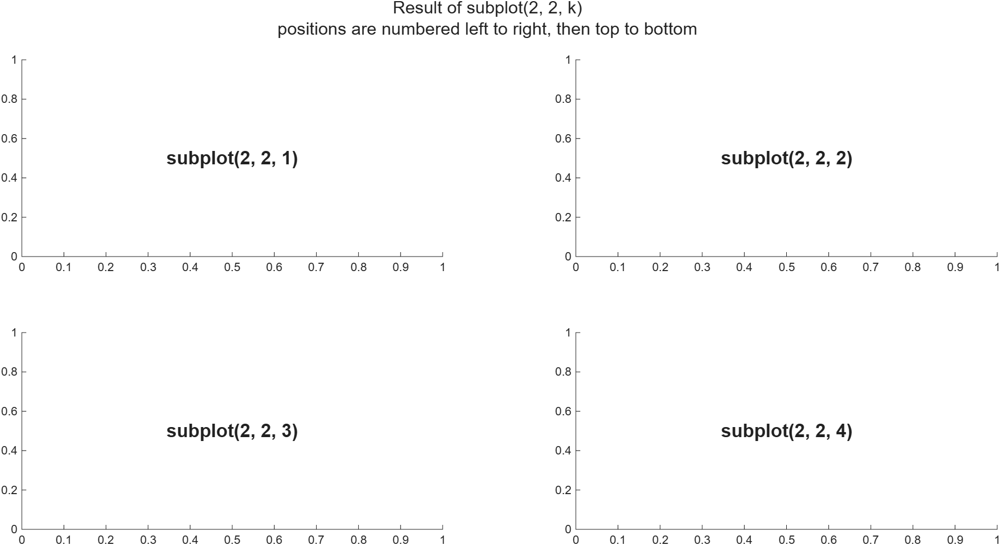
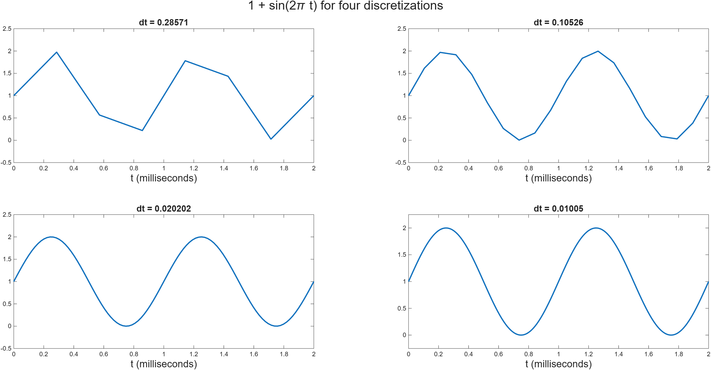

# Discretization and plotting {#sec-plotting}

::: {.prep-reminder}
 The PREP for this topic: [Lessons 4 & 5 PREP: Discretization and plotting]().
:::

::: {.callout-note appearance="simple"}
## Learning objectives

Throughout this chapter, you will learn to:

- Explain what it means to discretize a function $f(x)$ for $x \in [a, b]$ and describe how the parameters $a$, $b$, $N$, and $\Delta x$ relate to one another.
- Discretize a continuous function using `linspace` and array arithmetic.
- Create and customize line plots, including labels, titles, and line styles.
- Distinguish between figure and axes in MATLAB.
- Save and display figures appropriately using `exportgraphics`.
:::


::: {.callout-note appearance="simple"}
The [MATLAB plotting reference](../reference/style-guide.qmd) summarizes everything on this page. Go through the [figure checklist](../reference/style-guide.qmd#checklist) before submitting any figures for grading. 
:::
::: {.callout-note appearance="simple"}
A **graph** is a figure representing a mathematical function. **Plot** can be a verb (let's plot these points) or a specific type of figure (bar plot, scatter plot, etc.). The two words are often used interchangeably.
:::

## Discretizing functions {#sec-discretizing}

::: {.motivation}
Displaying numbers doesn't work once we have arrays of results; we need figures. But a function like $y = x^2 - 3$ is continuous, which means infinitely many points, and a computer can't do "infinitely many" anything.
:::

To graph a function $f(x)$, we use the same method you learned in your first algebra class:

1. Make a list of $x$ values.
2. Plug each $x$ value into $f(x)$ to get a list of $y$ values.
3. Draw a point at each $(x, y)$ pair.
4. Connect the dots.

Steps 1–2 are called **discretizing** the function: approximating it by evaluating it at a finite set of points. With array arithmetic, step 2 is one line:

```matlab
x = [-1, -0.5, 0.5, 1];       % choose the x values
y = x.^2 - 3;                 % evaluate f(x) at each x
```

The $x$ values can be anything, but we usually choose $N$ **evenly spaced** points $x_1 < x_2 < \dots < x_N$ on an interval $[a, b]$, with $x_1 = a$ and $x_N = b$. The spacing between neighboring points is
$$\Delta x = \frac{b - a}{N - 1}, \qquad x_k = a + (k-1)\Delta x, \qquad k = 1, 2, \ldots, N.$$
In code, $x_k$ is `x(k)`.

![A discretization of the interval $[a, b]$.](../figures/discretization_dx.png){fig-alt="A number line with evenly spaced points labeled x1 = a, x2 = a + Δx, x3 = a + 2Δx, up through xN = b. Each gap between neighboring points is labeled Δx."}

More points (larger $N$) means a smaller $\Delta x$, called a **finer** discretization. Fewer points means a larger $\Delta x$, a **coarser** discretization.

In MATLAB, `linspace(a, b, N)` creates exactly these points (@sec-linspace). For example, `x = linspace(-1, 1, 5)` gives `[-1, -0.5, 0, 0.5, 1]`, and `x(2) - x(1)` gives the spacing $\Delta x = \frac{1 - (-1)}{5 - 1} = 0.5$.

### Graphing a function with `plot`

[`plot(x, y)`](https://www.mathworks.com/help/matlab/ref/plot.html) draws a line through the points `(x(1), y(1))`, `(x(2), y(2))`, and so on.

```matlab
x = linspace(-1, 1, 5);
y = x.^2 - 3;
plot(x, y)
```

{fig-alt="A MATLAB plot of y = x squared minus 3 using 5 points. It is a jagged V-like shape made of four straight line segments, with no title, axis labels, or legend." width="48%"}
{fig-alt="A MATLAB plot of y = x squared minus 3 using 500 points. It is a smooth parabola with its lowest point at x = 0, y = -3." width="48%"}

With 5 points (left), you can see the straight lines MATLAB drew between points. With `linspace(-1, 1, 500)` (right), the graph looks smooth. MATLAB draws a box around the graph instead of axes through the origin; this is standard for scientific figures.

## Figures, axes, and lines {#sec-plotting-rizz}

::: {.motivation}
Our plots so far have no labels, no title, and no legend, so it's hard to tell what they show. Compare the same three lines before and after decorating:

{fig-alt="Three lines plotted on one set of axes with MATLAB's default thin lines and similar pale colors. Two of the lines are jagged. There is no title, no axis labels, and no legend." width="48%"}
{fig-alt="The same three discretizations of 1 + sin(2πt) on one set of axes, now decorated. Title: '1 + sin(2πt) for three discretizations'. N = 8 is a blue dashed line with circle markers, N = 20 is a red dotted line with square markers, and N = 100 is a solid black line. A legend in the top right identifies each line, the x-axis is labeled t and the y-axis 1 + sin(2πt)." width="48%"}
:::

A MATLAB figure has three main parts:

- **Figure:** the whole window that holds the plot. This is the part you save; think of it as the envelope holding everything else.
- **Axes:** the box with the $x$- and $y$-axes, where the data is drawn. Axis labels, the title, and the legend belong to the axes.
- **Lines:** the plotted curves. Each `plot` command creates one line.

{fig-alt="A labeled MATLAB figure titled 'Damped sine waves' with three oscillating lines. Labels point to the title, the legend, the y-axis label, the x-axis label, the grid lines, the lines (one per plot command), the axes (the box where data is drawn), and the figure (the whole gray window)."}

### Creating and managing figures

| Command | What it does |
|---|---|
| `fig1 = figure(1);` | Creates Figure 1 (or switches to it) and saves it as `fig1`. |
| `hold on` | Keeps what's already drawn, so the next `plot` adds a line instead of replacing the old one. |
| `close all` | Closes every open figure. |
| `exportgraphics(fig1, "name.png")` | Saves `fig1` as an image file. |

: Commands for working with figures.

Save figures with `exportgraphics` in your code rather than by hand. Then every time you change the code and rerun it, the saved figure updates too.

::: {.callout-note collapse="true"}
## Common question: Why start with `close all`?

`close all` closes every open figure window. It's especially important because it's easy to end up with several figures open and edit the wrong figure, so starting a script with `close all` gives you a clean slate.
:::

::: {.callout-note collapse="true"}
## Common question: What does `hold on` do and why do we need it?

We need to use `hold on` *if we are drawing multiple lines on one axis.* `hold
on` tells MATLAB to keep whatever is currently drawn on the axis, then plot the
next thing **on the same axis**. Try plotting two different functions with and
without `hold on` to compare the difference.  

```matlab
x = linspace(0, 1, 100);

fig1 = figure(1)
plot(x, x.^2)
plot(x, x)

% Compare to

fig2 = figure(2)
plot(x, x.^2)
hold on
plot(x, x)
```

:::


::: {.callout-note collapse="true"}
## Common question: Do I need to use `exportgraphics` or can I just take a screenshot?

**You should use `exportgraphics`.** A screenshot won't have the same resolution
as `exportgraphics` and will take into account settings you may have on your
computer, such as dark mode, which will make the plots look bad. 
:::


## Decorating a plot {#sec-decorating}

Every figure in this class should have **axis labels and a title**. These are the minimal requirements for a professional-looking figure. The [MATLAB plotting reference](../reference/style-guide.qmd) has more options, a figure template, and a checklist.

| Command | What it does |
|---|---|
| `xlabel("x values")` | Labels the $x$-axis. |
| `ylabel("y values")` | Labels the $y$-axis. |
| `title("My title")` | Adds a title to the axes. |
| `plot(x, y, "DisplayName", "sin(x)")` then `legend` | Labels a line and shows the legend. |
| `grid on` | Adds grid lines. |
| `ylim([ymin, ymax])` | Sets the $y$-axis limits. |
| `..., "FontSize", 14` | Sets the font size in `xlabel`, `ylabel`, `title`, or `legend`. |

: Commands for labeling axes.

Line styles go inside `plot( )` as name-value pairs:

| Option | Example | Result |
|---|---|---|
| `"LineWidth"` | `plot(x, y, "LineWidth", 2)` | line of width 2 |
| `"LineStyle"` | `plot(x, y, "LineStyle", "--")` | dashed line (default `"-"` is solid) |
| `"Color"` | `plot(x, y, "Color", "r")` | red line |
| `"Marker"` | `plot(x, y, "Marker", "o")` | circle at each point (`"s"` for squares) |

: Line options for `plot`.

Combine as many options as you like. More styles, colors, and markers are in the [`plot` documentation](https://www.mathworks.com/help/matlab/ref/plot.html) and the [MATLAB figure style guide](../reference/style-guide.qmd).

```matlab
plot(t1, y1, "Color", "b", "LineStyle", "--", "Marker", "o", ...
    "LineWidth", 2, "DisplayName", "N = 8")
```

`...` at the end of a line continues the code on the next line. In labels and titles, type `\pi` to get the symbol $\pi$; `pi` shows the letters "pi".

::: {.callout-warning appearance="simple"}
**Make accessible figures:** use lines that differ in style or marker, not just color, so every reader can tell them apart.
:::

::::: {.exercise}
### Exercise: Three line plots on one axes {#sec-ex-one-axes}

**Lesson files:** [Plotting_Exercise.m (starter)](../files/Plotting_Exercise.m) · [Plotting_Exercise.m (completed)](../files/Plotting_Exercise_Completed.m) (Exercise 1)

**Learning outcomes.** This exercise should help you to:

- Discretize a continuous function using `linspace` and array arithmetic.
- Create and customize line plots, including labels, titles, and line styles.
- Save and display figures appropriately using `exportgraphics`.

<!-- The CLASS page lists all five learning outcomes for the whole activity;
     they are split between the two exercises here. -->

:::: {.callout-note collapse="true" appearance="simple"}
## Full exercise

We will practice with the function
$$f(t) = 1 + \sin(2\pi t), \qquad t \in [0, 2].$$
This function is critical in:

- electrical engineering, where $t$ represents time (e.g., seconds or milliseconds) and $f(t)$ represents the voltage of an alternating current (AC) circuit.
- signal processing, where $t$ represents time (e.g., seconds or milliseconds) and $f(t)$ represents the amplitude of a sound wave.

**Tasks**

- **Task 0** (done for you): Create a figure `fig1`.
- **Task 1:** Discretize the function $f(t) = 1 + \sin(2\pi t)$ for $t \in [0, 2]$ using 8 points. Plot this discretization on the axes in `fig1`.
- **Task 2:** Repeat Task 1 using 20 points in the discretization.
- **Task 3:** Repeat Task 1 using 100 points in the discretization.

At this point, your figure should look like the undecorated figure in @sec-plotting-rizz. The next tasks are to make it look like the decorated one. You can try to do it on your own, or you can follow the steps below. Your plot does not need to match exactly!

- Label the $x$-axis using `xlabel`. Label it "t (milliseconds)" and use font size 16.
- Label the $y$-axis using `ylabel`. Label it "1 + sin(2\\pi t)" and use font size 16.
- Create a title using `title`. Match the title above and use font size 18.
- Update each line plot by editing each call to `plot`:
    - Change the `"LineWidth"` of each line to 2.
    - Match the colors above (or just use 3 different colors).
    - Match the line styles above (or choose 3 different line styles).
    - Use markers for $N = 8$ and $N = 20$.
    - Add a legend entry for each line using, e.g., `plot(..., "DisplayName", "N = 8")`. Match the legend above!
- Create the legend and use font size 18 for the legend.
- Turn the grid on.
- Change the $y$ limits of the graph using `ylim`. The goal is to add some padding to the axes so the peaks and troughs don't touch the edges.

Finally, save your figure using `exportgraphics(fig1, "Name.png")` where you get to decide the Name!

::: {.callout-tip collapse="true" appearance="simple"}
## Takeaways and common mistakes


**Key takeaways**

- Each discretization is two lines: `t1 = linspace(0, 2, N1);` and `y1 = 1 + sin(2*pi*t1);`
- `hold on` after the first `plot` lets the next two lines go on the same axes.
- `"DisplayName"` in each `plot` call, then one `legend`, labels all three lines.

**Common mistakes**

- Forgetting `hold on`. Each `plot` replaces the last one, so only the final line shows.
- Typing `pi` in a label or title instead of `\pi`.
- Hardcoding the number of points, like `linspace(0, 2, 8)` right after `N1 = 8;`. Use `linspace(0, 2, N1)` so the data and the legend label stay in sync if you change `N1`.
:::
::::
:::::

## Subplots: multiple axes in one figure {#sec-subplots}

::: {.motivation}
Sometimes several small graphs side by side are clearer than many lines on one set of axes.
:::

[`subplot(num_rows, num_columns, position)`](https://www.mathworks.com/help/matlab/ref/subplot.html) splits the figure into a grid of axes and selects one of them. Every `plot`, `title`, `xlabel`, and `ylim` after it applies to the selected axes, until the next `subplot`. Positions are numbered left to right, then top to bottom.

```matlab
fig = figure(1);         % create the figure
subplot(2, 2, 3);        % 2x2 grid of axes; select the 3rd one
plot(x, y);              % draw on the 3rd axes (bottom left)
```

{fig-alt="A figure titled 'Result of subplot(2, 2, k): positions are numbered left to right, then top to bottom'. It has four empty axes in a 2 by 2 grid labeled subplot(2, 2, 1) top left, subplot(2, 2, 2) top right, subplot(2, 2, 3) bottom left, and subplot(2, 2, 4) bottom right."}

`title` titles one axes. `sgtitle("...")` ("subplot grid title") titles the whole figure.

::::: {.exercise}
### Exercise: Four axes in one figure {#sec-ex-subplots}

**Lesson files:** [Plotting_Exercise.m (starter)](../files/Plotting_Exercise.m) · [Plotting_Exercise.m (completed)](../files/Plotting_Exercise_Completed.m) (Exercise 2)

**Learning outcomes.** This exercise should help you to:

- Explain what it means to discretize a function $f(x)$ for $x \in [a, b]$ and describe how the parameters $a$, $b$, $N$, and $\Delta x$ relate to one another.
- Distinguish between figure and axes in MATLAB.

:::: {.callout-note collapse="true" appearance="simple"}
## Full exercise

We can also represent the discretizations from the previous exercise using a grid of axes. Your goal will be to make the figure below.

{fig-alt="A figure titled '1 + sin(2πt) for four discretizations' with four axes in a 2 by 2 grid. Each shows 1 + sin(2πt) for t from 0 to 2 with a different spacing: dt = 0.28571 (top left, jagged), dt = 0.10526 (top right), dt = 0.020202 (bottom left), and dt = 0.01005 (bottom right). The curves get smoother as dt gets smaller."}

- **Task 1:** Create a new figure, `fig2`.
- **Task 2** (done for you): Use `sgtitle` to create a "subplot grid title", a title for the whole grid of subplots. Each subplot will have its own title as well.
- **Task 3:** Tell MATLAB you want to work with one subplot at a time using `subplot(2, 2, 1)` (top left corner).
    - Plot the discretization with $N = 8$ using line width 2.
    - Add a font-size 14 title by calculating $\Delta t$ ("dt" in the image above) for this discretization.
    - Adjust the $y$ limits with `ylim`.
    - Label the $x$-axis to match the plots above; use font size 16.
- **Task 4:** Repeat Task 3 for $N = 20$, $100$, and $200$. You can reuse the discretizations you've already made for $N = 20$ and $N = 100$, but you will need to create a new discretization for $N = 200$.
- **Task 5:** Save the figure using `exportgraphics`.

::: {.callout-tip collapse="true" appearance="simple"}
## Takeaways and common mistakes


**Key takeaways**

- `fig2 = figure(2);` before anything else keeps Figure 1 untouched.
- Call `subplot(2, 2, k)` before plotting and labeling each axes.
- Compute the spacing from the array: `"dt = " + (t1(2) - t1(1))`. More points means a smaller `dt` and a smoother curve.

**Common mistakes**

- Calling `title` or `xlabel` before `subplot`. They go to whichever axes was selected before.
- Forgetting to create a new figure. The subplots end up on top of Figure 1.
:::
::::
:::::

::: {.checkpoint}
 cover up through here.
:::
