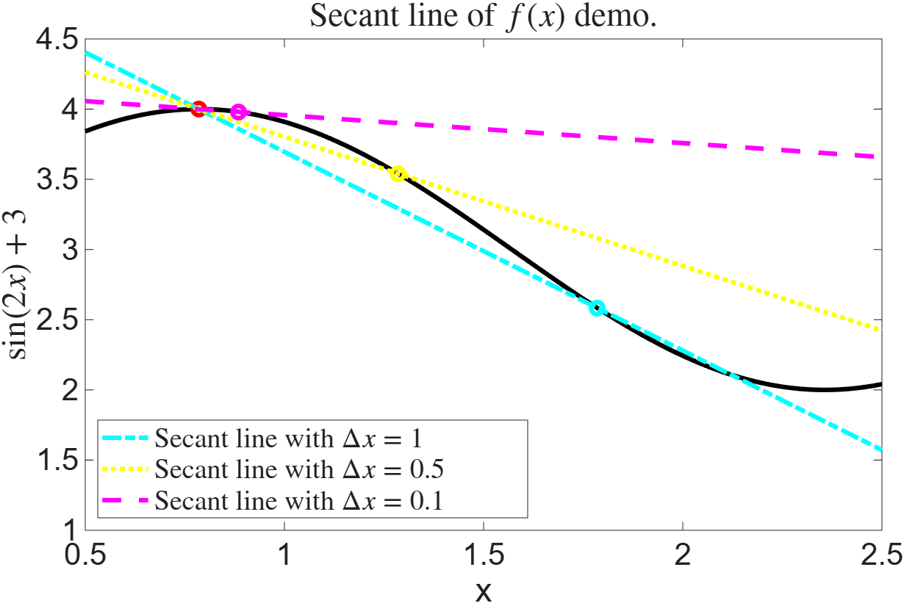
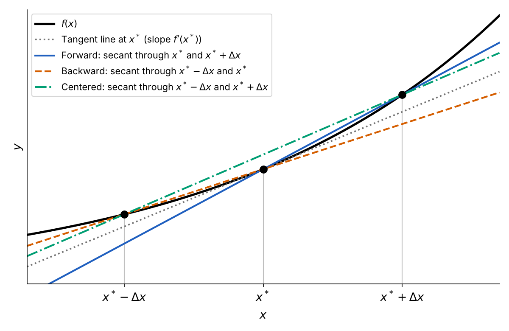

# Numerical derivatives {#sec-derivatives}

::: {.prep-reminder}
 The PREPs for this topic: [Lesson 11 PREP: Numerical derivatives (finite difference)]() and [Lesson 13 PREP: Loading data; numerical derivatives of data]().
:::

::: {.callout-note appearance="simple"}
## Learning objectives

Throughout this chapter, you will learn to:

- Recognize the first-order forward difference method, the first-order backward difference method, and the second-order centered difference method for approximating a derivative.
- Use MATLAB to implement a given finite difference scheme calculation for approximating the derivative of a function at a particular point.
- Use a for loop or slicing to approximate the derivative of a function on a grid (discretization).
- Compute derivatives of data using finite difference methods at a single point or across all applicable points.
:::

## Why numerical calculus? {#sec-why-numerical-calculus}

::: {.motivation}
When most students think back to Calculus 1, they think about **symbolic** calculations: "bring down the power and decrease the power by one," $\frac{d}{dx}x^3 = 3x^2$, or "if $f(x) = \sin(2x) + 3$, then $f'(x) = 2\cos(2x)$." In most applications, we don't even have a function to take a derivative of, so we can't do symbolic calculations! Instead, we need to compute things like:

- the speed of an object based on its location at certain times (for example, a rocket),
- the rate of change of temperature in a heat exchanger (think a refrigerator),
- the rate of change of salinity in the ocean as depth increases,
- the rate at which a body clears a lifesaving drug from the bloodstream,
- the change in the price of an option contract in finance, and
- how quickly a neural network algorithm is converging.

None of these start with a formula for $f(x)$. They are based on recorded data: some numbers (think arrays).
:::

**Numerical calculus** is calculus on the computer. Instead of formulas, we get numerical answers that we can turn into plots. It is built on the theory from your calculus classes.

::: {.callout-note collapse="true"}
## What about symbolic calculations in MATLAB?

MATLAB can do symbolic calculations of derivatives. Though symbolic calculations
are helpful, they are not scientific computing and won't help with most
application problems. We won't cover symbolic calculations in this class, and
you should avoid it except for specific purposes!
:::

Taking derivatives of data has some added difficulties (@sec-fd-data), so we
begin with derivatives of functions. This is something we actually do in scientific
computing: there are special functions in mathematics, like the [Gamma
function](https://en.wikipedia.org/wiki/Gamma_function) and the [Bessel
functions](https://en.wikipedia.org/wiki/Bessel_function), with no (simple)
derivative formula we can use.

## From average rate of change to the derivative {#sec-average-rate-of-change}

The steps for creating numerical derivatives will look a lot like what you did in Calculus 1, so don't be surprised if this feels familiar!

A car is traveling along a straight road. We record its position $s$ from a starting point at several times $t$:

| Time $t$ (seconds) | 1 | 2 | 3 | 4 | 5 |
|---|---|---|---|---|---|
| Position $s(t)$ (meters) | 2 | 6 | 12 | 14 | 19 |

: Position of the car from the starting point. {#tbl-car}

The **average rate of change** is
$$\text{ARC} = \frac{\text{change in output}}{\text{change in input}} = \frac{\Delta s}{\Delta t}.$$
Here the output is distance and the input is time, so the units are meters per second: the average rate of change is an average velocity.

- Over the first 3 seconds: $\dfrac{s(3) - s(1)}{3 - 1} = \dfrac{12 - 2}{3 - 1} = 5$ m/s.

- Over the first 5 seconds: $\dfrac{s(5) - s(1)}{5 - 1} = \dfrac{19 - 2}{5 - 1} = 4.25$ m/s.

On a graph, an average rate of change is the slope of the **secant line**: the line through two points on the curve.

To approximate the velocity *at* $t = 3$, use nearby points. Three ways, each with $\Delta t = 1$:

- $t = 3$ and the point after it: $v(3) \approx \dfrac{s(4) - s(3)}{1} = \dfrac{14 - 12}{1} = 2$ m/s.

- $t = 3$ and the point before it: $v(3) \approx \dfrac{s(3) - s(2)}{1} = \dfrac{12 - 6}{1} = 6$ m/s.

- The points on either side: $v(3) \approx \dfrac{s(4) - s(2)}{2} = \dfrac{14 - 6}{2} = 4$ m/s.

Of course, $v(3) \approx 9$ m/s is also an approximation; it's just not an informed one. Good approximations use nearby data!

If the car's position is described by a function $s(t)$, the velocity at $t = 3$ is exactly the derivative, $v(3) = s'(3)$. So each estimate above approximates the derivative. This is the essence of **finite difference approximations**: approximate the derivative using the average rate of change over a small interval near the point of interest. They are called *finite* because we don't take the limit $\Delta t \to 0$.

### From secant lines to the tangent line {#sec-secant}

To get the exact velocity, Calculus 1 uses the definition of the derivative:
$$v(t^*) = s'(t^*) = \lim_{\Delta t \to 0} \frac{s(t^* + \Delta t) - s(t^*)}{\Delta t}.$$
The fraction is the slope of a secant line, through $t^*$ and $t^* + \Delta t$. As $\Delta t \to 0$, the secant line approaches the **tangent line**, the line that just touches the curve at $t^*$, and its slope approaches the derivative.

With data, we can't make $\Delta t$ smaller than the spacing between measurements (@sec-fd-data). With a function, we can. For $f(x) = \sin(2x) + 3$ at $x^* = \pi/4$, the tangent line has slope $f'(\pi/4) = 2\cos(2\pi/4) = 0$:

{fig-alt="The same graph of f(x) = sin(2x) + 3 with three secant lines through the red base point at the peak, x = pi/4. The secant line with Delta x = 1 (cyan, dash-dot) is steep and goes down to the right. The line with Delta x = 0.5 (yellow, dotted) is less steep. The line with Delta x = 0.1 (magenta, dashed) is almost flat, close to the horizontal tangent line at the peak." width="70%"}

As $\Delta x$ gets smaller, the secant line gets closer to the flat tangent line. To draw a secant line with slope $m$ through $(x^*, f(x^*))$, use point-slope form: $y = m(x - x^*) + f(x^*)$.

In this class it's easier than Calculus 1: we can't take the limit on the computer at all. A limit needs points arbitrarily close to $t^*$, but machine epsilon (about $10^{-16}$) is the closest two numbers can be on the computer (@sec-round-off). Instead of taking the limit, we pick a small but nonzero $\Delta t$ and compute the slope of the secant line.

## Three finite difference formulas {#sec-fd-formulas}

There are three equally valid definitions of the derivative, depending on whether we approach $t^*$ from the right, the left, or both sides. Dropping the limit from each gives three approximations:

| Definition | Approximation |
|:---|:---|
| $\displaystyle s'(t^*) = \lim_{\Delta t \to 0} \frac{s(t^* + \Delta t) - s(t^*)}{\Delta t}$ | $\displaystyle s'(t^*) \approx \frac{s(t^* + \Delta t) - s(t^*)}{\Delta t}$ |
| $\displaystyle s'(t^*) = \lim_{\Delta t \to 0} \frac{s(t^*) - s(t^* - \Delta t)}{\Delta t}$ | $\displaystyle s'(t^*) \approx \frac{s(t^*) - s(t^* - \Delta t)}{\Delta t}$ |
| $\displaystyle s'(t^*) = \lim_{\Delta t \to 0} \frac{s(t^* + \Delta t) - s(t^* - \Delta t)}{2\Delta t}$ | $\displaystyle s'(t^*) \approx \frac{s(t^* + \Delta t) - s(t^* - \Delta t)}{2\Delta t}$ |

: Three definitions of the derivative, and the approximations we get by dropping the limit.

These are the three approximations for $v(3)$ above, with $\Delta t = 1$. The smaller $\Delta t$, the more accurate the approximation (usually).

In general, for a function $f(x)$ at a point $x^*$, with step size $\Delta x$ (also written $h$):

::: {.callout-important}
## The three finite difference formulas

| Name | Formula | Uses data |
|:---|:---|:---|
| First-order **forward** difference | $\displaystyle f'(x^*) \approx \frac{f(x^* + \Delta x) - f(x^*)}{\Delta x}$ | forward from (to the right of) $x^*$ |
| First-order **backward** difference | $\displaystyle f'(x^*) \approx \frac{f(x^*) - f(x^* - \Delta x)}{\Delta x}$ | backward from (to the left of) $x^*$ |
| Second-order **centered** difference | $\displaystyle f'(x^*) \approx \frac{f(x^* + \Delta x) - f(x^* - \Delta x)}{2\Delta x}$ | centered around $x^*$ |

: The three finite difference approximations of the first derivative. {#tbl-fd-formulas}

These numerical derivative methods are standard across all scientific computing fields. You will be asked to memorize and recognize these three!
:::

::: {.callout-tip}
## How to remember them

**Think of each formula as the slope of a secant line.** Draw a graph: mark
$x^*$, then the points you use, and draw the line through them. The slope is
rise over run.

{fig-alt="A curve f(x) with three points marked: x* minus Delta x, x*, and x* plus Delta x. A gray dotted tangent line touches the curve at x*. The forward secant line (blue, solid) goes through x* and x* plus Delta x, and is steeper than the tangent. The backward secant line (orange, dashed) goes through x* minus Delta x and x*, and is less steep than the tangent. The centered secant line (green, dash-dot) goes through x* minus Delta x and x* plus Delta x, and is almost parallel to the tangent line." width="80%"}

**For the numerator, we always do $f(\text{right point}) - f(\text{left
point})$** (the rise). Use this to remember which comes first in the numerator.
In the backward difference formula, $x^*$ is the *right* point, so it's
$f(x^*) - f(x^* - \Delta x)$.

**The denominator is the distance between the two points** (the run): $\Delta x$
for forward and backward, $2\Delta x$ for centered.
:::

- **"First-order"** and **"second-order"** refer to the accuracy of the approximation. Second order is generally more accurate than first order (@sec-truncation).
- **"Difference approximation"** refers to taking a difference of data: subtraction in the numerator and denominator.

:::: {.callout-tip collapse="true"}
## Practice: the three formulas

1. Which is the second-order centered difference approximation of $f'(x^*)$?

   (a) $\dfrac{f(x+h) - f(x)}{h}$ &emsp; (b) $\dfrac{f(x+h) - f(x-h)}{2h}$ &emsp; (c) $\dfrac{f(x+h) - f(x-h)}{h}$ &emsp; (d) $\dfrac{f(x) - f(x-h)}{h}$

2. What does "forward" in forward difference refer to?
3. True or false: the finite difference approximations give the exact value of the derivative when $\Delta x$ is small enough.

::: {.callout-caution collapse="true"}
## Answers

1. (b). Option (c) is missing the 2: the two points are $2h$ apart.
2. It uses data forward in time (to the right) from the target point $x^*$.
3. False. They are approximations for any $\Delta x > 0$, and $\Delta x$ can't be 0. @sec-truncation looks at how big the error is.
:::
::::

## The derivative at a point {#sec-fd-point}

To approximate $f'(1)$ for $f(x) = x^{\tan(x)}$ with the forward difference and $\Delta x = h = 0.1$:
$$f'(1) \approx \frac{f(1 + 0.1) - f(1)}{0.1}.$$

```matlab
f = @(x) x^tan(x);
h = 0.1;

d1 = (f(1 + h) - f(1))/h
```

``` {.output}
d1 =

    2.0594
```

To approximate $f'(2)$ and $f'(3)$, copy the line and change the point in two places:

```matlab
d2 = (f(2 + h) - f(2))/h;
d3 = (f(3 + h) - f(3))/h;
```

Two things change from line to line: the variable name (`d1`, `d2`, `d3`) and the point (in two places). To approximate the derivative at every integer up to 100, we would need 97 more lines. Copying and pasting is error-prone: it's easy to forget to change one of the numbers. Instead, store the points in an array, store the results in an array, and use a for loop (@sec-for-loops):

```matlab
x = [1, 2, 3];
d = zeros(1, 3);

for j = 1:length(x)
    d(j) = (f(x(j) + h) - f(x(j)))/h;
end

disp(d)
```

``` {.output}
    2.0594    0.6132    0.9896
```

`d(j)` approximates $f'$ at `x(j)`.

## The derivative of a function on a grid {#sec-fd-grid}

To plot $f'(x)$, we need its value at many points: a discretization
(@sec-discretizing). Create the grid with `linspace` (@sec-linspace). The step
size is the natural spacing between points:

```matlab
f = @(x) 2*x + cos(x);
x = linspace(0, 20, 100);
h = x(2) - x(1);            % the spacing between grid points
```

### With a for loop

```matlab
f_forward = zeros(1, length(x));
for j = 1:length(x)
    f_forward(j) = (f(x(j) + h) - f(x(j)))/h;
end
```

`f_forward` has the same length as `x`: one derivative approximation for each grid point.

### With array arithmetic

Because `f` can take an array as input (@sec-plot-handle), the whole loop is one line:

```matlab
f_forward2 = (f(x + h) - f(x))/h;
f_backward = (f(x) - f(x - h))/h;
f_center   = (f(x + h) - f(x - h))/(2*h);
```

`x + h` shifts every grid point to the right by `h`, so `f(x + h)` is $f$ evaluated one step to the right of every point at once. `f_forward2` is exactly the same as `f_forward`.

This only works if `f` uses element-wise operations: `.*`, `./`, and `.^` (@sec-array-math).

::: {.callout-note collapse="true"}
## Why use array arithmetic? Timing it

For loops help us understand the logic. Array arithmetic is faster. `tic` starts a timer and `toc` stops it:

```matlab
f = @(x) 2*x + cos(x);
x_plot = linspace(0, 20, 100);
h = x_plot(2) - x_plot(1);

tic;                                % start a timer
f_forward = zeros(1, length(x_plot));
for j = 1:length(x_plot)
    f_forward(j) = (f(x_plot(j) + h) - f(x_plot(j)))/h;
end
loop_time = toc;                    % stop the timer

tic;
f_forward2 = (f(x_plot + h) - f(x_plot))/h;
arr_time = toc;

disp("Array arithmetic is " + loop_time/arr_time + " times faster")
```

The exact number changes every time you run it, but array arithmetic is many times faster. This is why we prefer array operations over for loops.
:::

This section needs the function `f`, so that we can evaluate it at `x + h`. If you only have data, see @sec-fd-data.

::::: {.exercise}
### Exercise: Numerical derivatives of the Bessel function {#sec-ex-bessel}

**Lesson files:** [Lesson_11_NumericalDerivativesFunctions.m (starter)](../files/Lesson_11_NumericalDerivativesFunctions.m) · [Lesson_11_NumericalDerivativesFunctions.m (completed)](../files/Lesson_11_NumericalDerivativesFunctions_Completed.m)

**Learning outcomes.** This exercise should help you to:

- Recognize the first-order forward difference method, the first-order backward difference method, and the second-order centered difference method for approximating a derivative.
- Use MATLAB to implement a given finite difference scheme calculation for approximating the derivative of a function at a particular point.
- Use a for loop or slicing to approximate the derivative of a function on a grid (discretization).

:::: {.callout-note collapse="true" appearance="simple"}
## Full exercise

We will work with a special function: the zeroth-order Bessel function of the
first kind, $J_0(x)$. Besides having a long name, this function is important in
applications where waves are seen in circular and cylindrical geometries. For
example, when you hit a drum, the drum face bounces up and down in a wave-like
pattern, and the functions that describe this are Bessel functions.

::: {.callout-note collapse="true" appearance="simple"}
## Animation: a vibrating drum

{fig-alt="Animation of a circular drum
face, drawn as a disk with a grid of circles and spokes in a 3D box. The drum
starts flat, then ripples into a pattern of bumps and dips arranged in rings and
wedges around the center, flattens again, and repeats with the bumps and dips
swapped." width="50%"}

Close this box to stop the animation.
:::

$J_0(x)$ has no closed form: I can't write it down except with the symbol $J_0(x)$ ($\sin$ is like this too, we are just more used to it!). Instead, it is defined by an infinite series. Because we can't write down the function, our best bet is to calculate its derivative numerically. MATLAB implements it as `besselj`.

- **Task 1:** `besselj(n, x)` implements $J_n(x)$, the Bessel function of the $n$th kind. Create an anonymous function `J0` representing $J_0(x)$. It should be a function of one variable.
- **Task 2:** Create a figure with 2 panels (2 rows, 1 column). Discretize `J0` using 100 points in $[0, 20]$ and plot it in the top panel. Add a descriptive `ylabel`.

The next 3 tasks are to get comfortable calculating finite difference formulas.

- **Task 3:** Calculate $J_0'(1)$ using the first-order forward difference formula with $\Delta x = 0.02$. Save the result to `J0prime1`.
- **Task 4:** Calculate $J_0'(5)$ using the first-order backward difference formula with $\Delta x = 0.004$. Save the result to `J0prime5`.
- **Task 5:** Calculate $J_0'(10)$ using the second-order centered difference formula with $\Delta x = 0.5$. Save the result to `J0prime10`.

Now create a discretization of the derivative, so we can plot it.

- **Task 6:** Use a for loop to calculate $J_0'(x)$ at 100 equally spaced points $x \in [0, 20]$ using the forward difference formula. Use $\Delta x$ equal to the natural spacing between points. Save the result to `J0_forward` and plot it in the bottom panel, with a legend entry. Your result should be an array of length 100: the derivative at each point.
- **Task 7:** Repeat Task 6 using array arithmetic. Save the result to `J0_forward2` and plot it with a black dotted line. It should line up exactly with Task 6.
- **Task 8:** Use array arithmetic to approximate $J_0'(x)$ on the same grid using the backward difference formula. Save the result to `J0_back` and plot it in the bottom panel, with a legend entry.
- **Task 9:** Use array arithmetic to approximate $J_0'(x)$ on the same grid using the centered difference formula. Save the result to `J0_center` and plot it in the bottom panel, with a legend entry.

The three approximations of the derivative should look similar, but not exactly the same.

**If you finish early:**

- The three methods we have learned are not very accurate. This finite difference formula is fourth-order accurate:
  $$f'(x) \approx \frac{f(x - 2\Delta x) - 8f(x - \Delta x) + 8f(x + \Delta x) - f(x + 2\Delta x)}{12\Delta x}.$$
  Implement and plot it using looping and slicing (@sec-fd-data). Save your answer to `J0_accurate`.
- Try changing `n` in the `J0` anonymous function. This gives different Bessel functions.

::: {.callout-tip collapse="true" appearance="simple"}
## Takeaways and common mistakes

**Key takeaways**

- `J0 = @(x) besselj(0, x);` fixes $n = 0$ and leaves one input, `x`.
- At a single point, each task is one formula from @tbl-fd-formulas with the point and $\Delta x$ filled in, such as `J0prime1 = (J0(1 + 0.02) - J0(1))/0.02;`.
- On the grid, `h = x(2) - x(1)`, and array arithmetic replaces the loop: `J0_forward2 = (J0(x + h) - J0(x))/h;`.

**Common mistakes**

- `besselj(x, 0)` instead of `besselj(0, x)`. The order of the inputs matters: the first is $n$.
- Writing `/2*h` instead of `/(2*h)` in the centered difference. MATLAB divides by 2, then *multiplies* by `h`.
- Using $\Delta x = 0.02$ (from Task 3) in Task 6. On the grid, $\Delta x$ is the spacing between points.
- Leaving out the parentheses around the numerator: `J0(x + h) - J0(x)/h` divides only `J0(x)` by `h`.
:::
::::
:::::

## Derivatives of data {#sec-fd-data}

::: {.motivation}
Most applications (@sec-why-numerical-calculus) don't come with a function. They come with measurements: positions recorded at certain times, temperatures at certain depths, prices at certain dates. We don't know the underlying function, but we may still want to do calculus with the data! The same finite difference ideas work, but a few things change.
:::

Data usually comes in a file. To load a file into MATLAB, see @sec-loading-data.

| | Derivative of a function | Derivative of data |
|:---|:---|:---|
| What we have | A function, `f` | Arrays of measurements, `t` and `s` |
| Step size | We choose $\Delta x$, and can make it small | Fixed by the data: the spacing between measurements, which may not be constant |
| One step to the right | Evaluate `f(x + h)` | The next element, `s(n+1)` |
| Where we get the derivative | At every point, as long as we can evaluate $f$ there | Only where the formula's neighbors exist: not at the ends |
| How we calculate it | For loop or array arithmetic (@sec-fd-grid) | For loop or slicing |

: Derivatives of functions vs. derivatives of data.

### Finite difference formulas for data {#sec-fd-data-formulas}

Here is the car from @sec-average-rate-of-change again, with slightly different numbers:

| Time $t$ (seconds) | 1 | 2 | 4 | 4.5 | 6 |
|---|---|---|---|---|---|
| Position $s(t)$ (meters) | 2 | 6 | 12 | 14 | 19 |

: Position of the car, measured at uneven times. {#tbl-car-uneven}

This data is **not equally spaced**: $\Delta t$ is not a constant. So we go back to the definition of the derivative as the slope of the secant line (@sec-secant). Write the measurements as $(t_n, s_n)$, where $s_n = s(t_n)$. The slope of the secant line between neighboring points approximates the derivative:

| Name | Formula |
|:---|:---|
| First-order forward difference | $\displaystyle s'(t_n) \approx \frac{s_{n+1} - s_n}{t_{n+1} - t_n}$ |
| First-order backward difference | $\displaystyle s'(t_n) \approx \frac{s_n - s_{n-1}}{t_n - t_{n-1}}$ |
| Second-order centered difference | $\displaystyle s'(t_n) \approx \frac{s_{n+1} - s_{n-1}}{t_{n+1} - t_{n-1}}$ |

: The finite difference formulas for data, which may not be equally spaced. {#tbl-fd-data}

These are the formulas from @tbl-fd-formulas, with the denominator written as the actual distance between the two points (@sec-fd-formulas, "How to remember them"). When the data is equally spaced, $t_{n+1} - t_n = \Delta t$ and $t_{n+1} - t_{n-1} = 2\Delta t$, and they are exactly the same.

### Calculating the derivative at every point

```matlab
t = [1, 2, 4, 4.5, 6];          % time (seconds)
s = [2, 6, 12, 14, 19];         % position (meters)
```

**With a for loop.** A first try at the forward difference at every $t_n$:

```matlab
velocity = zeros(1, length(t));
for n = 1:length(t)
    velocity(n) = (s(n+1) - s(n))/(t(n+1) - t(n));
end
```

``` {.output}
Index exceeds the number of array elements. Index must not exceed 5.
```

At $n = 5$, the formula needs `s(6)`, which doesn't exist: we don't know the car's position at any time after $t = 6$. **This is the most important difference between numerical derivatives of functions and data**: some finite difference formulas can't be applied at some data points, because they would use data points that don't exist.

The fix: apply the forward difference only up to the second-to-last point.

```matlab
velocity = zeros(1, length(t) - 1);     % one fewer than the number of points
for n = 1:length(t) - 1
    velocity(n) = (s(n+1) - s(n))/(t(n+1) - t(n));
end
disp(velocity)
```

``` {.output}
    4.0000    3.0000    4.0000    3.3333
```

These are the velocity approximations at $t = 1, 2, 4, 4.5$.

**With slicing.** Slicing (@sec-slicing) lines up each value with its neighbor, so the whole loop is one line:

```matlab
v_forward  = (s(2:end) - s(1:end-1))./(t(2:end) - t(1:end-1));    % at t(1:end-1)
v_backward = (s(2:end) - s(1:end-1))./(t(2:end) - t(1:end-1));    % at t(2:end)
v_center   = (s(3:end) - s(1:end-2))./(t(3:end) - t(1:end-2));    % at t(2:end-1)
```

`s(2:end)` is every value except the first, and `s(1:end-1)` is every value except the last, so `s(2:end) - s(1:end-1)` subtracts each value from the one after it. The denominator is now an array too, so the division needs the dot: `./` (@sec-array-math). If the data is equally spaced, you can divide by a single number instead, like `h` or `2*h`.

::: {.callout-important}
## Notice something strange about the code for forward and backward difference?

The code is *exactly the same*: we do the same calculation! The only thing that
changes is our interpretation of *where* the derivative is calculated for each.
The forward difference calculation is at all $t$ values except the last. The
backward difference calculation is at all values except the first.
:::

Each result is shorter than the data: the forward difference has no point to the right of the last measurement, the backward difference has no point to the left of the first, and the centered difference needs both. To plot, match each result with the right times:

```matlab
plot(t(1:end-1), v_forward)
hold on
plot(t(2:end), v_backward)
plot(t(2:end-1), v_center)
```

::: {.callout-warning}
## Common mistakes with data

- `plot(t, v_forward)` gives an error: `t` has 5 elements, but `v_forward` has 4.
- `/` instead of `./` when the denominator is an array of time differences.
- Choosing a small step size, like `h = 0.01`, for data. The step size is the spacing between measurements; you can't choose it.
- Writing `s(t + h)`. `s` is an array, not a function: `s(t + h)` tries to use `t + h` as indices.
:::

:::: {.callout-tip collapse="true"}
## Practice: derivatives of data

1. The forward difference can be applied at all points except the last. Where can the backward difference be applied?
2. If a dataset has $n$ points, how many points does the second-order centered difference approximation have?
3. Which of these correctly implements the centered difference formula?

   (a)
   ```matlab
   velocity = zeros(1, length(t)-1);
   for k = 1:length(t)-1
       velocity(k) = (s(k+1) - s(k))/(t(k+1) - t(k));
   end
   ```

   (b)
   ```matlab
   velocity = zeros(1, length(t)-1);
   for k = 1:length(t)-1
       velocity(k) = (s(k+1) - s(k-1))/(t(k+1) - t(k-1));
   end
   ```

   (c)
   ```matlab
   velocity = zeros(1, length(t)-2);
   for k = 1:length(t)-2
       velocity(k) = (s(k+2) - s(k))/(t(k+2) - t(k));
   end
   ```

::: {.callout-caution collapse="true"}
## Answers

1. At all points except the first.
2. $n - 2$: it can't be applied at the first or last point.
3. (c). `velocity(k)` is the derivative at `t(k+1)`, using the points on either side of it. (a) is the forward difference. (b) uses `s(k-1)`, which is `s(0)` when `k = 1`: an error.
:::
::::

::::: {.exercise}
### Exercise: The rate of near-Earth asteroid discoveries {#sec-ex-nea}

**Lesson files:** [Lesson_13_NEA_Derivative.m (starter)](../files/Lesson_13_NEA_Derivative.m) · [Lesson_13_NEA_Derivative.m (completed)](../files/Lesson_13_NEA_Derivative_Completed.m) · [Asteroid_Data.csv](../files/Asteroid_Data.csv)

Save the data file in the same folder as the `.m` file (@sec-data-files).

**Learning outcomes.** This exercise should help you to:

- Read data from a `.csv` file using `readtable`.
- Create MATLAB arrays by extracting data from a MATLAB table.
- Compute derivatives of data using finite difference methods across all applicable points.

:::: {.callout-note collapse="true" appearance="simple"}
## Full exercise

We will use the near-Earth asteroid data from @sec-loading-data. `NEA` is the number of near-Earth asteroids discovered. We want to plot this data and calculate the rate at which new near-Earth asteroids are found.

- **Task 0** (done for you): Load and plot the data. What do you find? What does it look like?

::: {.callout-tip collapse="true" appearance="simple"}
## What to notice

We are plotting a cumulative total: the total number of NEAs found since January 1, 1900.

The data is also hard to read. It goes up really fast, because it's exponential. This is a great time to use a logarithmic scale on the vertical axis: change `plot` to `semilogy`. Like `loglog` (@sec-loglog), it uses a log scale, but only on the $y$-axis.
:::

- **Task 1:** The data is a cumulative total. We want to calculate how many NEAs are found per month. Notice that this is a derivative! Try to apply the first-order forward difference formula to this data, with the dependent variable `nea` and the independent variable `date`. What happens?

::: {.callout-tip collapse="true" appearance="simple"}
## Hint

You should get an error, because `date` isn't numbers: it's a datetime array (@sec-datetime). We need to convert it to a time. We will use "months since January 1, 1900". The function `convert_datetime_to_number` at the end of the file does this for you. Use it to create a new array `t`, and repeat the task.
:::

- **Task 2:** Create a 2-panel figure: the cumulative total of NEAs in the top panel, and NEAs discovered per month in the bottom panel. Experiment with `plot` and `semilogy`: which do you prefer for this data? Which is easier to read? Discuss!

::: {.callout-tip collapse="true" appearance="simple"}
## Takeaways and common mistakes

**Key takeaways**

- `data = readtable("Asteroid_Data.csv");`, then `nea = data.NEA;` and `date = data.Date;` (@sec-loading-data).
- `t = convert_datetime_to_number(date);` turns the dates into numbers we can subtract and divide.
- The data is not equally spaced (one point per decade early on, then per year, then per month), so divide by the time differences:
  `NEA_rate = (nea(2:end) - nea(1:end-1))./(t(2:end) - t(1:end-1));`
- `NEA_rate` is one element shorter than `t`, so plot it against `t(1:end-1)`.
- `semilogy` makes data, for which the dependent variable spans several orders of magnitude, readable.

- The file lists the **newest date first**, so `t(k+1)` is *earlier* than `t(k)`. Both differences are negative, so the rate comes out positive. Plotting at `t(1:end-1)` assigns each rate to the later of its two dates: in time, that's a backward difference. Same calculation, different interpretation!

**Common mistakes**

- Using `date` in the calculation. Subtracting datetimes doesn't give numbers we can divide by; convert to `t` first.
- `/` instead of `./` in the rate calculation.
- `semilogy(t, NEA_rate)`: the arrays have different lengths.
- `data.Dates` instead of `data.Date`. The name after the dot must match the column name exactly.
:::
::::
:::::
