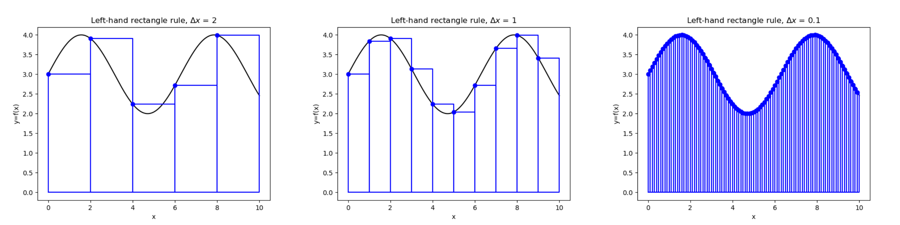
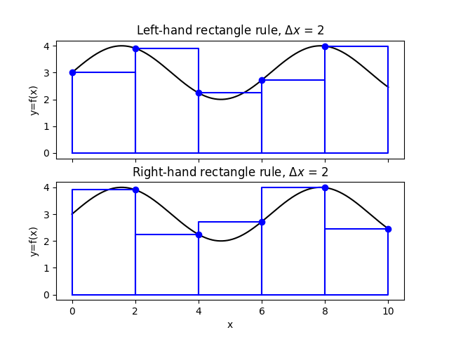
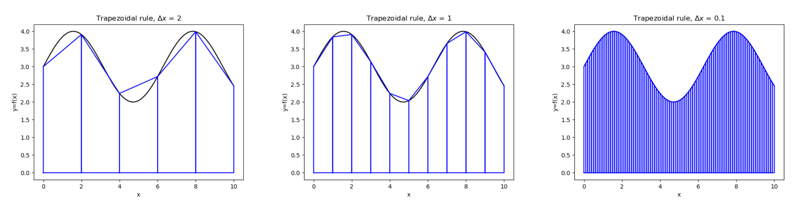

# Numerical integrals {#sec-integrals}

::: {.prep-reminder}
 The PREP for this topic: [Lesson 14 PREP: Numerical integrals]().
:::

::: {.callout-note appearance="simple"}
## Learning objectives

Throughout this chapter, you will learn to:

- Implement and identify the left-hand rectangle rule, the right-hand rectangle rule, and the trapezoidal rule, and compare their errors.
- Implement numerical integration using `trapz` and `integral`.
- Implement a given numerical quadrature scheme to compute an integral of a function or data.
- Compute the sum of selected elements in a vector using built-in commands.
:::

## Integrals as area {#sec-integrals-intro}

::: {.motivation}
There are many integrals which we cannot compute, for example,
$$\int_0^1 \sin(x^2) \, dx.$$
Though this integral looks simple, it is **impossible** to get an exact answer.
Instead, we will learn to approximate such integrals. 
:::

::: {.callout-warning}
On the computer, we can only work with **definite integrals**,
$$\int_a^b f(x)\,dx,$$
where the answer is a number. For an indefinite integral, $\int f(x)\,dx$, the answer is a function, which we cannot do in scientific computing.
:::

Methods for numerical integration are called **quadrature rules**. The setup is exactly the same as for derivatives (@sec-derivatives). We are either given a function $f(x)$, or a set of points $(x_0, y_0), (x_1, y_1), \ldots, (x_N, y_N)$, where $y_k = f(x_k)$ for some (usually unknown) function $f$.

- **With a function**, we choose a discretization with evenly spaced points, $a = x_0 < x_1 < \cdots < x_N = b$, where $x_k - x_{k-1} = \Delta x$ for all $k$. In other words, $x_k = a + k\Delta x$ for $0 \le k \le N$.
- **With data**, the spacing between points may not be the same. Evenly spaced data is very common (measurements at regular times, or on a regular grid), but not guaranteed (@sec-integrals-data).

::: {.callout-note appearance="simple"}
There are $N + 1$ points, $x_0, \ldots, x_N$, not just $N$, because we start counting at $x_0$. They split $[a, b]$ into $N$ intervals.
:::

You should get comfortable switching between these two settings. Given a
function, discretize it to get data, then integrate that data. Given data,
pretend that $y_k = f(x_k)$, and integrate that. You never use a formula for
$f$. The theory is easier to think about with a function, but real-world
applications usually come with data.

**The key idea:** the integral is the area under the curve $f(x)$ between $x = a$ and $x = b$. Chop that area into many smaller regions, calculate the area of each, and add them all up. As long as the small regions approximately cover the whole area, the sum is a good approximation of the integral. You have seen these methods in Calculus 2!

## The rectangle rules {#sec-rectangle-rules}

Chop the area under the curve into $N$ rectangles. The base of the $k$th
rectangle is the interval $[x_{k-1}, x_k]$, with width $\Delta x$. The height is
$f$ evaluated at some point in the base. The diferent rules, which give
different approximations, come from choosing *which* point to use for the
height.

### The left-hand rectangle rule (LHR) {#sec-lhr}

The **left-hand rule** (also called the left rectangle rule or left-hand
rectangle rule) uses the left endpoint, $f(x_{k-1})$ of each subinterval for the
height.

{fig-alt="Three panels showing the curve y = sin(x) + 3 from x = 0 to 10, with rectangles under it. With Delta x = 2 there are 5 wide rectangles; with Delta x = 1 there are 10; with Delta x = 0.1 there are 100 thin rectangles. Each rectangle's top left corner touches the curve, marked with a blue dot. As Delta x gets smaller, the rectangles cover the area under the curve more closely."}

The area of the $k$th rectangle is width times height, $\Delta x\, f(x_{k-1})$. Adding up all $N$ rectangles,
$$\int_a^b f(x)\,dx \approx \Delta x\, f(x_0) + \Delta x\, f(x_1) + \cdots + \Delta x\, f(x_{N-1}) = \sum_{k=0}^{N-1} \Delta x\, f(x_k) = \Delta x \sum_{k=0}^{N-1} f(x_k).$$

The left-hand rule is **first-order accurate**: its error is $O(\Delta x)$ (@sec-truncation).

### The right-hand rectangle rule (RHR) {#sec-rhr}

There was no particular reason to choose the left endpoint. The **right-hand
rule** (also called the right rectangle rule or right-hand rectangle rule) uses
the right endpoint, $f(x_k)$, of each subinterval for the height.

{fig-alt="Three panels like the left-hand rule figure, but each rectangle's top right corner touches the curve, marked with a blue dot. With Delta x = 2 there are 5 wide rectangles, with Delta x = 1 there are 10, and with Delta x = 0.1 there are 100 thin rectangles that closely cover the area under the curve."}

$$\int_a^b f(x)\,dx \approx \Delta x\, f(x_1) + \Delta x\, f(x_2) + \cdots + \Delta x\, f(x_N) = \sum_{k=1}^{N} \Delta x\, f(x_k) = \Delta x \sum_{k=1}^{N} f(x_k).$$

The formula is almost exactly the same as the left-hand rule, but the sum starts at 1 instead of 0, and goes up to $N$ instead of $N - 1$:

- The **left-hand rule** uses every $f(x_k)$ except the last, $f(x_N)$.
- The **right-hand rule** uses every $f(x_k)$ except the first, $f(x_0)$.

The right-hand rule is also **first-order accurate**: its error is $O(\Delta x)$.

### In MATLAB: `sum` {#sec-sum}

`sum(y)` adds up all the elements of the array `y`. Combined with slicing (@sec-slicing), it picks out exactly the values each rule uses:

```matlab
a = 0;
b = 10;
dx = 0.1;
x = a:dx:b;                     % N+1 points, x(1) = a, ..., x(end) = b
y = sin(x) + 3;

LHR = dx*sum(y(1:end-1))        % every value except the last
RHR = dx*sum(y(2:end))          % every value except the first
```

``` {.output}
LHR =

   31.8647

RHR =

   31.8103
```

MATLAB indices start at 1, so `y(1)` is $f(x_0)$ and `y(end)` is $f(x_N)$. The same calculation with a for loop:

```matlab
LHR = 0;                        % start at 0, then add each rectangle
for k = 1:length(x)-1
    LHR = LHR + dx*y(k);
end
```

:::: {.callout-tip collapse="true"}
## Practice: the rectangle rules

1. For the left-hand rule applied to $\int_a^b 3f(x)\,dx$ with $N$ intervals, which expressions correctly compute the approximation? Select all that apply.

   (a) $\Delta x \sum_{k=0}^{N} 3f(x_k)$ &emsp; (b) $3\Delta x \sum_{k=1}^{N} f(x_k)$ &emsp; (c) $3\Delta x \sum_{k=0}^{N-1} f(x_k)$ &emsp; (d) $\Delta x \sum_{k=0}^{N-1} f(x_k)$ &emsp; (e) $\Delta x \sum_{k=0}^{N-1} 3f(x_k)$

2. What is the order of accuracy of the LHR and the RHR?
3. Approximating $\int_0^{10} f(x)\,dx$ with $\Delta x = 2$, how many rectangles are used?

::: {.callout-caution collapse="true"}
## Answers

1. Options (c) and (e). The constant 3 can go inside or outside the sum. (a) has one rectangle too many, (b) is the right-hand rule, and (d) is missing the 3.
2. First order, $O(\Delta x)$, for both.
3. 5. The points are $x = 0, 2, 4, 6, 8, 10$: 6 points, 5 intervals.
:::
::::

## The trapezoidal rule {#sec-trapezoidal}

::: {.motivation}
The left-hand and right-hand rules make opposite mistakes. Averaging them cancels much of the error.
:::

{fig-alt="Two stacked panels comparing the left-hand rule (top) and right-hand rule (bottom) for sin(x) + 3 with Delta x = 2. Where the curve is increasing, the left-hand rectangles sit below the curve and the right-hand rectangles stick out above it. Where the curve is decreasing, it is the other way around." width="70%"}

- The **LHR under-approximates** where the function is increasing, and **over-approximates** where it is decreasing.
- The **RHR** does the exact opposite: it over-approximates where the function is increasing, and under-approximates where it is decreasing.

Averaging the LHR and the RHR gives
$$\int_a^b f(x)\,dx \approx \frac{1}{2}\left[\sum_{k=0}^{N-1} \Delta x\, f(x_k) + \sum_{k=1}^{N} \Delta x\, f(x_k)\right].$$
Most of the terms appear twice, once in each sum. The only exceptions are the $k = 0$ and $k = N$ terms, which appear once. So this simplifies to the **trapezoidal rule**:
$$\int_a^b f(x)\,dx \approx \frac{\Delta x}{2}\left[f(x_0) + 2\sum_{k=1}^{N-1} f(x_k) + f(x_N)\right].$$

The name comes from the fact that we can also derive this method by dividing the area into many small trapezoids instead of rectangles:

{fig-alt="Three panels showing the curve sin(x) + 3 with trapezoids under it. Each trapezoid's top edge is a straight line connecting the curve at the two ends of its interval. With Delta x = 2 the straight edges cut visibly across the curve; with Delta x = 1 they follow it closely; with Delta x = 0.1 they are indistinguishable from the curve."}

The trapezoidal rule is more accurate than the LHR or the RHR. It is
**second-order accurate**: its error is $O((\Delta x)^2)$.

| $\Delta x$ | LHR error | RHR error | Trapezoidal error |
|:---|:---|:---|:---|
| $0.1$ | $2.57 \times 10^{-2}$ | $2.87 \times 10^{-2}$ | $1.53 \times 10^{-3}$ |
| $0.01$ | $2.70 \times 10^{-3}$ | $2.74 \times 10^{-3}$ | $1.53 \times 10^{-5}$ |
| $0.001$ | $2.72 \times 10^{-4}$ | $2.72 \times 10^{-4}$ | $1.53 \times 10^{-7}$ |

: Errors for $\int_0^{10} (\sin(x) + 3)\,dx = 31 - \cos(10)$. When $\Delta x$ decreases by a factor of 10, the LHR and RHR errors decrease by a factor of 10 (first order), and the trapezoidal error by a factor of 100 (second order). {#tbl-quadrature-errors}

### In MATLAB: `trapz` {#sec-trapz}

The trapezoidal rule is so efficient and common that MATLAB has it built in: `trapz(x, y)`, with arrays of $x$ and $y$ values.

<!-- NEW: the PREP names the last variable `error`, which hides MATLAB's built-in `error` function. -->

```matlab
a = 0;
b = 10;
dx = 0.1;
x = a:dx:b;
y = sin(x) + 3;

trap = trapz(x, y)

exact = 31 - cos(10)            % we know the exact answer here
err = abs(trap - exact)
```

``` {.output}
trap =

   31.8375

exact =

   31.8391

err =

    0.0015
```

You can also code the formula yourself with `sum` and slicing: `dx/2*(y(1) + 2*sum(y(2:end-1)) + y(end))`.

::: {.callout-warning}
## Common mistakes with `trapz`

- `trapz(y, x)`: the order matters. The $x$ values come first.
- `trapz(f, a, b)`: `trapz` takes arrays of data, not a function. For a function, discretize it first, or use `integral` (@sec-integral-builtin).
:::

## Built-in integration: `integral` {#sec-integral-builtin}

`integral(f, a, b)` approximates $\int_a^b f(x)\,dx$ for a function handle `f` (@sec-anonymous-functions). It uses a fancy **adaptive quadrature** rule: it chooses the points itself, using more of them where the function is harder to integrate, until the answer is very accurate.

```matlab
f = @(x) sin(x) + 3;
integral(f, 0, 10)
```

``` {.output}
ans =

   31.8391
```

`integral` evaluates `f` on arrays of points, so `f` must use element-wise operations: `.*`, `./`, and `.^` (@sec-plot-handle).

| Tool | Input | Use it for |
|:---|:---|:---|
| `trapz(x, y)` | Arrays of data | Data, or a function you have discretized |
| `integral(f, a, b)` | A function handle and limits | A function, when you want a very accurate answer |

: Built-in integration in MATLAB.

::::: {.exercise}
### Exercise: Quadrature rules for a function {#sec-ex-quadrature-function}

**Lesson files:** [Lesson_14_Numerical_Integrals_Functions.m (starter)](../files/Lesson_14_Numerical_Integrals_Functions.m) · [Lesson_14_Numerical_Integrals_Functions.m (completed)](../files/Lesson_14_Numerical_Integrals_Functions_Completed.m)

**Learning outcomes.** This exercise should help you to:

- Implement and identify the left-hand rectangle rule, the right-hand rectangle rule, and the trapezoidal rule, and compare their errors.
- Implement numerical integration using `trapz` and `integral`.
- Implement a given numerical quadrature scheme to compute an integral of a function or data.
- Compute the sum of selected elements in a vector using built-in commands.

:::: {.callout-note collapse="true" appearance="simple"}
## Full exercise

We will practice computing
$$\int_0^1 \sin(x^2)\,dx.$$
This integral has no closed-form solution, so it cannot be computed exactly. Instead, we approximate it with the quadrature rules: the left-hand rule (@sec-lhr), the right-hand rule (@sec-rhr), and the trapezoidal rule (@sec-trapezoidal).

- **Task 1:** Define the variables we need: `a`, the lower limit of the integral; `b`, the upper limit; and `f`, a function handle for the integrand.
- **Task 2:** Discretize $f(x) = \sin(x^2)$ on $[0, 1]$ using equal grid spacing $\Delta x = 10^{-3}$.
- **Task 3:** Approximate the integral using the left-hand rule. Try using a for loop, and array arithmetic with `sum`, for practice. You should get the same result each time.
- **Task 4:** Repeat Task 3 using the right-hand rule.
- **Task 5:** Approximate the integral using the trapezoidal rule, three ways. They should all give the same result.
  - Average the left-hand and right-hand rule calculations.
  - Apply the trapezoidal rule formula.
  - Use `trapz`.
- **Task 6:** Use `integral` to compute the integral.

::: {.callout-tip collapse="true" appearance="simple"}
## Takeaways and common mistakes

**Key takeaways**

- `f = @(x) sin(x.^2);` (with the dot, so it works on arrays), `x = a:dx:b;`, and `y = f(x);`.
- Left-hand rule: `dx*sum(y(1:end-1))`. Right-hand rule: `dx*sum(y(2:end))`.
- Trapezoidal rule: `(LHR + RHR)/2`, `dx/2*(y(1) + 2*sum(y(2:end-1)) + y(end))`, and `trapz(x, y)` all agree.
- To check your work: `integral(f, 0, 1)` gives `0.3103`. With $\Delta x = 10^{-3}$, the left-hand and right-hand rules are off by about $4 \times 10^{-4}$, and the trapezoidal rule by about $10^{-7}$.

**Common mistakes**

- `sin(x^2)` instead of `sin(x.^2)` (@sec-plot-handle).
- Summing all of `y` for the left-hand or right-hand rule. Each rule leaves out one endpoint.
- `dx/2*(y(1) + 2*sum(y) + y(end))`: the middle sum must leave out both endpoints, `y(2:end-1)`.
:::
::::
:::::

## Integrals of data {#sec-integrals-data}

Numerical integrals of data are exactly the same as numerical integrals of functions, since we compute those by discretizing first. But when the data is not equally spaced, we can't use a constant $\Delta x$: the width of each rectangle is the distance between neighboring points, $x_{k+1} - x_k$.

| Rule | Unequally spaced data |
|:---|:---|
| Left-hand rule | $\displaystyle \int_a^b f(x)\,dx \approx \sum_{k=0}^{N-1} f(x_k)\,(x_{k+1} - x_k)$ |
| Right-hand rule | $\displaystyle \int_a^b f(x)\,dx \approx \sum_{k=0}^{N-1} f(x_{k+1})\,(x_{k+1} - x_k)$ |
| Trapezoidal rule | $\displaystyle \int_a^b f(x)\,dx \approx \sum_{k=0}^{N-1} \frac{f(x_k) + f(x_{k+1})}{2}\,(x_{k+1} - x_k)$ |

: The quadrature rules for data that may not be equally spaced. {#tbl-quadrature-data}

$x_{k+1} - x_k$ takes the place of $\Delta x$. When the data is equally spaced, these are exactly the formulas above.

Here are a car's velocities, measured at uneven times, like the positions in @tbl-car-uneven:

| Time $t$ (seconds) | 1 | 2 | 4 | 4.5 | 6 |
|---|---|---|---|---|---|
| Velocity $v(t)$ (meters per second) | 4 | 3 | −1 | 2 | 6 |

: Velocity of a car, measured at uneven times. {#tbl-car-velocity}

The integral of velocity is the change in position. With the left-hand rule:

```matlab
t = [1, 2, 4, 4.5, 6];          % time (seconds)
v = [4, 3, -1, 2, 6];           % velocity (meters per second)

displacement = 0;               % start at 0, then add each rectangle
for k = 1:length(t)-1
    displacement = displacement + v(k)*(t(k+1) - t(k));
end
disp(displacement)
```

``` {.output}
   12.5000
```

With slicing and `sum`, the loop is one line. The widths are an array now, so multiply with `.*` (@sec-array-math):

```matlab
LHR = sum(v(1:end-1).*(t(2:end) - t(1:end-1)))
```

`trapz(t, v)` handles unequal spacing automatically, and gives `11.7500`.

<!-- NEW: the PREP calls this "total distance traveled". -->
::: {.callout-note appearance="simple"}
The car's velocity is negative at $t = 4$: it is moving backward. So the integral of velocity is the car's **displacement** (its change in position), not the total distance it traveled. For the total distance, integrate the speed, `abs(v)`.
:::

:::: {.callout-tip collapse="true"}
## Practice: integrals of data

1. Which of these correctly calculate the right-hand rule with unequally spaced data? Select all that apply.

   (a) $\sum_{k=0}^{N-1} f(x_k)\,(x_{k+1} - x_k)$ &emsp; (b) $\sum_{k=1}^{N} f(x_k)\,(x_k - x_{k-1})$ &emsp; (c) $\sum_{k=0}^{N-1} f(x_{k+1})\,(x_{k+1} - x_k)$ &emsp; (d) $\sum_{k=1}^{N} f(x_{k-1})\,(x_k - x_{k-1})$

2. By hand, approximate the integral of the velocity data in @tbl-car-velocity with the right-hand rule.

::: {.callout-caution collapse="true"}
## Answers

1. Options (b) and (c). They are the same sum, with the index shifted by one. (a) and (d) are the left-hand rule.
2. Each rectangle uses the velocity at the *right* end of its interval:
   $$3(2 - 1) + (-1)(4 - 2) + 2(4.5 - 4) + 6(6 - 4.5) = 3 - 2 + 1 + 9 = 11 \text{ meters}.$$
:::
::::

::::: {.exercise}
### Exercise: Integrating the NEA discovery rate {#sec-ex-nea-integral}

**Lesson files:** [Lesson_14_NEA_Integral.m (starter)](../files/Lesson_14_NEA_Integral.m) · [Lesson_14_NEA_Integral.m (completed)](../files/Lesson_14_NEA_Integral_Completed.m) · [Asteroid_Data.csv](../files/Asteroid_Data.csv)

**Learning outcomes.** This exercise should help you to:

- Implement a given numerical quadrature scheme to compute an integral of a function or data.
- Compute the sum of selected elements in a vector using built-in commands.

:::: {.callout-note collapse="true" appearance="simple"}
## Full exercise

We will practice the quadrature rules with data, using the near-Earth asteroid dataset (@sec-loading-data). We start with the code that computes the NEA derivatives (@sec-ex-nea). Then we integrate the derivative and hope to recover the original data.

Let $N(t)$ be the cumulative NEA count as a function of months. In the previous exercise, we computed $N'(t)$, the number of NEAs discovered per month. Now we want to compute
$$\int_{\text{month } 0}^{\text{last month}} N'(t)\,dt.$$
What do you expect the answer to be?

- **Task:** Use `sum` and array arithmetic to implement the left-hand rule to approximate the integral above. Then compare to the original $N(t)$ data. What do you find?

<!-- TODO: check these takeaways against Lesson_14_NEA_Integral_Completed.m. -->
::: {.callout-tip collapse="true" appearance="simple"}
## Takeaways and common mistakes

**Key takeaways**

- The data is unequally spaced, so each rectangle's width is `t(2:end) - t(1:end-1)`: `sum(NEA_rate.*(t(2:end) - t(1:end-1)))`.
- The integral of a rate is the total change: $\int N'(t)\,dt = N(\text{last}) - N(\text{first})$, the number of NEAs discovered over the whole time period.
- Here the left-hand rule recovers it exactly (up to round-off error). Each rectangle's area is `NEA_rate(k)*(t(k+1) - t(k))`, which is exactly `nea(k+1) - nea(k)`, so the sum collapses to `nea(end) - nea(1)`.
- The file lists the newest date first (@sec-ex-nea), so `nea(end) - nea(1)` is the *oldest* count minus the *newest*: the answer comes out negative.

**Common mistakes**

- `*` instead of `.*` between the rates and the widths.
- Multiplying by a single `dx`: the data is not equally spaced.
- Mismatched lengths: `NEA_rate` has one fewer element than `t`, and so does `t(2:end) - t(1:end-1)`.
:::
::::
:::::

## Optional: Simpson's rule {#sec-simpson}

On the homework, you will implement **Simpson's rule**. It is more accurate than the LHR, the RHR, and the trapezoidal rule, and also harder to implement. You don't need to know where it comes from, but here is the idea, for anyone interested.

The other rules can be thought of as **interpolating** the function over each interval, then integrating the interpolant by hand:

- The LHR and RHR use a degree-0 interpolant: a constant.
- The trapezoidal rule uses a degree-1 interpolant: a line.

This works because it is easy to integrate a constant or a line. The next reasonable thing is to interpolate with a quadratic function. That's exactly what Simpson's rule does, over pairs of intervals.

<!-- NEW: the PREP text says f(x) = sin(2x + 3), but the code plots sin(2x) + 3. -->
![Simpson's rule for $f(x) = \sin(2x) + 3$ on $[0, 10]$ with $\Delta x = 1$.](../figures/integral_simpsons.png){fig-alt="The curve f(x) = sin(2x) + 3 in black, from x = 0 to 10, oscillating between 2 and 4. Blue quadratic arcs, each spanning two intervals (0 to 2, 2 to 4, and so on), approximate the curve, with vertical blue lines marking where each arc starts and ends. The arcs follow the black curve closely, but not exactly." width="70%"}

::: {.callout-note collapse="true"}
## Code for the figure

Try changing `wave_number` to see how the plot changes as the function gets more or less wiggly.

```matlab
function plot_simpsons(f, a, b, dx)
    x = a:dx:b;
    y = f(x);
    n = length(x);

    xplot = a:dx/100:b;
    yplot = f(xplot);
    fig1 = figure(1);
    hold on;
    plot(xplot, yplot, 'k');

    for k = 1:2:n-2
        x_interp = x(k:k+2);
        y_interp = y(k:k+2);
        quad_interp = polyfit(x_interp, y_interp, 2);
        xinterp_plot = linspace(x_interp(1), x_interp(end));
        yvals = polyval(quad_interp, xinterp_plot);
        plot(xinterp_plot, yvals, 'b');
        plot([x(k), x(k)], [0, yvals(1)], 'b');
        plot([x(k), x(k+2)], [0, 0], 'b');
    end

    plot([x(k+2), x(k+2)], [0, yvals(end)], 'b');
    hold off;
end

a = 0;
b = 10;
dx = 1;
wave_number = 2;                % <- TRY CHANGING THIS!
f = @(x) sin(wave_number*x) + 3;
plot_simpsons(f, a, b, dx);
```
:::

::: {.checkpoint}
 covers up through here.
:::