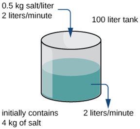
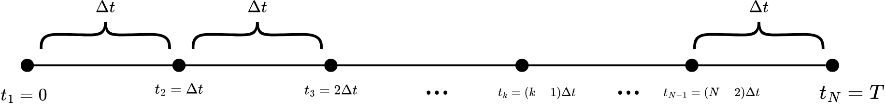
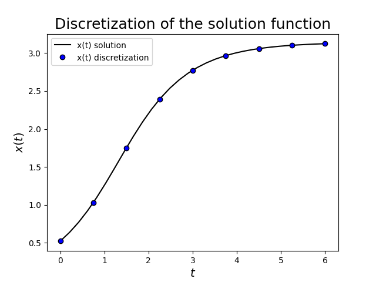
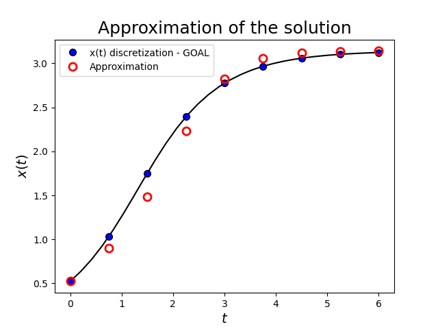
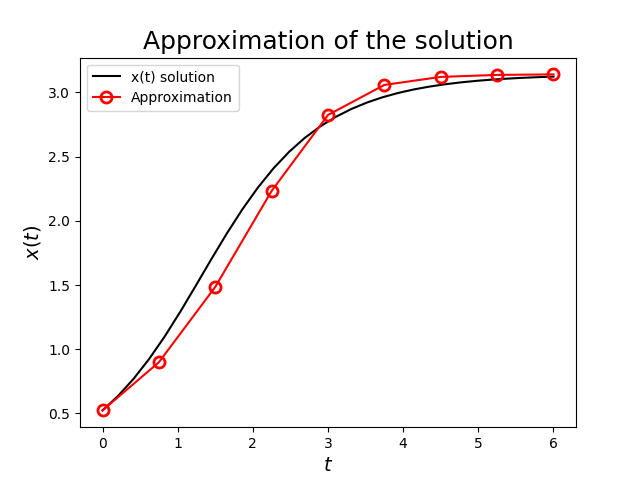
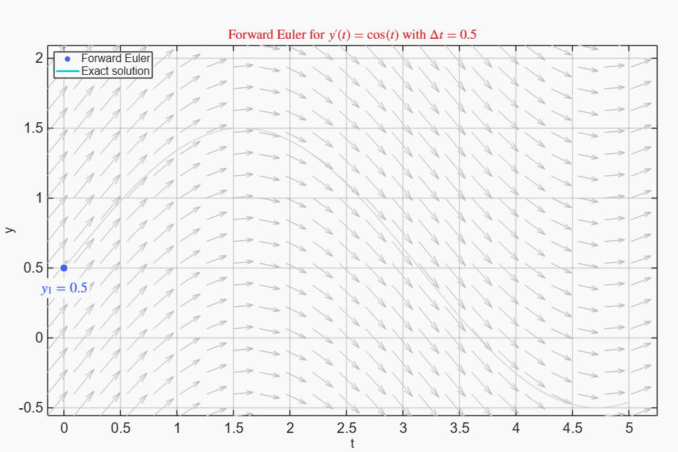
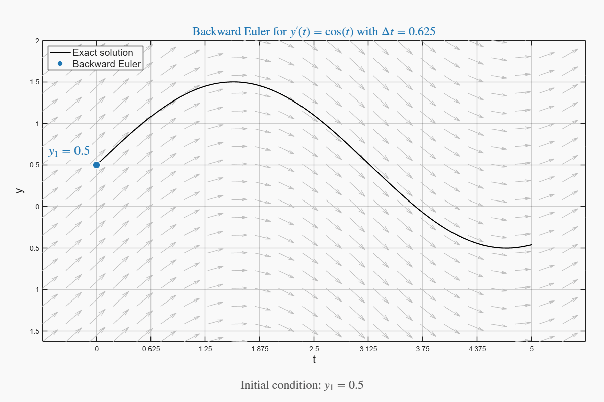
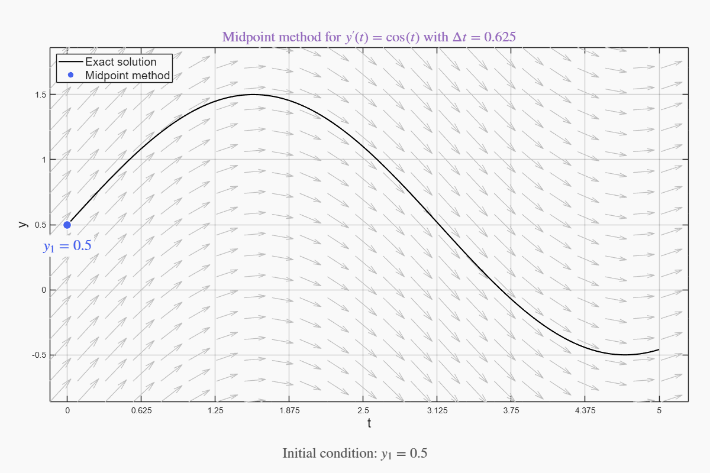
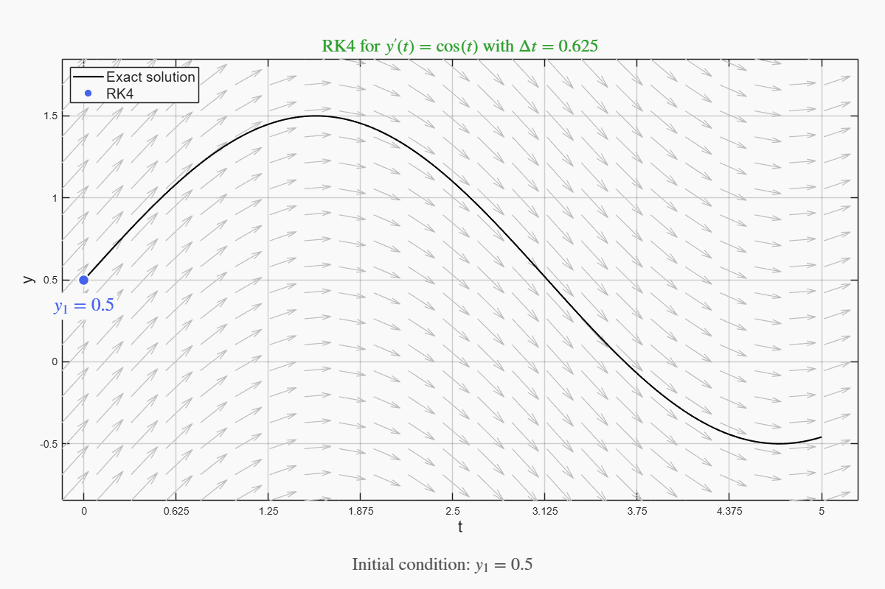
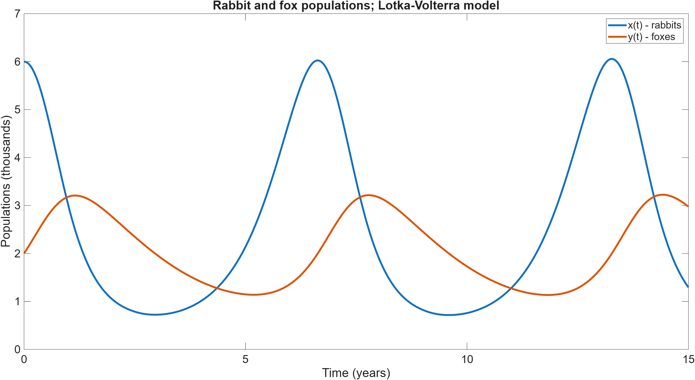

# Differential Equations and Initial Value Problems (IVPs) {#sec-ivps}

::: {.prep-reminder}
 The PREPs for this topic: [Lesson 15 PREP: Introduction to IVPs and forward Euler](), [Lesson 16 PREP: Backward Euler and order of accuracy for the Euler methods](), and [Lesson 17 PREP: `ode45` and systems of IVPs]().
:::

::: {.callout-note appearance="simple"}
## Learning objectives

Throughout this chapter, you will learn to:

- Recognize and rearrange differential equations and IVPs into a solvable form.
- Implement and identify the forward and backward Euler methods for scalar ODEs, and recognize that both are first-order accurate.
- Recognize that numerical IVP solutions are approximations of a discretization of the true solution.
- Recognize implicit methods and identify them as the appropriate choice for stiff ODEs.
- Use `ode45` to find approximate solutions to IVPs, including systems of IVPs.
:::

## Why do we study differential equations {#sec-why-ivps}

::: {.motivation}
Differential equations model anything that changes, in time or in space:
populations, temperatures, chemical reactions, the motion of a rocket. They are
the language most of science and engineering is written in, and learning to
solve them numerically opens the door to almost every application area.

- Self-driving cars use differential equations to model their own dynamics and
plan trajectories.
- Drug dosing schedules come from solving differential equations that describe
how your body absorbs and clears a compound.
- SpaceX lands rockets by solving an optimal control problem built on
differential equations, in real time, on the rocket.
- Even modern machine learning is built on top of differential equations: the
optimization algorithms that give us LLMs can be understood as discretizations
of ODEs, as we'll see in the last few weeks of class!

Some examples of differential equation simulations in action are given below

::: {.callout-note appearance="simple"}
**Watch:** [a simulation of a tsunami in Puget Sound after a magnitude 9.0 Cascadia earthquake](https://faculty.washington.edu/rjl/tsunamis/CSZ/_plots_f1p1s1/movieframe_allframesfig0.html), created by the UW Tsunami Modeling Group (AMATH professors Loyce Adams and Randy LeVeque, with Frank Gonzalez of UW Earth and Space Sciences). Click the play button on that page.
:::

::: {.callout-note collapse="true"}
## More simulations to watch

**Hair simulation at Pixar.** Pause this video at 0:48... you'll see some things that should look really familiar!



**Computational fluid dynamics: vortices on an airplane.**



**Vortices** (a 2D Navier–Stokes simulation).



**A drum head** (the wave equation).



**Heat moving across a plate** (for example, as a spacecraft descends back to Earth).


:::


**Every math class you've taken up to now is to prepare you to work with
differential equations. Let's get to it.**

:::

::: {.callout-note collapse="true"}
## But what about data science? I thought everything is data science?

Data science and machine learning are used when you already have data: the
machine *learns* from something. But what happens when you don't have any data
to rely on? A magnitude 9.0 earthquake on the Cascadia Subduction Zone, "the big
one" that seismologists expect in our lifetime, would send a tsunami into Puget
Sound. That has never happened in recorded history, so there's no dataset for a
machine to learn from. The only way to know what that wave will look like is to
simulate it from physical laws, and those laws are **differential equations**.
:::

## Differential equations {#sec-differential-equations}
Let's start with a simple definition. 

A **differential equation** is an equation that involves derivatives of one or
 more unknown functions (or dependent variables) with respect to one or more
 independent variables. For example, $$x'(t) = \cos(t)$$ is a differential
 equation. 

We won't do significant analysis of differential equations, but we need to be
able to identify them and get them in the right form.

| Differential equations | Not differential equations |
|:---|:---|
| $y'(x) = x$ | $-z(x) + x = 0$: there is no derivative |
| $y'(x) = y$ | $y'(x) + 3$: it is not an equation |
| $\dfrac{dy}{dx} + 5y = e^x$ | $y(x) = \int \sin(y(x))\,dx$: there is no derivative |
| $\dfrac{d^2y}{dx^2} - \dfrac{dy}{dx} + 6y = 0$ | |
| $\dfrac{dx}{dt} + \dfrac{dy}{dt} = 2x + y$ | |
| $y'(x) + z'(x) = 4$, &ensp; $z'(x) - \sin(y(x)) = 0$ | |

: Examples of differential equations, and of things that are not.


### Solutions are functions {#sec-de-solutions}

Because a differential equation is an equation, there must be some solution.

- **Solutions of algebraic equations are numbers.** $x^2 + 5x + 6 = 0$ has two solutions, $x = -3$ and $x = -2$. Check by plugging them in: $(-3)^2 + 5(-3) + 6 = 0$ and $(-2)^2 + 5(-2) + 6 = 0$.
- **Solutions of differential equations are functions.** $y = e^{2x}$ is a solution of $y' - 2y = 0$: plugging it in, $\dfrac{d}{dx}(e^{2x}) - 2e^{2x} = 2e^{2x} - 2e^{2x} = 0$.

That's not the kind of solution we will find in this class, because it is symbolic: we only do numbers and graphs. Our solutions will be **discretizations of the solution function** (an array), or graphs of them.

::: {.callout-note collapse="true"}
## Do you remember separable equations from Calculus 2?

Don't worry: we won't be solving differential equations by hand. But you have solved them in Calculus 2. Here's a reminder:

$$\frac{dA}{dt} = -3A$$
represents radioactive decay: the rate of change of the substance is directly proportional to the amount remaining. If there are 300 kg of a radioactive substance, we lose more of it in 1 hour than we would if there were 1 g.

To solve it, you separated variables and integrated,
$$\int \frac{dA}{A} = \int -3\,dt \quad \Longrightarrow \quad \ln|A| = -3t + c,$$
then solved for $A$: $A = Ke^{-3t}$.
:::

:::: {.callout-tip collapse="true"}
## Practice: recognizing differential equations

1. Which of these are differential equations? Select all that apply.

   (a) $x'(t) = 0$ &emsp; (b) $x(t) = 3t^2 + 2$ &emsp; (c) $y(t) = e^{-t}(t + 1)$ &emsp; (d) $y' + y = t$

2. Which of these is the solution of a differential equation: a function, a list of numbers, a circle, or one number?

::: {.callout-caution collapse="true"}
## Answers

1. Options (a) and (d). (b) and (c) have no derivative.
2. A function.
:::
::::

## Initial value problems {#sec-ivp-definition}

::: {.callout-important appearance="simple"}
An **initial value problem (IVP)** is a differential equation plus the value of
the unknown function at some particular time, usually $t = 0$ (the initial
time).
:::
For example, 
 $$x'(t) = \cos(t), \qquad x(0) = 3$$
 is an IVP. The solution is $x(t) = \sin(t) + 3$ because $x'(t) = \cos(t)$ and
 $x(0) = \sin(0) + 3 = 3.$

Despite the name, the information doesn't need to be at the initial time. In
this class it will usually be at $t = 0$, but it could be at $t = 1$, $t = -4$,
or any other time; the initial time just marks when we start modeling.

::: {.callout-note collapse="true"}
## A mixing problem, like you saw in Calculus 2

Again, this is here to jog your memory. We won't be setting up or solving IVPs
like this. For those interested in biology, chemistry, or medicine: this is
exactly how drug concentration in the body is modeled for drug development!

{fig-alt="Diagram of a 100 liter
tank, initially containing 4 kg of salt. A brine solution with 0.5 kg of salt
per liter flows in at the top at 2 liters per minute, and solution flows out of
the bottom at 2 liters per minute." width="45%"}

A tank contains 100 L of a brine solution that initially has 4 kg of salt
dissolved in it. At time $t = 0$, another brine solution with 0.5 kg/L of salt
flows into the tank at 2 L/min. At the same time, a hole at the bottom of the
tank is opened, letting the solution flow out at 2 L/min, so the level of liquid
in the tank stays constant. Find the amount of salt in the tank as a function of
time (in minutes), assuming the tank is well mixed at all times.

Let $S(t)$ be the amount of salt in the tank, in kg. The tank starts with 4 kg
of salt, so $S(0) = 4$. The salt changes according to $$\frac{dS}{dt} =
\text{rate of salt coming in} - \text{rate of salt going out}.$$

- Rate of salt in: $0.5\ \frac{\text{kg}}{\text{L}} \cdot 2\ \frac{\text{L}}{\text{min}} = 1\ \frac{\text{kg}}{\text{min}}$.
- Rate of salt out is proportional to the concentration in the tank: $\frac{S(t)}{100}\ \frac{\text{kg}}{\text{L}} \cdot 2\ \frac{\text{L}}{\text{min}} = \frac{S(t)}{50}\ \frac{\text{kg}}{\text{min}}$.

All together, the IVP is
$$\frac{dS}{dt} = 1 - \frac{S}{50}, \qquad S(0) = 4.$$
:::

::: {.callout-note collapse="true"}
## More real-world IVPs

- **Population growth with a carrying capacity.** Populations may grow at first, but as resources become sparse, growth slows down: $\dfrac{dP}{dt} = rP\left(1 - \dfrac{P}{K}\right)$, $P(0) = \alpha$. $P(t)$ is the population, $r$ the growth rate, $K$ the carrying capacity, and $\alpha$ the initial population.
- **Communicable diseases** spread when sick people come into contact with healthy people: $x'(t) = kx(n - x)$, $x(0) = \alpha$. $x(t)$ is the number of sick people, $n$ the total population, $k$ the rate at which the illness spreads, and $\alpha$ the number of sick people at the start.
- **An RLC circuit** (an inductor $L$, a resistor $R$, and a capacitor $C$): $Lq''(t) + Rq'(t) + \dfrac{q(t)}{C} = E(t)$, $q(0) = \alpha$, $q'(0) = \beta$. $q(t)$ is the charge on the capacitor, $E(t)$ the impressed voltage, and $\alpha$ and $\beta$ the initial charge and current.
- **Drug concentration in the bloodstream:** $\dfrac{dC}{dt} = -k_e C + D(t)$, $C(0) = \alpha$. $k_e$ is the elimination rate (the kidneys and liver filtering out the drug), and $D(t)$ is the dosing schedule: it spikes when the drug is given.
- **A rocket during powered descent:** $\dfrac{dv}{dt} = -g + \dfrac{T(t)}{m(t)} - \dfrac{c}{m(t)}v^2$, $v(0) = 0$. $v$ is the downward velocity, $g$ the gravitational acceleration, $T(t)$ the (controlled) thrust from the engines, $m(t)$ the mass (which changes as fuel burns), and $c$ the drag coefficient.
:::

::: {.callout-note collapse="true"}
## Why split up differential equations and initial value problems? 

There are other kinds of conditions we can add to a differential equation
(called *side conditions*), and adding information a different way changes the
solution method entirely. If you're interested, look into **boundary value
problems**. They are very common in some areas of engineering!
:::

:::: {.callout-tip collapse="true"}
## Practice: recognizing IVPs

Which of these are IVPs? Select all that apply.

(a) $A'(t) = -3A(0) + t$ &emsp; (b) $A(0) = 9$ &emsp; (c) $3 + y(t) = \sin(t)$, $y(0) = 3$ &emsp; (d) $3y'(t) + 9t - 4 = 0$, $y(0) = 4$

::: {.callout-caution collapse="true"}
## Answer

Only (d). (a) is a differential equation, but no value of $A$ is given. (b) is a value with no differential equation. (c) has no derivative.
:::
::::

## Numerical solutions of IVPs {#sec-numerical-ivp}

The general form of the IVPs we will solve is
$$x'(t) = f(t, x(t)), \qquad x(0) = \alpha.$$
Here $f(t, x)$ is a function, and $\alpha$ is a number: the initial value.

::: {.callout-note appearance="simple"}
If you haven't seen functions of two variables like $f(t, x)$, they work by
plugging in values for each of the unknowns.  For example, if $f(t, x) = \sin(t)
+ x$, then $f(3, 4) = \sin(3) + 4$ and $f(t_k, x_k) = \sin(t_k) + x_k$.
:::

The solution is a function, $x(t)$. Our goal is a discretization of that function. It should be no surprise at this point that we won't find the exact discretization; we will find an **approximation** of it.

**The setup.** Discretize $t$, the independent variable. The discretization
starts at $t = 0$, because we know $x(0) = \alpha$, and ends at a final time $t
= T$ (usually given to you). We get to choose the discretization, so we'll make
life easy by choosing evenly space points: `t = linspace(0, T, N)` or $t =
0:dt:T$, so that $t_{k+1} - t_k = \Delta t$ for every $k$, and $t_k = (k -
1)\Delta t$.

{fig-alt="A number line with evenly spaced dots labeled t1 = 0, t2 = Delta t, t3 = 2 Delta t, and so on, through t_k = (k - 1) Delta t, up to t_N = T. Braces above neighboring dots mark each gap as Delta t."}

We want the correct value of $x$ at each of those times, $x(t_1), x(t_2),
\ldots, x(t_N)$. Knowing we will always have some error, we find
**approximations** $x_1, x_2, \ldots, x_N$, with $x_k \approx x(t_k)$.

- $x_1 = x(t_1) = \alpha$ is not actually an approximation: it's the initial condition, which we are given, so it is exact.
- Every other $x_k$ is only approximately correct.

::: {.panel-tabset}
#### The solution

{fig-alt="Plot titled 'Discretization of the solution function'. A black S-shaped curve x(t) rises from 0.5 at t = 0 to about 3.1 at t = 6, with blue dots on the curve at evenly spaced times."}

The black curve is the true solution, $x(t)$. The blue dots are its discretization, $x(t_k)$: what we would like to find.

#### The approximation

{fig-alt="Plot titled 'Approximation of the solution'. Blue dots mark the discretization of the solution (the goal). Red circles mark the approximation. At t = 0 the red circle and the blue dot are in the same place. At later times the red circles are near the blue dots, but not on them."}

The red circles are our approximation, $x_k$. It is exact at $t = 0$, because that's the only place we know the solution exactly: $x(0) = \alpha$.

#### Connecting the dots

{fig-alt="The same approximation, with the red circles connected by straight red lines, next to the black solution curve. The red lines follow the curve's general shape, with visible corners at each circle."}

To make the solution look more like a function, MATLAB can fill in between the dots. But it's only interpolating by drawing a line between the points. It doesn't really know what's happening in between!
:::

:::: {.callout-tip collapse="true"}
## Practice: numerical solutions of IVPs

Which of these is most true about numerical solutions of IVPs?

(a) They are numbers found by evaluating the solution of an IVP. 

(b) They are the discretization of the solution of the IVP. 

(c) They are approximations of the function that solves the IVP. 

(d) They are approximations of the discretization of the solution of an IVP.

::: {.callout-caution collapse="true"}
## Answer

(d). We can't find the discretization exactly; we find an approximation of it.
:::
::::

## The forward Euler method {#sec-forward-euler}

### Deriving the forward Euler method {#sec-forward-euler-derivation}

We derive the first method for solving IVPs using a particular IVP, then go to the general form. Consider
$$x'(t) = \sin(x(t)), \qquad x(0) = \alpha.$$
(This is the IVP plotted above, with $\alpha = 0.5$.) The problem is the $x'(t)$, so approximate it with the first-order forward difference (@sec-fd-formulas):
$$x'(t) \approx \frac{x(t + \Delta t) - x(t)}{\Delta t} \quad \Longrightarrow \quad \frac{x(t + \Delta t) - x(t)}{\Delta t} \approx \sin(x(t)).$$
This is valid for any time; in particular, at $t = t_1 = 0$. Since $t_2 = \Delta t$ and $x(t_1) = \alpha$ exactly,
$$\frac{x(t_2) - \alpha}{\Delta t} \approx \sin(\alpha) \quad \Longrightarrow \quad x(t_2) \approx \alpha + \Delta t \sin(\alpha).$$
This isn't the actual $x(t_2)$, but if $\Delta t$ is small, it should be a good approximation. So we take it as our definition of $x_2$: 
$$x_2 = x_1 + \Delta t \sin(x_1).$$
We know everything on the right-hand side: $x_1 = \alpha$ is given, and we chose $\Delta t$. This is an **explicit** formula: it is already solved for $x_2$ in terms of things we know.

Repeat the process at $t_2$ to find $x_3 = x_2 + \Delta t \sin(x_2)$, and so on:
$$x_{k+1} = x_k + \Delta t \sin(x_k), \qquad k = 1, 2, \ldots, N - 1.$$

We used a particular ODE here, but in general $x'(t) = f(t, x(t))$:

::: {.callout-important}
## The forward Euler method (explicit Euler method)

$$x_{k+1} = x_k + \Delta t\, f(t_k, x_k), \qquad x_1 = \alpha.$$
:::

**In words:** calculate the slope at $(t_k, x_k)$, follow that slope for a step of $\Delta t$, and $x_{k+1}$ is the value at the end of that step.

### Visualizing forward Euler {#sec-forward-euler-visual}

The animation below shows the forward Euler solution of 
$$y'(t) = \cos(t), \qquad y(0) = 0.5, \qquad t \in [0, 5]$$
with $\Delta t = 0.5.$ 

::: {.callout-note collapse="true"}
## Animation: forward Euler

- The gray arrows show the slope of the solution, $y'(t) = \cos(t)$.
- The cyan curve is the true solution, traced out through time: the "continuous version" (i.e, $\Delta t \to 0$).
- The forward Euler solution is shown step by step alongside: the blue dots are
the "discrete version," with a slope calculated at every time step. Lines are
drawn between the dots to make a curve.

{fig-alt="Animation on a grid of gray slope arrows for y' = cos(t), for t from 0 to 5. Starting from the point y = 0.5 at t = 0, a cyan curve traces out the exact solution, which rises to about 1.5, then falls. Alongside it, the forward Euler solution steps forward 0.5 at a time: at each blue dot, it follows the slope there in a straight line to the next dot. The blue dots stay close to the cyan curve but drift away from it."}


::: {.callout-warning appearance="simple"}
**Common misconception:** the curve here is $y(t) = \cos(t)$. **No!** The curve
is the function $y(t)$ such that $y'(t) = \cos(t)$ and $y(0) = 0.5$, i.e. y(t) =
\sin(t) + 0.5.
:::
:::

### Setting up $f(t, x)$ {#sec-ivp-setup}

::: {.callout-warning}
## Rearrange first!

$x'(t) = f(t, x)$ doesn't mean that whatever is on the right side of your equation is $f(t, x)$. Rearrange the ODE to get $x'(t)$ alone on the left-hand side. Everything else is $f(t, x)$.
:::

For example, if
$$2x'(t) + \sin(3t) = x(t) + 4,$$
rearrange to get
$$x'(t) = \frac{1}{2}\left(x(t) + 4 - \sin(3t)\right),$$
and identify
$$f(t, x) = \frac{1}{2}\left(x + 4 - \sin(3t)\right).$$

In MATLAB, $f$ is an anonymous function of two inputs, in the order `(t, x)` (@sec-anonymous-functions):

```matlab
f = @(t, x) (x + 4 - sin(3*t))/2;
```

:::: {.callout-tip collapse="true"}
## Practice: the forward Euler method

1. Which of these is the explicit Euler method for $x'(t) = f(t, x)$?

   (a) $x_k = x_k + \Delta t\, f(t_k, x_k)$ 
   
   (b) $\dfrac{x_{k+1} - x_k}{\Delta x} = f(t_k, x_k)$ 
   
   (c) $x_{k+1} = x_k + \Delta t\, f(t_k, x_k)$ 
   
   (d) $x_{k+1} = x_k + \Delta t\, f(t_{k+1}, x_{k+1})$ 
   
   (e) $x_{k+1} = x_k + \Delta x\, f(t_k, x_k)$

2. Rewrite $t^2 x' + 3tx = \sin(t)$ in the form $x'(t) = f(t, x)$, and identify
$f(t, x)$. This is a critical step for solving IVPs numerically!

::: {.callout-caution collapse="true"}
## Answers

1. (c). (d) is the backward Euler method (@sec-backward-euler).
2. $f(t, x) = \dfrac{\sin(t) - 3tx}{t^2}$: subtract $3tx$ from both sides, then divide by $t^2$.
:::
::::

### Coding forward Euler

Forward Euler fills in an array one element at a time, using the element before
it. This is very similar to the rabbit population loop (@sec-for-loops). $x_k$
is `x(k)`, and $t_k$ is `t(k)`:

```matlab
f = @(t, x) sin(x);             % the ODE: x'(t) = f(t, x)
T = 6;                          % final time
N = 61;                         % number of times
t = linspace(0, T, N);          % the discretization of t
dt = t(2) - t(1);               % time step: 0.1

x = zeros(1, N);                % predefine the solution array
x(1) = 0.5;                     % the initial condition (exact)

for k = 1:N-1
    x(k+1) = x(k) + dt*f(t(k), x(k));
end

plot(t, x)
```

::::: {.exercise}
### Exercise: Solve a viral-load IVP {#sec-ex-viral}

**Lesson files:** [Lesson_15_Forward_Euler_Viral.m (starter)](../files/Lesson_15_Forward_Euler_Viral.m) · [Lesson_15_Forward_Euler_Viral.m (completed)](../files/Lesson_15_Forward_Euler_Viral_Completed.m)

**Learning outcomes.** This exercise should help you to:

- Recognize and rearrange differential equations and IVPs into a solvable form.
- Implement and identify the forward and backward Euler methods for scalar ODEs, and recognize that both are first-order accurate.
- Recognize that numerical IVP solutions are approximations of a discretization of the true solution.

:::: {.callout-note collapse="true" appearance="simple"}
## Full exercise

We will solve our first IVP: a real-world model of how viral infections progress in the human body. This is a simple model scientists might first use to understand diseases like influenza, COVID-19, or HIV.

If someone gets infected with a virus, how does the **viral load**, the concentration of the virus in their blood, change over time? The model considers three mechanisms:

1. The virus replicates (reproduces) itself inside your cells: it grows unimpeded by any mitigation.
2. The virus population decreases due to viruses dying, and your body mechanically filtering them out (e.g., through the kidneys).
3. Your immune system ramps up and starts killing the virus.

The model is
$$\underbrace{\frac{dV}{dt}}_{\text{viral rate of change}} = \underbrace{pV}_{\text{replication}} - \underbrace{cV}_{\text{clearance}} - \underbrace{kV \cdot I(t)}_{\text{immune response}}, \qquad I(t) = I_{\max}\left(1 - e^{-\beta t}\right), \qquad V(0) = 100,$$
for $t \in [0, 30]$. $V(t)$ is the viral load (particles/mL) $t$ days after the infection begins, and $I(t)$ models the immune response. $I(0) = 0$: the immune response starts at 0, then ramps up over time to a maximum, $I_{\max}$. The parameters are
$$p = 2.5, \qquad c = 0.5, \qquad k = 0.26, \qquad I_{\max} = 10, \qquad \beta = 0.2.$$
Defining the model with parameters, and separating out $I(t)$, makes it easier to change the model and experiment with it.

- **Task 0:** Set up the IVP. Define the parameters $p$, $c$, $k$, $I_{\max}$, $\beta$, $T$ (the final time), and $\Delta t = 0.1$ at the beginning of the file. Create a function for $I(t)$ instead of hard-coding it, so it's easy to change later.
- **Task 1:** Solve the IVP using the forward Euler method with $\Delta t = 0.1$. Create the discretization of the times, `t`. Call the approximate solution `y`: set up the array, implement the initial condition, then fill in the rest with a for loop and the forward Euler formula.
- **Task 2:** Plot the approximate solution, `t` vs. `y`.
- **Task 3:** Interpret the result. Do you see the viral load peak, then get cleared by the immune system?

**Optional tasks:**

1. Convert your forward Euler code to a function, `forward_euler`, so you can use it for other problems, including your homework. Inputs: `ode`, a function representing the differential equation; `IC`, the initial condition; and `t`, an array of the times at which we want the solution. Output: `V`, the approximation of the discretization of the solution.
2. Use your function to explore other parameters. For a chronic infection, try $p = 2.5$, $c = 0.5$, $k = 0.2$, $I_{\max} = 10$, $\beta = 0.3$; you may need to increase $T$ to see what value the viral load settles to. What if the immune response ramps up faster? Try $\beta = 0.8$. How does this change the peak viral load?
3. Make it more modular: define `dVdt = @(t, V, p, c, k, I_max, beta)`. You can't pass this into your forward Euler function, because it expects a function of two variables; define a "helper function" with `@(t, V) ...` that has only those two inputs.

<!-- TODO: add the viral-load figure ("Viral..." in figures/) here, inside the takeaways. -->
::: {.callout-tip collapse="true" appearance="simple"}
## Takeaways and common mistakes

**Key takeaways**

- `I = @(t) I_max*(1 - exp(-beta*t));` and `dVdt = @(t, V) p*V - c*V - k*V*I(t);`.
- `t = 0:dt:T;`, `y = zeros(1, length(t));`, `y(1) = 100;`, then `y(k+1) = y(k) + dt*dVdt(t(k), y(k))` for `k = 1:length(t)-1`.
- The viral load peaks at about $2.2 \times 10^4$ particles/mL around day 7, then is cleared: by day 30 it is below 1.
   - Why day 7? The viral load stops growing when $dV/dt = 0$: when the immune
   response balances the net growth, $k\,I(t) = p - c$. That happens at $t
   \approx 7.3$ days.

**Common mistakes**

- Writing `I` instead of `I(t)` inside `dVdt`: `I` is a function, so it has to be evaluated.
- Looping to `length(t)` instead of `length(t)-1`: `y(k+1)` would go past the end of the time array.
- Calling `dVdt(y(k))` with one input. The function has two inputs, `(t, V)`, even though you might think of it as a function of `V`.
:::
::::
:::::

## Stiff ODEs {#sec-stiff}

Forward Euler works on many problems, but some IVPs are surprisingly hard to solve numerically. For example,
$$\frac{dx}{dt} = -15x(t), \qquad x(0) = 1.2, \qquad t \in [0, 1],$$
which has the exact solution $x(t) = 1.2e^{-15t}$. With forward Euler, $\Delta t = 0.05$ and $\Delta t = 0.1$ give reasonable solutions at $t = T$, but $\Delta t = 0.2$ **blows up**.

Why would we want a larger $\Delta t$? A larger $\Delta t$ means fewer steps in the for loop, which means faster code. We generally want the largest $\Delta t$ that gives an accurate enough solution for whatever we are trying to do.

::: {.callout-important}
## Stiff ODEs

ODEs for which reasonably accurate numerical solutions can only be found with a very small $\Delta t$ are called **stiff ODEs**. For this course, here is what you need to know about them:

1. Explicit methods (like forward Euler) don't work well.
2. Implicit methods do work well.
3. The backward Euler method is an implicit method, so it works well for stiff ODEs.
:::

Stiff ODEs are common in applied math, chemistry, chemical engineering,
electrical engineering, atmospheric science, bioengineering, and physics. They
typically arise in problems with dynamics on multiple time scales of vastly
different sizes. 

For example, in the Artemis II mission, the vessel's trajectory is governed by
gravity and brief thruster firings. The thrusters may fire for only fractions of
a second, but their effect on the orbit plays out over hours or days. Because
these two time scales differ by several orders of magnitude, this is a highly
stiff problem, and aerospace engineers must model it accurately to know exactly
when and how to fire the thrusters.

::::: {.exercise}
### Exercise: Solve and explore a stiff ODE {#sec-ex-stiff-fe}

**Lesson files:** No starter file: start from scratch, or reuse code from the last exercise. · [Lesson_15_Forward_Euler_Stiff.m (completed)](../files/Lesson_15_Forward_Euler_Stiff_Completed.m)

**Learning outcomes.** This exercise should help you to:

- Implement and identify the forward and backward Euler methods for scalar ODEs, and recognize that both are first-order accurate.
- Recognize that numerical IVP solutions are approximations of a discretization of the true solution.

:::: {.callout-note collapse="true" appearance="simple"}
## Full exercise

We will stress-test forward Euler (or your `forward_euler` function) on the stiff IVP above, $x'(t) = -15x(t)$, $x(0) = 1.2$, $t \in [0, 1]$.

- **Task 1:** Approximate a solution using forward Euler with $\Delta t = 0.05$. Plot it with markers and a legend entry.
- **Task 2:** Repeat Task 1 with $\Delta t = 0.1$.
- **Task 3:** Repeat Task 1 with $\Delta t = 0.2$.
- **Task 4:** Discuss what is happening. Does it seem like there is a largest $\Delta t$ for which the solution is reasonable at $t = T$?
- **Optional:** Play around with $\Delta t$ to find the borderline for which the solution converges at $t = T$.

<!-- NEW: the explanation of the borderline isn't in the CLASS page. -->
::: {.callout-tip collapse="true" appearance="simple"}
## Takeaways and common mistakes

**Key takeaways**

- For this ODE, forward Euler is $x_{k+1} = x_k + \Delta t(-15x_k) = (1 - 15\Delta t)\,x_k$: every step multiplies by the same number, $1 - 15\Delta t$.
- $\Delta t = 0.05$: multiply by $0.25$ each step. The solution decays, like the exact solution.
- $\Delta t = 0.1$: multiply by $-0.5$. The solution flips sign every step, but still decays.
- $\Delta t = 0.2$: multiply by $-2$. The solution flips sign *and doubles* every step: it blows up, reaching about $-38$ at $t = 1$.
- The borderline is $|1 - 15\Delta t| = 1$, at $\Delta t = 2/15 \approx 0.133$. Any larger, and forward Euler blows up.

**Common mistakes**

- Reusing the same `t` array for every $\Delta t$. Each step size needs its own discretization, `t = 0:dt:1`.
- Plotting without markers: with $\Delta t = 0.2$ there are only 6 points, and it's hard to see what each step does.
:::
::::
:::::

## The backward Euler method {#sec-backward-euler}

::: {.motivation}
Forward Euler fails on stiff ODEs unless $\Delta t$ is very small. With an **implicit** method, we can solve stiff ODEs with reasonable values of $\Delta t$. The only implicit method we will learn in this class is the backward Euler method.
:::

### Deriving the backward Euler method {#sec-backward-euler-derivation}

Go through the same steps as forward Euler, but approximate the derivative with the **backward** difference (@sec-fd-formulas). Again, consider $x'(t) = \sin(x(t))$, $x(0) = \alpha$:
$$x'(t) \approx \frac{x(t) - x(t - \Delta t)}{\Delta t} \quad \Longrightarrow \quad \frac{x(t) - x(t - \Delta t)}{\Delta t} \approx \sin(x(t)).$$
This is valid for any time; in particular, at $t = t_2$. Since $t_2 - \Delta t = t_1$,
$$\frac{x(t_2) - x(t_1)}{\Delta t} \approx \sin(x(t_2)) \quad \Longrightarrow \quad x(t_2) \approx x_1 + \Delta t \sin(x(t_2)).$$
We take this as our definition of $x_2$:
$$x_2 = x_1 + \Delta t \sin(x_2).$$

This is very similar to forward Euler, with one small difference: **$x_2$ is on
both sides of the equation.** We can't just plug in values to get $x_2$. 
Instead, the equation **implicitly** defines $x_2$, and to find it, we need to
solve $x_2 = x_1 + \Delta t\sin(x_2)$. Sometimes we can solve it by hand, but
usually we need to solve it numerically, for example example with bisection or
Newton's method (@sec-root-finding)! This is why backward Euler is also called
**implicit Euler**.

Once we have found $x_2$, repeat the process for $x_3$, $x_4$, and so on: $x_{k+1} = x_k + \Delta t \sin(x_{k+1})$. In general:

::: {.callout-important}
## The backward Euler method (implicit Euler method)

$$x_{k+1} = x_k + \Delta t\, f(t_{k+1}, x_{k+1}), \qquad x_1 = \alpha.$$

Each step requires solving this equation for $x_{k+1}$.
:::

| | Forward Euler | Backward Euler |
|:---|:---|:---|
| Formula | $x_{k+1} = x_k + \Delta t\, f(t_k, x_k)$ | $x_{k+1} = x_k + \Delta t\, f(t_{k+1}, x_{k+1})$ |
| Derived from | Forward difference | Backward difference |
| Type | Explicit: $x_{k+1}$ only on the left | Implicit: $x_{k+1}$ on both sides |
| Each step | One evaluation of $f$ | Solve an equation (root finding) |
| Stiff ODEs | Needs a very small $\Delta t$ | Works with reasonable $\Delta t$ |
| Order of accuracy | First order, $O(\Delta t)$ | First order, $O(\Delta t)$ |

: Comparing the two Euler methods.

### Visualizing backward Euler {#sec-backward-euler-visual}


::: {.callout-note collapse="true"}
## Animation: backward Euler

1. At the point $(t_k, y_k)$, look forward to $t_{k+1}$.
2. Find the value of $y_{k+1}$ for which going *backward* a step of $\Delta t$, along the slope at $(t_{k+1}, y_{k+1})$, gets us to $y_k$.
3. That value is $y_{k+1}$.

Step 2 is a root-finding problem! We can solve it using bisection, Newton's method, or a built-in root finder like `fzero`.

{fig-alt="Animation on a grid of gray slope arrows for y' = cos(t), for t from 0 to 5, with the exact solution drawn as a black curve starting at y = 0.5. For each step, a dashed vertical line marks the next time, t_{k+1}. The next value y_{k+1} lies somewhere on that line: the animation searches for the value whose slope, followed backward a step of Delta t, lands exactly on the current point y_k. That value becomes the next point, and the process repeats."}

Close this box to stop the animation.
:::

:::: {.callout-tip collapse="true"}
## Practice: explicit and implicit

1. Each equation defines $y$ in terms of $x$. Which is explicit, and which is implicit? 
   (a) $y^3 + xy - 2x = 7$ 
   (b) $y = 3x^5$

2. Both of these are methods for approximationg solutions of $y'(t) = f(y(t))$.
Which is explicit, and which is implicit?

   (a) $y_{k+1} = y_k + \Delta t\, f\!\left(y_k + \dfrac{\Delta t}{2} f(y_k)\right)$ 
   
   (b) $y_{k+1} = y_k + \dfrac{\Delta t}{2}\left(f(y_k) + f(y_{k+1})\right)$

::: {.callout-caution collapse="true"}
## Answers

1. Equation (a) is implicit: $y$ can't be isolated. Equation (b) is explicit: it is already solved for $y$.
2. Method (a) is explicit: the right side only uses $y_k$. Method (b) is implicit: $y_{k+1}$ is on both sides. (a) is the midpoint method (@sec-midpoint).
:::
::::

::::: {.exercise}
### Exercise: Solve a stiff ODE with backward Euler {#sec-ex-stiff-be}

**Lesson files:** [Lesson_16_Backward_Euler_Stiff.m (starter)](../files/Lesson_16_Backward_Euler_Stiff.m) · [Lesson_16_Backward_Euler_Stiff.m (completed)](../files/Lesson_16_Backward_Euler_Stiff_Completed.m)

**Learning outcomes.** This exercise should help you to:

- Recognize and rearrange differential equations and IVPs into a solvable form.
- Implement and identify the forward and backward Euler methods for scalar ODEs, and recognize that both are first-order accurate.
- Recognize implicit methods and identify them as the appropriate choice for stiff ODEs.

:::: {.callout-note collapse="true" appearance="simple"}
## Full exercise

Forward Euler with $\Delta t = 0.2$ failed for $x'(t) = -15x(t)$, $x(0) = 1.2$ (@sec-stiff), but worked with a small step size: the ODE is stiff. Here we solve it with backward Euler and the same step size.

- **Task 1:** Solve the IVP using forward Euler with $\Delta t = 0.2$. Plot the solution and interpret the result. Did it work?
- **Task 2:** Set up the first step of backward Euler on paper: $x_2 = x_1 + \Delta t\, f(0 + \Delta t, x_2)$. How can we solve this for $x_2$?

::: {.callout-tip collapse="true" appearance="simple"}
## Hint

We need to solve $x_2 = x_1 + \Delta t(-15x_2)$ for $x_2$. There are a few ways:

1. This one can be solved completely by algebra! Solve for $x_2$ yourself.
2. It can be solved with a root-finding algorithm: bisection, Newton's method, or the built-in function [`fzero`](https://www.mathworks.com/help/matlab/ref/fzero.html).

If we can solve for $x_{k+1}$ ourselves, that's preferable.
:::

- **Task 3:** Task 2 gives $x_2$ from $x_1$. We now need $x_3$, then $x_4$, and so on. Use a control structure (you should know which one by now!) to find each $x_{k+1}$.
- **Task 4:** Plot the solution and interpret the result. Did it work?
- **Task 5:** Keep increasing $\Delta t$. Remember that this broke forward Euler. What happens here?
- **Task 6:** Discuss the results. Which method works better here, and what are the limitations of each?
- **Optional:** Implement a higher-order implicit method, the second-order Adams–Moulton method,
  $$y_{k+1} = y_k + \frac{\Delta t}{2}\left(f(t_{k+1}, y_{k+1}) + f(t_k, y_k)\right).$$
  How can you tell it's an implicit method?

::: {.callout-tip collapse="true" appearance="simple"}
## Takeaways and common mistakes

**Key takeaways**

- Solving $x_{k+1} = x_k - 15\Delta t\, x_{k+1}$ for $x_{k+1}$ gives $x_{k+1} = \dfrac{x_k}{1 + 15\Delta t}$.
- Every step divides by $1 + 15\Delta t > 1$, so the solution decays for *every* $\Delta t$. Backward Euler never blows up here; with a large $\Delta t$ it is just less accurate.
- Forward Euler needs $\Delta t < 2/15$ for this ODE; backward Euler has no such limit. That's why implicit methods are the right choice for stiff ODEs.

**Common mistakes**

- Using $f(t_k, x_k)$ on the right side. That's forward Euler.
- Solving for $x_{k+1}$ with algebra mistakes: check the formula with one step by hand.
:::
::::
:::::

::::: {.exercise}
### Exercise: Solve a stiff *nonlinear* ODE with backward Euler {#sec-ex-stiff-nonlinear}

**Lesson files:** [Lesson_16_Backward_Euler_Stiff_Nonlinear.m (starter)](../files/Lesson_16_Backward_Euler_Stiff_Nonlinear.m) · [Lesson_16_Backward_Euler_Stiff_Nonlinear.m (completed)](../files/Lesson_16_Backward_Euler_Stiff_Nonlinear_Completed.m)

**Learning outcomes.** This exercise should help you to:

- Recognize and rearrange differential equations and IVPs into a solvable form.
- Implement and identify the forward and backward Euler methods for scalar ODEs, and recognize that both are first-order accurate.
- Recognize implicit methods and identify them as the appropriate choice for stiff ODEs.

:::: {.callout-note collapse="true" appearance="simple"}
## Full exercise

What happens when the ODE gets harder? Here is a very stiff ODE:
$$y'(t) - (5 \times 10^5)\left(\sin(t) - \sin(y)\right) = 0, \qquad y(0) = 0, \qquad 0 \le t \le 6.$$

- **Task 0:** Use algebra to rearrange this IVP into a form you can solve with the Euler methods. In other words, define $f(t, y)$.
- **Task 1:** Solve the IVP using forward Euler with $\Delta t = 0.1$. Plot the solution and interpret the result. Did it work?
- **Task 2:** Set up the first step of backward Euler on paper: $y_2 = y_1 + \Delta t\, f(0 + \Delta t, y_2)$. How can we solve this for $y_2$?

::: {.callout-tip collapse="true" appearance="simple"}
## Hint

We need to solve
$$y_2 = y_1 + \Delta t\,(5 \times 10^5)\left(\sin(t_2) - \sin(y_2)\right)$$
for $y_2$. Now we can't use algebra: we need a root-finding algorithm. We'll use `fzero` in class, but try it with bisection or Newton's method too.
:::

- **Task 3:** Task 2 gives $y_2$ from $y_1$. We now need $y_3$, then $y_4$, and so on. Use a control structure to find each $y_{k+1}$.
- **Optional:** Compare to the solution from `ode45` (@sec-ode45-usage). Experiment with forward Euler: can you choose a small enough step size for it to converge? Try the second-order Adams–Moulton method.

<!-- NEW: the CLASS page doesn't show fzero's syntax; check against the completed file. -->
::: {.callout-tip collapse="true" appearance="simple"}
## Takeaways and common mistakes

**Key takeaways**

- $f(t, y) = (5 \times 10^5)(\sin(t) - \sin(y))$: move the other term to the right side.
- Each backward Euler step is a root-finding problem: find the root of $g(z) = z - y_k - \Delta t\, f(t_{k+1}, z)$. With `fzero`, using $y_k$ as the starting guess:
  `y(k+1) = fzero(@(z) z - y(k) - dt*f(t(k+1), z), y(k));`

**Common mistakes**

- Using $\sin(t_k)$ instead of $\sin(t_{k+1})$: backward Euler evaluates $f$ at the *next* time.
- Forgetting that $f$ needs both inputs, `f(t(k+1), z)`.
:::
::::
:::::

## Order of accuracy for the Euler methods {#sec-euler-accuracy}

You may have guessed that forward and backward Euler have low accuracy, since they come from the forward and backward differences, which are only first-order accurate (@sec-truncation). But how do we measure the error when our answer is an array of numbers, or a figure? There are three common versions of the question:

- **Local accuracy:** how much error do you add between two consecutive times? If $x_k$ is off from $x(t_k)$ by some amount, how much more (or less) off will $x_{k+1}$ be from $x(t_{k+1})$? For a wide range of IVPs this doesn't really depend on $k$, so we can ask about the first step: how big is $|x_2 - x(t_2)|$? This depends on $\Delta t$, but not on $T$.
- **Global accuracy:** how much error do you have by the final time $T$? How big is $|x_N - x(t_N)|$? This depends on both $\Delta t$ and $T$ in complicated ways, but for all the methods we'll look at, it is $O((\Delta t)^p)$ for some power $p$ that doesn't depend on $T$. **This is the definition of error we use for the "order of accuracy" of IVP solvers.**
- **Stability:** what happens to the global error as $T \to \infty$? This is a much more delicate question, mostly beyond the scope of this class.

Both Euler methods are **first-order accurate** (global accuracy):
$$|x_N - x(t_N)| = O(\Delta t).$$

::: {.callout-note collapse="true"}
## Optional: where the forward Euler error comes from

The surprising part is *how* the error arises. Reading this is optional, but encouraged if you are interested in applied math or algorithms.

Forward Euler comes from the forward difference, and we know its error (@sec-forward-error):
$$x'(t) = \frac{x(t + \Delta t) - x(t)}{\Delta t} + O(\Delta t).$$
Since $x'(t_k) = f(t_k, x(t_k))$,
$$f(t_k, x(t_k)) = \frac{x(t_{k+1}) - x(t_k)}{\Delta t} + O(\Delta t).$$
Multiplying through by $\Delta t$ and solving for $x(t_{k+1})$,
$$x(t_{k+1}) = x(t_k) + \Delta t\, f(t_k, x(t_k)) + O((\Delta t)^2).$$
In other words, if we know $x(t_k)$ exactly, taking one step forward to $x(t_{k+1})$ gives an $O((\Delta t)^2)$ error. **The local (one-step) error of forward Euler is $O((\Delta t)^2)$.**

The global error comes from adding up the local error over every step. How many steps? With `linspace`, $\Delta t = \dfrac{T - 0}{N - 1}$, so reaching $t_N = T$ takes $N - 1 = \dfrac{T}{\Delta t}$ steps. So
$$\text{global error} = \frac{T}{\Delta t}\, O((\Delta t)^2) = O(\Delta t).$$
**The global error of forward Euler is $O(\Delta t)$: it is a first-order method.**
:::

:::: {.callout-tip collapse="true"}
## Practice: order of accuracy

We solve $x'(t) = \dfrac{t + \sin(t)}{x + 1}$, $x(0) = 3$, $t \in [0, 5]$ with forward Euler and $\Delta t = 0.1$, and save the result in `x_sol`. We also know the exact solution, and save its discretization in `exact_sol`. We find `abs(x_sol(end) - exact_sol(end))` $= 0.4$.

We aren't happy with this error, so we solve again with $\Delta t = 0.05$ and save the result in `x_sol2`. Which value is `abs(x_sol2(end) - exact_sol(end))` most likely to be: 0.4, 0.8, 0.04, or 0.2?

::: {.callout-caution collapse="true"}
## Answer

0.2. Forward Euler is first order, so halving $\Delta t$ roughly halves the global error.
:::
::::


## Beyond the Euler methods {#sec-runge-kutta}

::: {.motivation}
Forward and backward Euler are only first-order accurate (@sec-euler-accuracy). They are not the only numerical methods for IVPs, and they are rarely the ones used in practice.
:::

Here are two more explicit methods. Both are explicit methods that work like
forward Euler: at a point $(t_j, y_j)$, calculate some slope $m$, and follow
that slope for a step of $\Delta t$ to the next point, $(t_{j+1}, y_{j+1})$. The
difference in the methods is how the slope $m$ is calculated. Forward Euler uses
the slope at the start of the step.  These methods use more information, which
makes them more accurate. 

::: {.callout-note appearance="simple"}
Don't worry: you aren't expected to memorize these! They are here to give you an
idea of how explicit methods solve IVPs. Understanding how they work, and how
their code might work, is generally helpful for success in this class.
:::

### The midpoint method {#sec-midpoint}

The **midpoint method** is a second-order accurate, $O((\Delta t)^2)$, explicit
method. Its slope is the slope halfway along a forward Euler step. To find
$y_{j+1}$ from $y_j$:

1. Calculate the slope at the start of the step: $k_1 = f(t_j, y_j)$.
2. Look half a step in the direction of $k_1$, and calculate the slope there: $k_2 = f\!\left(t_j + \frac{\Delta t}{2},\ y_j + \frac{\Delta t}{2}k_1\right)$.
3. Take a full step in the $k_2$ direction: $y_{j+1} = y_j + \Delta t\, k_2$.

All together,
$$y_{j+1} = y_j + \Delta t\, f\!\left(t_j + \frac{\Delta t}{2},\ y_j + \frac{\Delta t}{2} f(t_j, y_j)\right).$$

::: {.callout-note collapse="true"}
## Animation: the midpoint method

{fig-alt="Animation on a grid of gray slope arrows for y' = cos(t), for t from 0 to 5, with the exact solution drawn as a black curve starting at y = 0.5. For each step, the animation draws the slope k1 at the current point, follows it half a step, draws the slope k2 there, then goes back to the current point and takes a full step along k2 to the next point. The points stay very close to the black curve."}
:::

### Runge–Kutta 4 (RK4) {#sec-rk4}

Woof. If you thought that was a lot, just wait. **RK4** uses 4 slopes instead of 2! It is a fourth-order accurate, $O((\Delta t)^4)$, explicit method. Its slope is a weighted average of four slopes: one at the start of the step, two halfway along it, and one at the end. To find $y_{j+1}$ from $y_j$:

1. Calculate the slope at the start: $k_1 = f(t_j, y_j)$.
2. Look half a step in the direction of $k_1$: $k_2 = f\!\left(t_j + \frac{\Delta t}{2},\ y_j + \frac{\Delta t}{2}k_1\right)$.
3. Go back to $y_j$, and look half a step in the direction of $k_2$: $k_3 = f\!\left(t_j + \frac{\Delta t}{2},\ y_j + \frac{\Delta t}{2}k_2\right)$.
4. Go back to $y_j$, and look a full step in the direction of $k_3$: $k_4 = f(t_j + \Delta t,\ y_j + \Delta t\, k_3)$.
5. Take a full step in the direction of the weighted average $m = \frac{1}{6}(k_1 + 2k_2 + 2k_3 + k_4)$: $y_{j+1} = y_j + \Delta t\, m$.

The two middle slopes count twice in the average because they are taken at the middle of the step. All together, one step of RK4 is
$$
\begin{aligned}
k_1 &= f(t_j, y_j) \\
k_2 &= f\!\left(t_j + \tfrac{\Delta t}{2},\ y_j + \tfrac{\Delta t}{2}k_1\right) \\
k_3 &= f\!\left(t_j + \tfrac{\Delta t}{2},\ y_j + \tfrac{\Delta t}{2}k_2\right) \\
k_4 &= f(t_j + \Delta t,\ y_j + \Delta t\, k_3) \\
y_{j+1} &= y_j + \frac{\Delta t}{6}(k_1 + 2k_2 + 2k_3 + k_4).
\end{aligned}
$$

::: {.callout-note collapse="true"}
## Animation: RK4

{fig-alt="Animation on a grid of gray slope arrows for y' = cos(t), for t from 0 to 5, with the exact solution drawn as a black curve starting at y = 0.5. For each step, the animation draws the four slopes k1 through k4 in different colors, with a box in the top right showing each calculated slope, then steps to the next point along their weighted average. The points land on the black curve."}

Each slope has its own color, and the box in the top right shows the calculated slope. 
:::

This seems random: where does it come from? The answer, like most things in
numerical calculus, is Taylor series (@sec-taylor). Don't worry about memorizing
this formula; you don't need to!

::: {.callout-note appearance="simple"}
The midpoint method and RK4 are two of infinitely many methods for approximating
solutions of ODEs called [**Runge–Kutta
methods**](https://en.wikipedia.org/wiki/Runge%E2%80%93Kutta_methods) (named
after two people, Runge and Kutta). Forward Euler is the first Runge–Kutta
method: RK1!
:::

| Method | Type | Order of accuracy | Slopes per step |
|:---|:---|:---|:---|
| Forward Euler | Explicit | 1: $O(\Delta t)$ | 1 |
| Backward Euler | Implicit | 1: $O(\Delta t)$ | 1, plus root finding |
| Midpoint | Explicit | 2: $O((\Delta t)^2)$ | 2 |
| RK4 | Explicit | 4: $O((\Delta t)^4)$ | 4 |

: The IVP methods in this class.

## `ode45`: MATLAB's built-in IVP solver {#sec-ode45-usage}

RK4 is the baseline method for solving IVPs: you usually start with RK4, then
try other things if it doesn't work. You may be asked to code RK4 yourself, but
mostly we will use a similar method built into MATLAB: [`ode45`](https://www.mathworks.com/help/matlab/ref/ode45.html).

```matlab
[t, y] = ode45(f, tspan, y0)
```

**Inputs:**

- `f`: a function handle. It must take two inputs, **in the order `(t, x)`**:
`t` is the independent variable, and `x` is the dependent variable (what we are
solving for). Include `@(t, x)` even if $f(t, x)$ doesn't have $t$ or $x$ in it! The
order matters, the names "t" and "x" don't, they just mean "independent
variable" and "dependent variable(s)" respectively.
- `tspan`: the interval of $t$ values for the solution, usually an interval like
`[0, 4]` for $t \in [0, 4]$. It can also be an array of points.
- `y0`: the initial condition.

**Outputs:**

- `t`: the $t$ values at which the approximate solution was found.
- `y`: the approximate solution at the corresponding $t$ values.

::: {.callout-warning appearance="simple"}
`ode45` uses an **adaptive time step**: it usually doesn't use the same $\Delta
t$ every step. The `t` array it outputs is **not evenly spaced**!
:::

For example, for $y'(t) = \cos(t)$, $y(0) = 0.5$, $t \in [0, 5]$ (the IVP in the animations):

```matlab
f = @(t, y) cos(t);                 % use t, y even if there is no y dependence

[t, ysol] = ode45(f, [0, 5], 0.5);

plot(t, ysol, 'linewidth', 3)
xlabel('t')
ylabel('y(t)')
```

You can also skip the separate line defining `f`, and pass the function handle directly: `ode45(@(t, y) cos(t), [0, 5], 0.5)`.

:::: {.callout-tip collapse="true"}
## Practice: `ode45`

1. Which are correct ways to use `ode45` to solve $x'(t) = t^2 + x$, $x(0) = 2$, for $t \in [0, 5]$? Select all that apply. There are two correct answers! Think carefully about local and global variables (@sec-scope).

   (a) `[t, y] = ode45(@(t) t.^2 + x, [0, 5], 2)`
   (b) `[t, y] = ode45(@(t, x) t.^2 + x, [0, 5], 2)`
   (c) `[t, y] = ode45(@(x) t^2 + x, [0, 5], 2)`
   (d) `[t, y] = ode45(@(t, y) t.^2 + y, [0, 5], 2)`

2. Identify the error in this attempt to solve $y'(t) = e^{y(t)}$, $y(0) = 0.5$, $t \in [0, 2]$:

   `[t, y] = ode45(@(z) exp(z), [0, 2], 0.5)`

::: {.callout-caution collapse="true"}
## Answers

1. Options (b) and (d). The names of the inputs don't matter, but there must be two of them, in the order (independent variable, dependent variable). (a) and (c) have only one input.
2. The anonymous function needs two inputs: `@(t, z) exp(z)`. Using `z` as the name is fine.
:::
::::


::: {.checkpoint}
 covers up through here.
:::

## Systems of ODEs {#sec-systems}

::: {.motivation}
Most interesting problems model more than one thing at a time. Populations, for example, don't exist on their own: they interact, and it would be wise to include that in how they change.
:::

### Recall: systems of equations

A system of algebraic equations, such as
$$y = x^2 - 4, \qquad x = y - 2,$$
has solutions: $(x, y)$ values that solve **both** equations. It looks like we've already solved for $x$ and $y$, because we have $y = \ldots$ and $x = \ldots$, but we don't have numerical values yet, so we haven't found the solution. Substituting $y = x^2 - 4$ into the second equation,
$$x = (x^2 - 4) - 2 \quad \Longrightarrow \quad x^2 - x - 6 = 0 \quad \Longrightarrow \quad (x - 3)(x + 2) = 0,$$
so $x = 3$ or $x = -2$, and plugging in gives $y = 5$ or $y = 0$. The solutions
are $(x, y) = (3, 5)$ and $(x, y) = (-2, 0)$. We need to solve both equations
together to get the full solution. The same is true for systems of differential
equations, but now we need to find functions: $x(t)$ and $y(t)$. 

### The Lotka–Volterra predator–prey model {#sec-lotka-volterra}

Let $x(t)$ be the population of rabbits, and $y(t)$ the population of foxes. They interact: foxes eat rabbits. A **Lotka–Volterra predator–prey model** is
$$\frac{dx}{dt} = ax - bxy, \qquad \frac{dy}{dt} = -cy + dxy,$$
where $a$, $b$, $c$, and $d$ are constants. The solution is two functions, $x(t)$ and $y(t)$. (We write $x$ for $x(t)$ and $y$ for $y(t)$ for brevity.)

With $a = 2$, $b = 1$, $c = 0.5$, and $d = 0.2$:
$$\frac{dx}{dt} = 2x - xy, \qquad \frac{dy}{dt} = -0.5y + 0.2xy.$$

- **$\dfrac{dx}{dt}$, the rabbits.** On their own, rabbits grow proportional to the number of rabbits: $2x$. They reproduce rapidly and eat plants, which are plentiful and not in our model. Rabbits are eaten by foxes at a rate proportional to the number of rabbits *and* the number of foxes: if there are no rabbits, none get eaten, but if there are no foxes, none get eaten either. That's the $-xy$ term.
- **$\dfrac{dy}{dt}$, the foxes.** Without any food, foxes die off: the $-0.5y$ term. The fox population only increases when there are rabbits to eat and foxes to eat them: the $0.2xy$ term.

We want to see how $x(t)$ and $y(t)$ change for $t \in [0, 15]$ (years), starting from $x(0) = 6$ and $y(0) = 2$. (6 rabbits and 2 foxes would be a strange starting point; think of the units as thousands.)

This is a **system of ODEs**: two differential equations that depend on each
other. We can't find $x(t)$ without $y(t)$, or $y(t)$ without $x(t)$, so we
can't solve one equation first: we have to solve them together. In this class,
we mostly solve systems of ODEs with `ode45`.

A solution of the example Lotka-Volterra model is shown below. 

{fig-alt="Plot titled 'Rabbit and fox populations; Lotka-Volterra Model', with time in years from 0 to 15 on the horizontal axis and population in thousands on the vertical axis. The rabbit population (blue) starts at 6, drops to about 0.7 near year 3, then spikes back to 6 near year 6.5, and repeats. The fox population (orange) starts at 2, peaks at about 3.2 just after each drop in rabbits begins, falls to about 1.2 when rabbits are at their minimum, and repeats. The two curves cycle with the same period, with the fox peaks lagging behind the rabbit peaks." width="75%"}

- Rabbits decrease as foxes increase.
- Foxes decrease when rabbits are at their minimum: no food.
- The process repeats: it is cyclical.

:::: {.callout-tip collapse="true"}
## Practice: systems of ODEs

1. Suppose a disease affects foxes, causing them to die off at a higher rate. Which model represents this?

   (a) $\dfrac{dx}{dt} = 2x - xy$, $\dfrac{dy}{dt} = 0.5y + 0.2xy$ &emsp; (b) $\dfrac{dx}{dt} = 2x - xy$, $\dfrac{dy}{dt} = -2y + 0.2xy$ &emsp; (c) $\dfrac{dx}{dt} = 2x - 2xy$, $\dfrac{dy}{dt} = -0.5y + 0.2xy$ &emsp; (d) $\dfrac{dx}{dt} = 2x - xy$, $\dfrac{dy}{dt} = -0.5y - 2xy$

2. Where on the plot above can you see the initial condition for the fox population?

::: {.callout-caution collapse="true"}
## Answers

1. (b). The death rate is the coefficient of $-y$; it increases from 0.5 to 2. (a) makes foxes grow without food, (c) changes how fast rabbits are eaten, and (d) makes foxes die when they eat rabbits.
2. At $t = 0$, where the orange (fox) curve starts: $y(0) = 2$.
:::
::::

### Solving systems with `ode45` {#sec-systems-ode45}

All of the work is in setting up the ODEs to work with `ode45`. Recall what it needs:

- **`odefun`**, a function of the form `@(independent_variable, dependent_variable)`.
  - Difficulty 1: we now have two ODEs. How can we package them?
  - Difficulty 2: `odefun` needs exactly 2 inputs, but we have three variables: `t` (always needed, even if it's not in the ODEs), `x` (rabbits), and `y` (foxes).
- **`tspan`**, the times. This is unchanged.
- **`y0`**, the initial condition. Difficulty: now there are two.

The answer to every difficulty is the same: **package things together in an array.**

1. **The initial conditions**, the way we store any two numbers together: `IC = [6, 2];`.
2. **The two ODEs**, packaged the same way. Define a function of $x$ and $y$ that outputs both derivatives, $[x'(t), y'(t)]$:

   ```matlab
   ode_xy = @(x, y) [2*x - x*y, -0.5*y + 0.2*x*y];
   ```

3. **The two dependent variables.** `ode45` needs `@(t, z)`, with one variable `z` that packages $x$ and $y$: `z = [x, y]`. We can't write that line in our code, because `x` and `y` aren't defined: they are local variables in functions (@sec-scope). Instead, we do it *implicitly*, by choosing `z(1)` to be $x$ and `z(2)` to be $y$, matching the order of the inputs to `ode_xy`. It's good to say so in a comment:

   ```matlab
   odefun = @(t, z) ode_xy(z(1), z(2))';    % z = [x, y], implicitly
   ```

   This matches the initial condition: `IC = [6, 2]` is $z(0) = [x(0), y(0)]$.

4. **Solve:**

   ```matlab
   tspan = [0, 15];
   [t, z] = ode45(odefun, tspan, IC);
   ```

::: {.callout-important}
## `odefun` must output a column vector

`ode_xy` outputs a row vector, $[x'(t), y'(t)]$, but `ode45` needs a column vector. The transpose, `'`, turns one into the other. That's the `'` at the end of `odefun` above.
:::

**The output.** `z` is a table of numbers (a **matrix**, in linear algebra land): one row for each time in `t`, and 2 columns. The first column is $x(t)$, and the second column is $y(t)$. `z(:, 1)` extracts all rows and the first column:

```matlab
x = z(:, 1);        % rabbits: column 1
y = z(:, 2);        % foxes: column 2

plot(t, x, t, y)
legend('Rabbit population', 'Fox population')
```

<!-- NEW: the CLASS page writes `odefun = @(t, z) odefun(t, z)'`, which refers to itself; this version transposes directly. -->

::: {.callout-warning}
## Common mistakes with systems

- **Forgetting the transpose.** `ode45` gives an error if `odefun` returns a row vector.
- **`@(t, x, y)`.** `ode45` passes exactly two inputs; package $x$ and $y$ into one variable, `z`.
- **Mixing up the order.** If `z(1)` is $x$ in `odefun`, then `IC(1)` must be $x(0)$ and `z(:, 1)` is $x(t)$.
- **`z(1)` instead of `z(:, 1)` after solving.** `z(1)` is one number: $x$ at the first time.
:::

::::: {.exercise}
### Exercise: The Lotka–Volterra predator–prey model {#sec-ex-lotka-volterra}

**Lesson files:** [Lesson_17_ode45_system.m (starter)](../files/Lesson_17_ode45_system.m) · [Lesson_17_ode45_system.m (completed)](../files/Lesson_17_ode45_system_Completed.m)

**Learning outcomes.** This exercise should help you to:

- Recognize that numerical IVP solutions are approximations of a discretization of the true solution.
- Use `ode45` to find approximate solutions to IVPs, including systems of IVPs.

:::: {.callout-note collapse="true" appearance="simple"}
## Full exercise

Solve the Lotka–Volterra system with `ode45`:
$$\frac{dx}{dt} = 2x - xy, \quad x(0) = 6, \qquad \frac{dy}{dt} = -0.5y + 0.2xy, \quad y(0) = 2.$$
Pay close attention to the details, and ask lots of questions when you are stuck: this is often one of the hardest parts of the class. Think about *how* you will do each step before you work out the details.

- **Step 0** (done for you): Set up `tspan`.
- **Step 1:** Implement the initial condition. How can you package the two initial conditions together?
- **Step 2:** Package the two ODEs into one: define a function `ode_xy = @(x, y)` that outputs both $x'(t)$ and $y'(t)$. How will you package them?
- **Step 3:** `ode45` expects `@(independent_variable, dependent_variables)`, but `ode_xy` is `@(dependent_variable_1, dependent_variable_2)`: both $x$ and $y$ depend on $t$! Define `odefun = @(t, z)`, with a variable `z` that packages `x` and `y`.
- **Step 4:** Use `[t, z] = ode45(odefun, tspan, IC)`, and examine what `z` is.
- **Step 5:** Extract $x(t)$ and $y(t)$ from `z`, and plot them. `a(:, 1)` extracts all rows and the first column of a table (matrix).
- **Step 6** (optional): The plot looks choppy, because `ode45` uses a coarse discretization. Ask for the solution on a finer grid by passing a fine discretization as `tspan` instead of an interval. `ode45` still uses its own step size, but interpolates to find the solution on the finer grid.

**If you have time:**

- What happens if you plot $x(t)$ vs. $y(t)$? Can you interpret the plot?
- Try changing the ODEs to explore different situations. What happens when you add a time term (e.g., harvesting) to one of the populations?

::: {.callout-tip collapse="true" appearance="simple"}
## Takeaways and common mistakes

**Key takeaways**

- Everything gets packaged in an array: `IC = [6, 2]`, `ode_xy = @(x, y) [2*x - x*y, -0.5*y + 0.2*x*y]`, and `odefun = @(t, z) ode_xy(z(1), z(2))'`.
- `z` has one column per variable: `z(:, 1)` is the rabbits, and `z(:, 2)` is the foxes.
- For a smooth plot, use `tspan = linspace(0, 15, 1000)`.
- Plotting $x$ vs. $y$ gives a closed loop: the populations repeat the same cycle.

**Common mistakes**: see @sec-systems-ode45.
:::
::::
:::::

::::: {.exercise}
### Optional exercise: The Belousov–Zhabotinsky (BZ) reaction {#sec-ex-bz}

**Lesson files:** [Lesson_17_BZ_reaction.m (starter)](../files/Lesson_17_BZ_reaction.m)

**Learning outcomes.** This exercise should help you to:

- Use `ode45` to find approximate solutions to IVPs, including systems of IVPs.

:::: {.callout-note collapse="true" appearance="simple"}
## Full exercise

The Belousov–Zhabotinsky (BZ) reaction is a chemical reaction that gives rise to a nonlinear chemical oscillator. It has many important applications, but most importantly for me, it looks cool. A model for the BZ reaction is
$$
\begin{aligned}
y_1'(t) &= s\left(y_2 - y_1 y_2 + y_1 - q y_1^2\right) \\
y_2'(t) &= \frac{1}{s}\left(-y_2 - y_1 y_2 + y_3\right) \\
y_3'(t) &= w(y_1 - y_3)
\end{aligned}
$$

- $y_1$ is the relative concentration of bromous acid (HBrO₂).
- $y_2$ is the relative concentration of bromide (Br⁻).
- $y_3$ is the relative concentration of cerium (Ce⁴⁺).
- $s$, $w$, and $q$ are parameters for the rates of conversion between compounds. We use $s = 7.27$, $w = 1.61$, and $q = 10^{-3}$.

Solve for $0 \le t \le 30$ with $y_1(0) = 1$, $y_2(0) = 2$, and $y_3(0) = 3$.

- **Task 1:** Create a function `ode` implementing the ODEs. It should be a function of two variables, `t` and `y`, where `y` is an array.
- **Task 2:** Solve the IVP using `ode45`. Save the resulting arrays, `[t, y]`.
- **Task 3:** Plot $y_1$, $y_2$, and $y_3$ vs. $t$ on one figure, with a legend.
- **Task 4:** Discuss what you see.
::::
:::::
