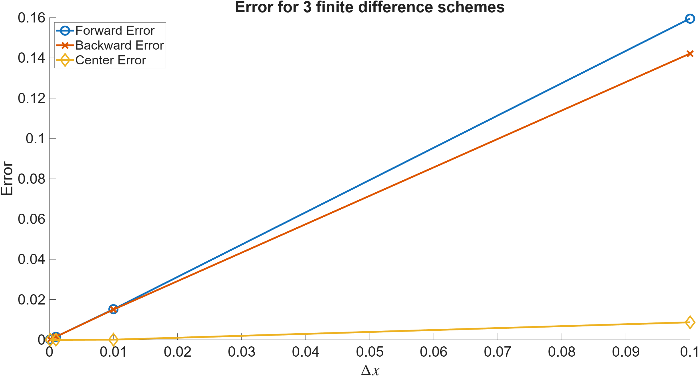
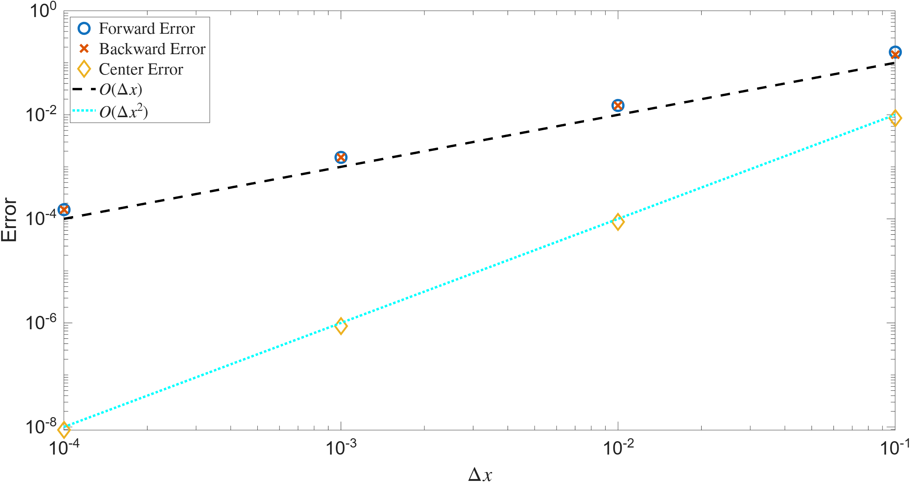

# Truncation error {#sec-truncation}

::: {.prep-reminder}
 The PREP for this topic: [Lesson 12 PREP: Finite difference (truncation) error]().
:::

::: {.callout-note appearance="simple"}
## Learning objectives

Throughout this chapter, you will learn to:

- Distinguish between round-off error, truncation error, and coding errors.
- Interpret big-O notation and use it to compare the order of accuracy of finite difference schemes.
- Predict how the error in a numerical derivative changes as step size decreases.
- Create and interpret `loglog` plots, including what the slope reveals about the relationship between variables.
:::

## Defining truncation error {#sec-truncation-error}

::: {.motivation}
The finite difference formulas (@sec-fd-formulas) are approximations: the slope of a secant line instead of the tangent line. How good are they? How does the error change as $\Delta x$ gets smaller? And what do "first-order" and "second-order" actually mean?
:::

For $f(x) = \sin(2x) + 3$, the secant lines in @sec-secant get closer to the tangent line as $\Delta x$ gets smaller. Because we know the exact derivative, $f'(x) = 2\cos(2x)$, we can calculate the error of each approximation.

Let
$$\frac{\Delta f}{\Delta x} = \frac{f(x + \Delta x) - f(x)}{\Delta x}$$
be the first-order forward difference approximation of the derivative, $\dfrac{df}{dx} = f'(x)$. The **error** for a given step size $\Delta x$ is
$$\text{Err}_{\Delta x} = \left| \frac{\Delta f}{\Delta x} - \frac{df}{dx} \right|.$$
This error is called **truncation error**. It is due to not taking the limit.

::: {.callout-important}
## Three kinds of error

1. **Round-off error** comes from rounding numbers on a computer (@sec-round-off). It is unavoidable, and the more calculations we do with rounded numbers, the more it adds up.
2. **Truncation error** comes from the algorithm and discretization. For finite differences, it comes from not taking the limit.
3. **Coding errors** are mistakes in the implementation of an algorithm. They give wrong answers, but not because the method is wrong!

**Numerical error** usually means round-off error and truncation error together. If the error is far different from what the theory predicts, it is probably a coding error.
:::

## Error vs. step size: a numerical experiment {#sec-error-experiment}

**Goal:** see how decreasing $\Delta x$ affects the error. For $\Delta x = 0.1, 0.01, 0.001, 0.0001$, approximate the derivative of $f(x) = \sin(2x) + 3$ at $x^*$, compare it to the exact answer $2\cos(2x^*)$, and print the error.

### Forward difference

```matlab
f = @(x) sin(2*x) + 3;
xstar = pi/4;                       % the point where we approximate f'
exact_slope = 2*cos(2*xstar);

for deltax = [0.1, 0.01, 0.001, 0.0001]
    forward_diff = (f(xstar + deltax) - f(xstar))/deltax;
    err = abs(forward_diff - exact_slope);
    fprintf("With Delta x = %.4f, The error = %.4e\n", deltax, err);
end
```

``` {.output}
With Delta x = 0.1000, The error = 1.9933e-01
With Delta x = 0.0100, The error = 1.9999e-02
With Delta x = 0.0010, The error = 2.0000e-03
With Delta x = 0.0001, The error = 2.0000e-04
```

When $\Delta x$ decreases by a factor of 10, **the error also decreases by (approximately) a factor of 10**. The error decreases at the same rate as the step size. That's why this is called a **first-order** finite difference method.

### Centered difference

Change one line:

```matlab
center_diff = (f(xstar + deltax) - f(xstar - deltax))/(2*deltax);
```

At $x^* = \pi/4$, every error is about $10^{-16}$: round-off error! That's
unexpected. It only happens because we chose a special base point. $x^* = \pi/4$
is the top of the hump, and $\sin(2x)$ is symmetric around it, so $f(x^* +
\Delta x) = f(x^* - \Delta x)$. The centered difference gives exactly 0, which
is the exact slope. All that's left is round-off error.

{fig-alt="Line plot showing how
the centered-difference approximation, in this case, has slope exactly 0 which
is the same as the slope of the tangent line. This causes the error to be
essentially zero." width="80%"}

Try again with $x^* = 2$:

``` {.output}
With Delta x = 0.1000, The error = 8.6978e-03
With Delta x = 0.0100, The error = 8.7151e-05
With Delta x = 0.0010, The error = 8.7152e-07
With Delta x = 0.0001, The error = 8.7128e-09
```

When $\Delta x$ decreases by a factor of 10, **the error decreases by a factor of $100 = 10^2$**. The error decreases at the same rate *squared* as the step size. That's why the centered difference is a **second-order** finite difference method.

::: {.callout-note appearance="simple"}
We have only learned first- and second-order finite difference approximations, but there are also third-order, fourth-order, and so on. In general, for an $n$th-order approximation, decreasing the step size by a factor of $a$ ($\Delta x \to \Delta x/a$) decreases the error by a factor of $a^n$. This is the worst case; sometimes it does better, as at $x^* = \pi/4$.
:::

## Where the order comes from: Taylor series {#sec-taylor}

The experiment shows *how* the error changes with $\Delta x$, but not *why*. For that, we need Taylor series. We only briefly go into the theory: enough to see where the error comes from. Taylor series are covered in Math 126, so they are not a prerequisite for this class.

A magical result of calculus states that for almost any function,
$$f(x^* + \Delta x) = f(x^*) + \Delta x\, f'(x^*) + \frac{(\Delta x)^2}{2} f''(x^*) + \frac{(\Delta x)^3}{3!} f'''(x^*) + \cdots + \frac{(\Delta x)^n}{n!} f^{(n)}(x^*) + \cdots.$$
If we nudge the input of $f$ by a small amount $\Delta x$ away from a known point $x^*$, we can predict how the output changes using nothing but the derivatives of $f$ at $x^*$. This is one of the most powerful and important results in all of mathematics and applied mathematics. Without Taylor series, we would not have gone to the moon, or have weather models, robots, LLMs, the theory of relativity, wireless communication, radar, sonar, video games, etc.

::: {.callout-note collapse="true"}
## Taylor series, and the form you saw in calculus

If you've studied Taylor series, you might be stressing right now. Many of you have had a bad time with them, and others have heard the horror stories. The good news: you will not need to work with Taylor series directly in this class. The bad news: if you want to do anything with math, applied math, engineering, etc., there are more Taylor series in your future! But they get better.

The form above probably looks different from the one in calculus, the Taylor series of $g(x)$ centered at $x = a$:
$$g(x) = \sum_{n=0}^{\infty} \frac{g^{(n)}(a)}{n!}(x - a)^n = g(a) + g'(a)(x - a) + \frac{g''(a)}{2}(x - a)^2 + \cdots.$$
These are exactly the same thing! Take $g = f$, center the series at $a = x^*$, and evaluate it at $x = x^* + \Delta x$. Then $x - a = \Delta x$, so everything lines up:
$$f(x^* + \Delta x) = f(x^*) + f'(x^*)\Delta x + \frac{f''(x^*)}{2}(\Delta x)^2 + \cdots.$$
$x^*$ is where we know everything about $f$ (where we center the series), and
$\Delta x$ is how far we step from it. Thinking of it as "start here, step this
far" is what makes this form easier to work with, and it is usually how you will
see it in the future. See? It gets better.
:::

### How small is small? Big-O notation {#sec-big-o}

There is no universal definition of "small". Instead, think about size relative to other quantities. If $\Delta x \ll 1$ ("much less than" 1), each higher power of $\Delta x$ is much smaller than the one before:
$$\Delta x = 0.1, \qquad (\Delta x)^2 = 0.01, \qquad (\Delta x)^3 = 0.001, \qquad \ldots$$
So in a sum of powers of $\Delta x$, the lowest power is the biggest term, and it controls the size of the whole sum. For example, with $\Delta x = 0.1$,
$$2\Delta x + 4(\Delta x)^2 + 9(\Delta x)^3 + 3(\Delta x)^4 + 6(\Delta x)^5 + 8(\Delta x)^6 = 0.249368 \approx 0.2 = 2\Delta x.$$

**Big-O notation** keeps only that lowest power. An expression is $O((\Delta x)^n)$ (read "big O of delta x to the n" or "order delta x to the n") if its lowest power of $\Delta x$ is $(\Delta x)^n$:
$$2\Delta x + 4(\Delta x)^2 + 9(\Delta x)^3 + \cdots = O(\Delta x) \quad \text{("first order in } \Delta x\text{")},$$
$$9(\Delta x)^3 + 3(\Delta x)^4 + 6(\Delta x)^5 + 8(\Delta x)^6 = O((\Delta x)^3) \quad \text{("third order in } \Delta x\text{")}.$$

:::: {.callout-tip collapse="true"}
## Practice: what does "small" mean?

1. If $\Delta x = 20$, what is $(\Delta x)^2$? If $\Delta x = 0.2$, what are $(\Delta x)^2$ and $(\Delta x)^3$?
2. If $\Delta x = 0.1$, what is $9\Delta x + 3(\Delta x)^2 + 4(\Delta x)^3$?
3. True or false: if $\Delta x \ll 1$, then $\Delta x > (\Delta x)^2 + (\Delta x)^3 + (\Delta x)^4 + \cdots$.

::: {.callout-caution collapse="true"}
## Answers

1. $20^2 = 400$: squaring a big number makes it bigger. $0.2^2 = 0.04$ and $0.2^3 = 0.008$: powers of a small number get smaller.
2. $0.9 + 0.03 + 0.004 = 0.934$. The first term is most of the answer.
3. True. With $\Delta x = 0.1$, the right side is $0.0111\ldots < 0.1$.
:::
::::

:::: {.callout-tip collapse="true"}
## Practice: big-O notation

Assume $\Delta x \ll 1$. Write each expression in big-O notation.

1. $4(\Delta x)^3 + 2(\Delta x)^5 + 6(\Delta x)^2 + (\Delta x)^4$
2. $8(\Delta x)^6 + 3(\Delta x)^4 + 5(\Delta x)^7$
3. $\dfrac{(\Delta x)^2}{6} f'''(x) + \dfrac{\Delta x}{2} f''(x) + \dfrac{(\Delta x)^3}{24} f^{(4)}(x)$

::: {.callout-caution collapse="true"}
## Answers

1. $O((\Delta x)^2)$. The lowest power is $(\Delta x)^2$, even though it's the third term. The order of the terms in the sum doesn't matter, only the powers.
2. $O((\Delta x)^4)$. There is no $\Delta x$, $(\Delta x)^2$, or $(\Delta x)^3$ term, so the lowest power is $(\Delta x)^4$.
3. $O(\Delta x)$. The derivatives $f''(x)$, $f'''(x)$, and $f^{(4)}(x)$ are just numbers that don't depend on $\Delta x$, like the coefficients in 1 and 2. The lowest power is $\Delta x$, in the middle term. Expressions like this one come up in the Taylor series calculation below.
:::
::::

### The error in the forward difference {#sec-forward-error}

We write the Taylor series with only the terms we need, and collect the rest in big-O:
$$f(x + \Delta x) = f(x) + \Delta x\, f'(x) + \frac{(\Delta x)^2}{2} f''(x) + O((\Delta x)^3),$$
where $O((\Delta x)^3) = \frac{(\Delta x)^3}{3!} f'''(x) + \cdots$ represents infinitely many terms. Substitute this into the forward difference. The $f(x)$ terms cancel:
$$
\begin{aligned}
\frac{f(x + \Delta x) - f(x)}{\Delta x}
&= \frac{1}{\Delta x}\left[\Delta x\, f'(x) + \frac{(\Delta x)^2}{2} f''(x) + O((\Delta x)^3)\right] \\
&= f'(x) + \frac{\Delta x}{2} f''(x) + O((\Delta x)^2) \\
&= f'(x) + O(\Delta x).
\end{aligned}
$$

::: {.callout-note collapse="true"}
## Common question: what happened in the last step there?
In the last step, I used 
$$ \frac{\Delta x}{2} f^{\prime\prime}(x) + O((\Delta x)^2) = O(\Delta x).$$
Why is this true?

Recall that the big-O notation is used to replace infinitely many terms. So 
$$ \frac{\Delta x}{2} f^{\prime\prime}(x) + O((\Delta x)^2) = \frac{\Delta x}{2} f^{\prime\prime}(x) + C_2 (\Delta x)^2 + C_3 (\Delta x)^3 + \ldots$$
Looking at this whole thing, we see it's some constant times $\Delta x$ plus a
bunch of smaller terms. That's exactly our definition of $O(\Delta x)$. Therefore

$$ \frac{\Delta x}{2} f^{\prime\prime}(x) + O((\Delta x)^2) = \frac{\Delta x}{2} f^{\prime\prime}(x) + C_2 (\Delta x)^2 + C_3 (\Delta x)^3 + \ldots = O(\Delta x)$$
:::

In other words,
$$f'(x) = \frac{f(x + \Delta x) - f(x)}{\Delta x} + O(\Delta x).$$


The left side is exact, and we use the forward difference to approximate it. So the error is
$$\text{Err}_{\Delta x} = \left| f'(x) - \frac{f(x + \Delta x) - f(x)}{\Delta x} \right| = |O(\Delta x)|.$$

- The $O(\Delta x)$ term is the error.
- The truncation error is first order in $\Delta x$: $O((\Delta x)^1)$. This is what "first-order" means.

The same calculation for the centered difference gives $O((\Delta x)^2)$: a second-order method.

::::: {.exercise}
### Exercise: Visualizing truncation error {#sec-ex-truncation-plot}

**Lesson files:** [Lesson_12_truncation_plot.m (starter)](../files/Lesson_12_truncation_plot.m) · [Lesson_12_truncation_plot.m (completed)](../files/Lesson_12_truncation_plot_Completed.m)

**Learning outcomes.** This exercise should help you to:

- Predict and visualize how the error in a numerical derivative changes as step size decreases.

:::: {.callout-note collapse="true" appearance="simple"}
## Full exercise

Calculate the error for the forward, backward, and centered differences for several step sizes, and plot error vs. step size. The plots are set up for you, but you need to make the things you will plot. Before writing any code, think about your strategy:

- **The plot.** We want $\Delta x$ on the horizontal axis and the error for a method with that step size on the vertical axis. What does each point in the plot represent? What do you need to know to place one point?
- **Repetition.** We want to do this for each step size $h = 10^{-1}, 10^{-2}, 10^{-3}, 10^{-4}$ (remember $h = \Delta x$). What steps will you repeat?
- **Storing the output.** How will you keep track of each error, for each method?

::: {.callout-tip collapse="true" appearance="simple"}
## Strategy hints

- A single point on the plot is $(\Delta x, \text{Err}_{\Delta x})$. You calculate it with one finite difference formula and one step size.
- Repeating the same task means a for loop. Before the loop, define the step sizes. Do you see a pattern you can exploit?
- We need an array for each method: 3 arrays, each the same length as the number of step sizes.
:::

Steps:

- **Step 0** (done for you): Define $f(x) = \sin(2x) + 3$ and $x^*$. We will approximate $f'(x^*)$; the exact answer is $2\cos(2x^*)$.
- **Step 1:** Set up the array `h_arr` of step sizes $[10^{-1}, 10^{-2}, 10^{-3}, 10^{-4}]$. Can you do this using `linspace` and array arithmetic?
- **Step 2:** Make arrays to hold the errors, one per method. They should contain 0s to start and have the same size as `h_arr`.
- **Step 3:** Loop over each element of `h_arr`. Calculate the forward difference approximation for that step size and save the error. Repeat for the backward and centered differences.
- **Step 4** (done for you; uncomment it): Create the figure.

What do you notice about the figure? Does it look like you expected?

::: {.callout-tip collapse="true" appearance="simple"}
## Completed figure and takeaways

{fig-alt="Line plot titled 'Error for 3 finite difference schemes', with Delta x from 0 to 0.1 on the horizontal axis and error from 0 to 0.16 on the vertical axis. Forward error (blue circles) and backward error (orange crosses) rise along nearly straight lines to about 0.16 and 0.14 at Delta x = 0.1. Center error (yellow diamonds) stays near 0, rising only to about 0.01. All the points for the three smallest step sizes are bunched together near Delta x = 0." width="80%"}

- Error decreases as $h = \Delta x$ decreases (from right to left).
- The centered difference error looks smallest for every $\Delta x$, but it's
hard to tell, because everything is bunched up near $\Delta x = 0$.
- `h_arr = 10.^linspace(-1, -4, 4);` creates the step sizes: `linspace` makes
the exponents $-1, -2, -3, -4$.
:::
::::
:::::

## Logarithms and order {#sec-log-order}

An $n$th-order method has truncation error $O(h^n)$, with $h = \Delta x$. Decreasing $h$ by a factor of 10 decreases the error by a factor of $10^n$. Logarithms turn that factor back into $n$.

Suppose the error is $\text{Err}_{0.1} = 0.5$ for $h = 0.1$. Decreasing $h$ to $0.01$ gives
$$\text{Err}_{0.01} = \frac{0.5}{10^n} = \frac{\text{Err}_{0.1}}{10^n}, \qquad \text{so} \qquad \frac{\text{Err}_{0.1}}{\text{Err}_{0.01}} = 10^n \qquad \text{and} \qquad \log_{10}\!\left(\frac{\text{Err}_{0.1}}{\text{Err}_{0.01}}\right) = n.$$

::: {.callout-note appearance="simple"}
## Log rules

$$\log(a^n) = n\log(a), \qquad \log(b \cdot a) = \log(b) + \log(a), \qquad \text{together:} \quad \log(b \cdot a^n) = \log(b) + n\log(a).$$
:::

In action, with the forward difference at $x^* = 2$:

```matlab
f = @(x) sin(2*x) + 3;
xstar = 2;
exact_slope = 2*cos(2*xstar);

deltaxs = 10.^linspace(-1, -4, 4);      % 0.1, 0.01, 0.001, 0.0001
errs = zeros(1, length(deltaxs));

for i = 1:length(deltaxs)
    forward_diff = (f(xstar + deltaxs(i)) - f(xstar))/deltaxs(i);
    errs(i) = abs(forward_diff - exact_slope);
end

disp(errs)
```

``` {.output}
    0.1596    0.0152    0.0015    0.0002
```

:::: {.callout-tip collapse="true"}
## Practice: divide each error by the next

Divide each element of `errs` by the next one. What do you get, and what is $n$?

::: {.callout-caution collapse="true"}
## Answer

With slicing (@sec-slicing), `errs(1:end-1)./errs(2:end)` divides each element by the next:

``` {.output}
   10.4814   10.0515   10.0052
```

Each ratio is about $10 = 10^1$, so $n = 1$: first order. `log10` of the ratios gives $1.0204$, $1.0022$, and $1.0002$. Not exactly 1, but when is anything exact in scientific computing?
:::
::::

## Log-log plots {#sec-loglog}

On a regular plot of error vs. $\Delta x$, everything is bunched up near $\Delta x = 0$. To spread it out, plot the logarithm of the error instead.

We know $\text{Err} = O(h^n) \approx C h^n$ for some constant $C$. Taking the log of both sides,
$$\log(\text{Err}) = \log(C) + n\log(h).$$
Letting $x = \log(h)$ and $y = \log(\text{Err})$,
$$y = \log(C) + n x,$$
**a line, with slope $n$**, the order of the method!

`loglog` plots show this. `loglog(A, B)` makes the same picture as `plot(log(A), log(B))`, but labels the axes with the original values (powers of 10). So `loglog(deltaxs, errs)` shows $\log(\text{Err})$ against $\log(\Delta x)$.

::: {.callout-tip appearance="simple"}
Before making the plot, predict it. Each method's errors should fall on a line. What should the slope of each line be?
:::

::::: {.exercise}
### Exercise: Visualizing truncation error using `loglog` plots {#sec-ex-loglog}

**Lesson files:** [Lesson_12_truncation_loglog.m (starter)](../files/Lesson_12_truncation_loglog.m) · [Lesson_12_truncation_loglog.m (completed)](../files/Lesson_12_truncation_loglog_Completed.m)

**Learning outcomes.** This exercise should help you to:

- Predict and visualize how the error in a numerical derivative changes as step size decreases.
- Create and interpret `loglog` plots, including what the slope reveals about the relationship between variables.

:::: {.callout-note collapse="true" appearance="simple"}
## Full exercise

Starting from the previous exercise's code, turn the plot into a `loglog` plot and interpret the findings.

- **Step 1:** Turn the code into a `loglog` plot. Plot only the markers, with no lines between them: `loglog(..., 'linestyle', 'none')`.
- **Step 2:** Add trend lines with known slope, to compare the numerical experiment to the theory. What slopes should they have? Don't use the data to create the trend lines. Instead, think about how to plot a line with slope 1, 2, 3, etc. on a `loglog` plot. How do you change the slope and the $y$-intercept?

What do you notice about the figure? Does it look like you expected?

::: {.callout-tip collapse="true" appearance="simple"}
## Completed figure and takeaways

{fig-alt="Log-log plot with Delta x values from 10^-4 to 10^-1 on the horizontal axis and error from 10^-8 to 10^0 on the vertical axis. Forward error (blue circles) and backward error (orange crosses) lie on top of each other along a black dashed trend line labeled O(Delta x), with slope 1. Center error (yellow diamonds) lies along a steeper cyan dotted trend line labeled O(Delta x^2), with slope 2, going from about 10^-2 at Delta x = 10^-1 down to about 10^-8 at Delta x = 10^-4."}

- Error decreases as $h = \Delta x$ decreases (from right to left).
- The errors for each method fall on a line.
- The centered difference line is steeper: its error decreases faster as $\Delta x$ decreases.
- Since $\log(\text{Err}) = \log(C) + n\log(\Delta x)$, **the slope of the line is the order of the method**.
- A trend line with slope $n$ is `loglog(h_arr, h_arr.^n)`. Multiplying by a constant, `C*h_arr.^n`, shifts the line up or down without changing its slope.
:::
::::
:::::

::: {.callout-important}
## Convergence and order

- A numerical method **converges** if the error approaches 0 (or machine
  precision) as the step size $\Delta x$ approaches 0 (or machine precision). In
  other words, decreasing $\Delta x$ should decrease the error. If the plot does
  not look like it's approaching 0, the method is not converging.
- When the slope of one method's error on a log-log plot is greater than
  another's, it is a **higher-order** method. It is considered more accurate,
  because its error decreases faster as the step size decreases.
:::
