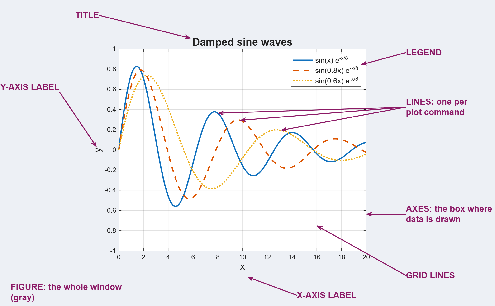
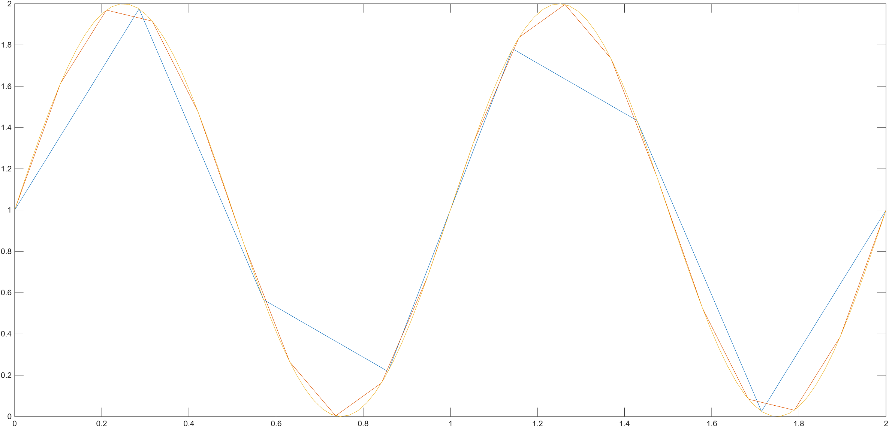
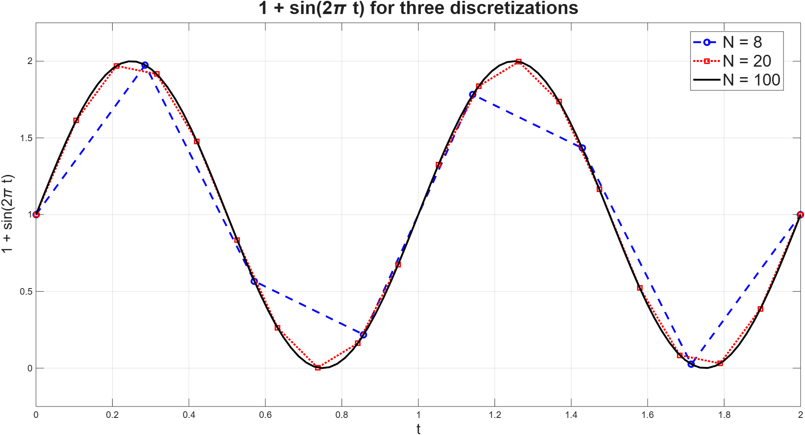

# MATLAB plotting reference {#sec-style-guide}

A reference for making clear, readable figures in MATLAB. @sec-plotting introduces these commands; this guide collects them in one place, with more options and examples.

## Figures, axes, and lines {#figures-axes}

### The parts of a plot: figure, axes, and lines {#figure-vs-axes}

MATLAB uses three words for the main parts of a plot. Each one sits inside the one before it: lines are drawn inside axes, and axes sit inside a figure.

{fig-alt="A labeled MATLAB figure titled 'Damped sine waves' with three oscillating lines. Labels point to the title, the legend, the y-axis label, the x-axis label, the grid lines, the lines (one per plot command), the axes (the box where data is drawn), and the figure (the whole gray window)."}

| Part | What it is | Commands in this guide that change it |
|----|----|----|
| **Figure** | The whole window (or panel) that holds your plot. | [`figure`](#new-figure), [`exportgraphics`](#exportgraphics), [`savefig`](#savefig) |
| **Axes** | The box inside the figure with the x- and y-axes, where the data is drawn. | [`xlabel`, `ylabel`, `title`](#labels-title), [`legend`](#legend), [`xlim`, `ylim`](#axis-limits), [`grid on`](#grid), [`hold on`](#hold-on) |
| **Line** | One plotted curve. Each `plot` command creates one line. | Options inside `plot`: [`"DisplayName"`](#displayname), [`"LineWidth"`](#linewidth), [`"LineStyle"`](#linestyle), [`"Color"`](#color), [`"Marker"`](#markers) |

Knowing which part you're changing tells you where the code goes. Line options go *inside* the `plot` command for that line. Axes commands like `title` and `legend` go on their own lines *after* plotting.

Most commands act on the *current* figure and axes, which are the ones you most recently made or selected. In code, `gcf` means "get current figure" and `gca` means "get current axes."

### Starting a new figure (`figure`) {#new-figure}

By default, `plot` draws in the figure that is already open, replacing what was there. To keep your old figure and make a separate one, call `figure` first.

```matlab
figure
plot(x, y)

figure
plot(x, 2*y)    % appears in a second window; the first is unchanged
```

**Tip:** starting each figure in your code with `figure` keeps plots from different problems from landing on top of each other.

### Numbered figures (`figure(10)`) {#numbered-figure}

You can give a figure a number by putting it in the parentheses. The same command does two things:

-   **If figure 10 doesn't exist yet**, MATLAB creates it.
-   **If figure 10 already exists**, MATLAB grabs it and makes it the current figure, so the next commands draw there.

```matlab
figure(10)       % create (or grab) figure 10
plot(x, y)

figure(20)       % create (or grab) figure 20
plot(x, 2*y)

figure(10)       % go back to figure 10
title("Graph of y = x^2 - 3")   % this title goes on figure 10
```

You may also see this written without parentheses, as `figure 10`. It does the same thing.

**Why this is useful:** a plain `figure` opens a brand-new window every time you run your code, so windows pile up. With `figure(10)`, rerunning your code reuses the same window. Giving each problem its own number (e.g., `figure(1)` for Problem 1, `figure(2)` for Problem 2) keeps everything organized.

**Watch out:** grabbing an existing figure keeps whatever was already in it. To wipe it clean before plotting again, add `clf` ("clear figure") right after:

```matlab
figure(10)
clf              % remove everything from figure 10
plot(x, y)
```

### Naming a figure (`fig = figure(1)`) {#name-figure}

You can save a figure in a variable when you create it. This gives you a name to refer to that exact figure later, no matter which figure is "current."

```matlab
fig = figure(1);
clf
plot(x, y)
title("Graph of y = x^2 - 3")

exportgraphics(fig, "my_plot.png")   % saves this figure, and only this one
```

The most common use is [saving](#saving): `exportgraphics(fig, ...)` always saves the figure you named, even if you've made other figures since. **We'll use this style for every figure in this class.**

**Going further (optional):** you can do the same thing for the axes and lines. `ax = axes(fig)` names the axes, and commands like `title(ax, ...)` and `plot(ax, ...)` then target those axes directly. `ln = plot(...)` names a line, and `ln.LineWidth = 2` changes it afterward. This is useful for figures with several sets of axes, but you won't need it in this class.

### Starting fresh in the same figure (`hold off`) {#hold-off}

[`hold on`](#hold-on) keeps adding lines to the same axes until you turn it off. If you rerun your code and see old lines piling up, add `hold off` after your last `plot` command.

```matlab
plot(x, y)
hold on
plot(x, 2*y)
hold off        % the next plot command will start fresh
```


## Axis labels and titles {#labels-title}

**Every figure you make for this class should have labeled axes and a title.** Run these commands *after* your `plot` command. They add text to the current axes.

### x-axis label (`xlabel`) {#xlabel}

Labels the horizontal axis.

```matlab
xlabel("x values")
```

**Tip:** say what the axis measures, and include units when there are any, e.g., `xlabel("Time (months)")`.

### y-axis label (`ylabel`) {#ylabel}

Labels the vertical axis.

```matlab
ylabel("y values")
```

### Title (`title`) {#title}

Adds a title above the figure. A good title tells the reader what they are looking at.

```matlab
title("Plot of sin(x) for various discretizations")
```

### Font size (`"FontSize"`) {#fontsize}

The default text is often small. Add `"FontSize"` followed by a number to make labels and titles easier to read.

```matlab
xlabel("x values", "FontSize", 14)
ylabel("y values", "FontSize", 14)
title("Plot of sin(x) for various discretizations", "FontSize", 16)
```

**Tip:** making the title slightly larger than the axis labels helps it stand out.

### Using variables in titles and labels {#variables-in-text}

Sometimes you want a title or label to include a number from your code, like the number of points `N`. Build the text first and save it in a variable, then pass that variable to `title`.

```matlab
N = 500;
x = linspace(-1, 1, N);
y = x.^2 - 3;
plot(x, y)

plt_title = "Graph of y = x^2 - 3 with N = " + N;
title(plt_title)
```

The `+` joins the text and the number together, so the title reads "Graph of $y = x^{2} - 3$ with N = 500." If you change `N`, the title updates automatically.

The same idea works for axis labels and [legend names](#displayname):

```matlab
line_name = "N = " + N;
plot(x, y, "DisplayName", line_name)
```

**Watch out:** use double quotes `" "`, not single quotes `' '`. With single quotes, `+` tries to do arithmetic on the characters instead of joining text, and you'll get an error or a strange result.


## Legends {#legends}

When a figure has more than one line, a legend tells the reader which line is which. Making a legend takes two steps: name each line, then show the legend.

### Naming each line (`"DisplayName"`) {#displayname}

Give each line a name inside its `plot` command using `"DisplayName"`. This name is what will appear in the legend.

```matlab
plot(x, y, "DisplayName", "sin(x)")
```

### Plotting several lines on one figure (`hold on`) {#hold-on}

By default, each new `plot` command replaces the previous line. Use `hold on` after your first `plot` to keep it and draw the next lines on the same axes.

```matlab
x_coarse = linspace(0, 2, 10);
x_fine   = linspace(0, 2, 500);

plot(x_coarse, sin(2*pi*x_coarse) + 1, "DisplayName", "N = 10")
hold on
plot(x_fine, sin(2*pi*x_fine) + 1, "DisplayName", "N = 500")
```

### Showing the legend (`legend`) {#legend}

After all your lines are plotted, call `legend` to display the names you gave them.

```matlab
plot(x, y, "DisplayName", "sin(x)");
legend;
```

**Tip:** if your legend is empty or shows "data1, data2," check that each `plot` command includes a `"DisplayName"`.

### Moving the legend (`"Location"`) {#legend-location}

If the legend covers part of your data, move it with `"Location"`.

```matlab
legend("Location", "best")
```

| Value           | Where the legend goes                          |
|-----------------|------------------------------------------------|
| `"best"`        | MATLAB picks a spot that covers the least data |
| `"northeast"`   | Top right, inside the axes (default)           |
| `"northwest"`   | Top left                                       |
| `"southeast"`   | Bottom right                                   |
| `"southwest"`   | Bottom left                                    |
| `"eastoutside"` | Outside the axes, to the right                 |


## Line appearance {#line-style}

You can change how a line looks by adding *arguments* inside the `plot` command. Each one is a name in quotes followed by its value.

### Line width (`"LineWidth"`) {#linewidth}

Thicker lines are easier to see, especially on slides or printed pages.

```matlab
plot(x, y, "LineWidth", 2)
```

### Line style: solid, dashed, dotted (`"LineStyle"`) {#linestyle}

Changes the pattern of the line.

```matlab
plot(x, y, "LineStyle", "--")
```

| Value  | Style           |
|--------|-----------------|
| `"-"`  | Solid (default) |
| `"--"` | Dashed          |
| `":"`  | Dotted          |
| `"-."` | Dash-dot        |

**Tip:** different line styles let readers tell lines apart even when the figure is printed in black and white.

### Color (`"Color"`) {#color}

Changes the color of the line.

```matlab
plot(x, y, "Color", "r")
```

| Value | Color   |
|-------|---------|
| `"r"` | Red     |
| `"g"` | Green   |
| `"b"` | Blue    |
| `"c"` | Cyan    |
| `"m"` | Magenta |
| `"y"` | Yellow  |
| `"k"` | Black   |
| `"w"` | White   |

For more options, see MATLAB's documentation on [plot](https://www.mathworks.com/help/matlab/ref/plot.html).

### Markers: showing the data points (`"Marker"`) {#markers}

A plotted line is really a set of points connected by straight segments. Markers draw a symbol at each point, so you can see exactly where your discretization put them.

```matlab
x_coarse = linspace(-1, 1, 5);
plot(x_coarse, x_coarse.^2 - 3, "Marker", "o")
```

With only 5 points, the markers make it clear why the graph looks like straight segments instead of a smooth curve.

| Value | Marker   |
|-------|----------|
| `"o"` | Circle   |
| `"."` | Dot      |
| `"*"` | Asterisk |
| `"x"` | Cross    |
| `"s"` | Square   |
| `"^"` | Triangle |

Change the marker size with `"MarkerSize"`, e.g., `plot(x, y, "Marker", "o", "MarkerSize", 8)`.

To show *only* the points with no connecting line, set `"LineStyle", "none"`:

```matlab
plot(x_coarse, x_coarse.^2 - 3, "Marker", "o", "LineStyle", "none")
```

**Tip:** markers are best for a small number of points. With 500 points, they crowd together and hide the line.

### Combining options {#combining}

You can use several options in the same `plot` command, in any order.

```matlab
plot(x, y, "Color", "r", "LineStyle", "--", "LineWidth", 2, "DisplayName", "x^2 - 3")
```

This draws a thick, red, dashed line named "x\^2 - 3" in the legend.

### Shorthand styles (e.g., `"r--o"`) {#linespec}

You will often see MATLAB code online (and in AI explanations) that sets color, line style, and marker all at once with a short code right after `x` and `y`:

```matlab
plot(x, y, "r--o")
```

This is the same as:

```matlab
plot(x, y, "Color", "r", "LineStyle", "--", "Marker", "o")
```

The short code is just the [color](#color), [line style](#linestyle), and [marker](#markers) values from the tables above, written together. You can leave out any of the three, e.g., `"k:"` (black dotted) or `"bo"` (blue circles, no line). You can still add other options after it:

```matlab
plot(x, y, "r--", "LineWidth", 2, "DisplayName", "x^2 - 3")
```

Either form is fine in this class. The longer form is easier to read; the shorthand is quicker to type.


## Axis limits (`xlim`, `ylim`) {#axis-limits}

MATLAB picks the axis ranges automatically. Set them yourself to zoom in on part of a graph, or to give several figures the same axes so they're easy to compare.

```matlab
plot(x, y)
xlim([-0.5, 0.5])    % show x from -0.5 to 0.5
ylim([-3.5, -2])     % show y from -3.5 to -2
```

Each takes a pair of numbers in square brackets: `[lower, upper]`. The lower number must be smaller than the upper one.

**Tip:** a little extra space above and below the data often makes a figure easier to read than having the line touch the edges of the box.


## Grid lines (`grid on`) {#grid}

Adds background grid lines, like graphing paper, which make it easier to read values off the figure.

```matlab
plot(x, y)
grid on
```


## Subplots: several axes in one figure {#subplots}

Sometimes you want two plots in one figure, one above the other, for example, to compare a coarse and a fine discretization. A figure can hold more than one set of [axes](#figure-vs-axes). Each set of axes is called a **subplot**.

### Top and bottom subplots (`subplot`) {#subplot-basic}

Use `subplot(rows, columns, position)` to split the figure into a grid and pick which spot to draw in. For one plot on top and one on the bottom, use 2 rows and 1 column:

```matlab
x_coarse = linspace(-1, 1, 5);
x_fine   = linspace(-1, 1, 500);

fig = figure(1);
clf

subplot(2, 1, 1)        % 2 rows, 1 column, position 1 (top)
plot(x_coarse, x_coarse.^2 - 3)

subplot(2, 1, 2)        % 2 rows, 1 column, position 2 (bottom)
plot(x_fine, x_fine.^2 - 3)

exportgraphics(fig, "subplots.png")   % saves both subplots together
```

Positions are numbered left to right, then top to bottom. In a 2-by-1 grid, position 1 is the top and position 2 is the bottom. Everything after a `subplot` command goes into that spot until the next `subplot` command.

To go back to a subplot you already made, call `subplot` again with its position, e.g., `subplot(2, 1, 1)` returns to the top.

### Decorating each subplot {#subplot-decorations}

Each subplot is its own set of axes, so it needs its own labels and title. Decoration commands like `xlabel`, `title`, `legend`, `xlim`, `grid on`, and `hold on` only affect the subplot you're currently in. Put them right after that subplot's `plot` command, before the next `subplot`.

```matlab
fig = figure(1);
clf

% Top subplot
subplot(2, 1, 1)
plot(x_coarse, x_coarse.^2 - 3, "Marker", "o", "LineWidth", 2)
xlabel("x")
ylabel("y")
title("N = 5")
grid on

% Bottom subplot
subplot(2, 1, 2)
plot(x_fine, x_fine.^2 - 3, "LineWidth", 2)
xlabel("x")
ylabel("y")
title("N = 500")
grid on

exportgraphics(fig, "subplots.png")
```

**Tip:** when two subplots show the same kind of data, give them the same axis limits with [`xlim` and `ylim`](#axis-limits) so they're easy to compare.

### One title for the whole figure (`sgtitle`) {#subplot-title}

To add a title above all the subplots, use `sgtitle` ("subplot grid title"):

```matlab
fig = figure(1);
clf

subplot(2, 1, 1)
% ... top subplot ...

subplot(2, 1, 2)
% ... bottom subplot ...

sgtitle("Graph of y = x^2 - 3 for two discretizations")
```

A plain `title("...")` would only title the current subplot.

### Newer alternative: `tiledlayout` {#subplot-new}

You may also see subplots made with `tiledlayout` and `nexttile`. It does the same job, but moves to the next spot automatically instead of using a position number:

```matlab
tiledlayout(2, 1)
nexttile            % top
plot(x_coarse, x_coarse.^2 - 3)
nexttile            % bottom
plot(x_fine, x_fine.^2 - 3)
```

MATLAB recommends this newer version because it gives you more control over spacing. Either one is fine for this class; we'll use `subplot`.


## Math in labels with LaTeX (optional) {#latex}

*This section is optional. You do not need LaTeX for any assignment in this class, but it can make math in your figures look much nicer.*

### Simple math without LaTeX {#tex-default}

By default, MATLAB already understands a few math symbols in labels, titles, and legend names:

| You type | You get |
|----|----|
| `"x^2"` | $x^{2}$ (superscript) |
| `"x_k"` | $x_{k}$ (subscript) |
| `"x^{10}"` | $x^{10}$ (use braces for more than one character) |
| `"\pi"`, `"\Delta"`, `"\theta"` | $\pi$, $\Delta$, $\theta$ (Greek letters) |

```matlab
title("Graph of y = x^2 - 3 with \Delta x = 0.004")
```

For many figures, this is all you need.

### Turning on LaTeX (`"Interpreter"`) {#latex-interpreter}

For fractions, square roots, or more polished-looking math, add `"Interpreter", "latex"` and wrap the math in dollar signs `$ ... $`.

```matlab
xlabel("$x$", "Interpreter", "latex", "FontSize", 14)
ylabel("$f(x) = \sqrt{x} + \frac{1}{2}$", "Interpreter", "latex", "FontSize", 14)
title("Graph of $f(x) = x^3$ for $x \in [0, 2]$", "Interpreter", "latex", "FontSize", 16)
```

**Common mistakes:**

-   Forgetting the `$` signs. Without them, LaTeX treats the text as plain words and the math symbols will not work.
-   Using LaTeX commands without turning on the interpreter. `\frac` and `\sqrt` only work with `"Interpreter", "latex"`.
-   A typo in the LaTeX. MATLAB will show a warning and display the raw text instead. Check your braces `{ }` and dollar signs.

### LaTeX in legends {#latex-legend}

Put the LaTeX in each line's `"DisplayName"`, then turn on the interpreter when you call `legend`.

```matlab
plot(x, y, "DisplayName", "$y = x^2 - 3$")
legend("Interpreter", "latex", "FontSize", 12)
```


## Saving figures {#saving}

It's a good idea to save figures with a command in your code instead of saving them by hand. That way, when you change your code, re-running it saves the updated figure automatically.

**Save the figure last**, after all of your decorations. Anything you add after saving won't be in the saved file.

### Saving an image or PDF (`exportgraphics`) {#exportgraphics}

Use `exportgraphics` to save a figure as an image or PDF you can submit or put in a document. Give it the [figure you named](#name-figure) and a file name.

```matlab
fig = figure(1);
clf
plot(x, y)
title("Graph of y = x^2 - 3")

exportgraphics(fig, "my_plot.png")
```

-   The file extension chooses the format: `.png`, `.jpg`, or `.pdf`.
-   It trims the extra blank space around the figure, so the saved image is just your plot.
-   The file is saved in MATLAB's current folder (shown in the Current Folder panel). Check there if you can't find it.
-   Saving with the same file name again overwrites the old file.

**Didn't name your figure?** Use `gcf` ("get current figure") instead: `exportgraphics(gcf, "my_plot.png")`. This saves whichever figure was made or selected most recently, so double-check it's the one you want.

You may also see older code that uses `saveas` or `print` to save figures. They still work, but MATLAB now recommends `exportgraphics`.

### Saving a MATLAB figure file (`savefig`) {#savefig}

`savefig` saves a `.fig` file that you can reopen and edit in MATLAB later. It can't be opened outside MATLAB, so use `exportgraphics` for anything you submit.

```matlab
savefig(fig, "my_plot.fig")
```


## Putting it all together: a figure template {#template}

### Template code {#template-code}

Here is a complete example that uses the decorations in this guide. You can copy it as a starting point for your own figures and change the data, names, and styles.

```matlab
% Data: 1 + sin(2*pi*t) at three different discretizations
N1 = 8;
N2 = 20;
N3 = 100;
t1 = linspace(0, 2, N1);
t2 = linspace(0, 2, N2);
t3 = linspace(0, 2, N3);
y1 = 1 + sin(2*pi*t1);
y2 = 1 + sin(2*pi*t2);
y3 = 1 + sin(2*pi*t3);

% Create (or grab) figure 1, name it fig, and clear it
fig = figure(1);
clf

% Plot each line with its own style and name
name1 = "N = " + N1;
name2 = "N = " + N2;
name3 = "N = " + N3;
plot(t1, y1, "Color", "b", "LineStyle", "--", "Marker", "o", ...
     "LineWidth", 2, "DisplayName", name1)
hold on
plot(t2, y2, "Color", "r", "LineStyle", ":", "Marker", "s", ...
     "LineWidth", 2, "DisplayName", name2)
plot(t3, y3, "Color", "k", "LineWidth", 2, "DisplayName", name3)
hold off

% Decorations
xlabel("t", "FontSize", 14)
ylabel("1 + sin(2\pi t)", "FontSize", 14)
title("1 + sin(2\pi t) for three discretizations", "FontSize", 16)
legend("Location", "best")
ylim([-0.25, 2.25])
grid on

% Save last, after all decorations
exportgraphics(fig, "GoodPlot.png")
```

The `...` at the end of a line tells MATLAB the command continues on the next line. It's just there to keep long lines readable.

### Before and after {#before-after}

Here is the same data with no decorations at all:

```matlab
t = linspace(0, 2, 8);
y = 1 + sin(2*pi*t);
plot(t, y);
hold on
t = linspace(0, 2, 20);
y = 1 + sin(2*pi*t);
plot(t, y);
t = linspace(0, 2, 100);
y = 1 + sin(2*pi*t);
plot(t, y);
exportgraphics(gcf, "BadPlot.png")
```

{fig-alt="Three lines plotted on one set of axes with MATLAB's default thin lines and similar pale colors. Two of the lines are jagged. There is no title, no axis labels, and no legend."}

And here it is using the template above:

{fig-alt="The same three discretizations of 1 + sin(2πt), decorated. Title: '1 + sin(2πt) for three discretizations'. N = 8 is a blue dashed line with circle markers, N = 20 is a red dotted line with square markers, and N = 100 is a solid black line. A legend identifies each line, and both axes are labeled."}

Without decorations, a reader can't tell what the axes measure, which line is which, or why there are three lines. With them, the figure explains itself.


## Figure checklist {#checklist}

Before you submit a figure, check:

-   [ ] Is the x-axis labeled (with units, if any)?
-   [ ] Is the y-axis labeled (with units, if any)?
-   [ ] Can the extent of the lines be seen, or do you need to change the x and y limits?
-   [ ] If there are subplots, does each one have its own axis labels and title?
-   [ ] Does the figure have a title that says what it shows?
-   [ ] If there is more than one line, is there a legend that names each one?
-   [ ] Can the lines be told apart (different colors and/or line styles)?
-   [ ] Is the text large enough to read?
-   [ ] Did you save the figure *after* adding all decorations?
-   [ ] Would someone who didn't write the code understand what the figure shows?
